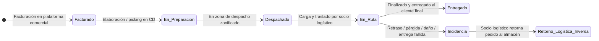

# Transporte y Logística: Yanbal

> **Navegación:**
> - [[Índice de información]] | [[Transcripción original]] | [[Aclaración adicional del entrevistado]]
> - Módulos relacionados: [[Información general de la empresa]] | [[Producción]] | [[Inventario y almacén]] | [[Trazabilidad]] | [[Sistemas y tecnología]] | [[Problemas y necesidades]] | [[Actores y responsabilidades]]

---

## 1. Procesos de Transporte y Flujo de Distribución

El movimiento de productos e insumos comprende dos tramos logísticos claramente diferenciados en el testimonio del entrevistado:

### A. Tránsito Primario (Almacén PT $\rightarrow$ Centro de Distribución)
- **Modalidad de empaque:** Se manipulan exclusivamente **cajas master selladas mono SKU** [TO 3:40–3:52].
- **Restricción operativa estricta:** Durante este trayecto **no** se consideran saldos ni se realiza ningún tipo de retiro para redistribución [TO 3:46–3:52].
- **Destino intermedio:** Las cajas ingresan íntegras al Centro de Distribución para ser desconsolidadas en la línea de preparación unitaria [TO 4:01–4:09].

### B. Distribución y Despacho hacia Destino Final
- **Origen:** Zona de despacho del Centro de Distribución tras culminar el picking [TO 17:26; 19:04].
- **Zonificación:** Canalización de pedidos en base a la dirección de entrega para ser distribuidos por regiones en los **24 departamentos del país** [TO 19:07–19:23].
- **Operadores de transporte:** Despacho ejecutado a través de **proveedores logísticos asociados** (socios de transporte) [TO 1:24; 18:02; 20:30].

> [!IMPORTANT]
> **Enfoque del Problema Central (`[AC]`):**
> De acuerdo con la aclaración adicional brindada fuera de la entrevista, la dificultad medular de trazabilidad se concentra en el **seguimiento de las entregas desde la fábrica hacia sus distribuidoras y otras sedes o destinos correspondientes**. En la entrevista original, el Ing. Condorpusa complementa que la brecha técnica radica en el desfase de hasta 2 horas en la actualización del estatus en ruta del sistema de tracking [TO 23:41–24:09].

---

## 2. Preparación, Volumetría y Empaque de Pedidos

La conformación física del despacho sigue un procedimiento técnico de cubicaje previo:

1. **Registro anticipado de datos maestros:** Cada producto cuenta con un registro paramétrico previo de su **peso** y su **volumetría** teórica [TO 15:30–15:41].
2. **Cálculo y consolidación teórica:** Al generarse el pedido en la plataforma comercial (Maya / SAP Commerce), los pesos y medidas teóricas de los artículos requeridos se suman y consolidan [TO 15:41–15:59].
3. **Asignación automática a formato de empaque:** El sistema asigna el consolidado a uno de los **8 tipos de cajas disponibles** según la volumetría requerida [TO 15:59–16:17].
4. **Picking unitario guiado:** El sistema SPY dirige el recorrido de la caja para que recolecte la cantidad requerida en cada ubicación del almacén [TO 17:12–17:20].

---

## 3. Cobertura, Modalidades de Envío y Promesas de Entrega (Lead Times)

### A. Cobertura Geográfica Nacional
Yanbal realiza la distribución cubriendo los **24 departamentos del país**, alcanzando tanto ciudades principales como ciudades alejadas [TO 17:53; 19:15–19:23].

### B. Modalidades de Envío Declaradas
Para atender la geografía peruana se utilizan tres modalidades de transporte [TO 19:26–19:30]:
- **Envío terrestre:** Transporte convencional por carretera.
- **Envío bimodal:** (Mencionado literalmente como «biomodal» [TO 19:26]) Combinación de tramos (habitualmente terrestre con fluvial/lacustre para zonas de selva/sierra).
- **Envío aéreo:** Empleado para destinos distantes o de acceso complejo [TO 19:30].

### C. Promesas de Entrega (*Lead Times*)
La empresa compromete tiempos de atención diferenciados según el destino [TO 22:38–22:54]:
- **Lima Metropolitana:** Promesa de entrega de **24 horas** [TO 22:47].
- **Provincias:** Rango de entrega de **hasta 7 días** [TO 22:54].

---

## 4. Ciclo de Estados del Pedido y del Despacho

De acuerdo con lo expresado por el entrevistado [TO 18:41–19:53], el ciclo secuencial del pedido contempla los siguientes estados:

1. **Pedido facturado:** Generación inicial o facturación comercial [TO 18:49].
2. **Elaboración o En preparación:** Proceso de armado y picking unitario [TO 18:57].
3. **Zona de despacho / Pedido despachado:** Clasificación y zonificación en muelle de salida [TO 19:04; 19:44].
4. **Pedido en ruta:** Tránsito y traslado bajo custodia del socio logístico [TO 19:53].
5. **Pedido entregado:** Cierre de ciclo al entregarse físicamente al cliente final o persona autorizada [TO 19:53; 24:40].

---

## 5. Información Asociada al Despacho

Toda la información viaja unificada bajo el **Número de Pedido** como llave integradora [TO 16:30–16:34; 17:26–18:11]:
- **Información comercial:** Nombre, dirección personal, datos de contacto del cliente / consultora [TO 16:34–16:44].
- **Detalle de tareas operativas:** Ruta y recolección dentro de la línea de picking [TO 16:44–17:20].
- **Datos de destino geográfico:** Dirección de entrega, distrito, provincia, región/departamento, ciudad principal o alejada [TO 17:41–17:53].
- **Datos de transporte:** Identificación del socio logístico de transporte y parámetros referenciales de tracking [TO 18:02–18:11].

---

## 6. Gestión de Incidencias y Logística Inversa

Ante contingencias en ruta (retraso, pérdida o daño físico que originen una entrega fallida) [TO 20:00–21:35]:

1. **Verificación:** Se corrobora la situación con la persona o cliente final afectado [TO 20:18–20:25].
2. **Registro de incidencia:** Si no se concreta la entrega, el socio logístico genera el registro y activa el flujo de **logística inversa** [TO 20:25–20:30].
3. **Reposición del pedido:** Se activa de forma paralela para no perjudicar al cliente final, preparando y despachando un nuevo pedido [TO 20:30–20:45; 21:25–21:35].
4. **Retorno al almacén:** El transportista retorna físicamente el pedido devuelto al área de almacén [TO 20:48–20:55].
5. **Evaluación interna:** El área de almacén evalúa el estado del paquete bajo dos criterios [TO 20:55–21:15]:
   - **En base a calidad:** Para evaluar si el producto se encuentra apto para reincorporarse a la línea de atención.
   - **En base a seguridad patrimonial:** Para verificar si procede la cobertura de seguro o garantía por siniestro contra el socio logístico [TO 21:15–21:25].

---

## 7. Retos y Dificultades Críticas en el Transporte

- **Desfase de hasta 2 horas en el sistema de tracking:** El sistema de seguimiento refleja los cambios de estatus con una latencia de alrededor de 2 horas [TO 23:41–24:09; s2 0:49].
- **Margen de desconocimiento:** Provoca incertidumbre interna sobre si el pedido ya fue entregado o continúa en ruta [TO 24:09–24:18].
- **Falta de visibilidad sobre personas autorizadas:** Frecuentemente quien recibe el pedido no es el cliente titular sino un tercero autorizado en el domicilio, lo que genera reportes de no recepción mientras el sistema aún no ha reflejado la entrega [TO 24:40–25:01].
- **Meta del negocio:** Alcanzar una conexión que permita actualizar en vivo o con un **desfase menor a 30 minutos** [TO 23:29; s2 1:07].

---

## 8. Clasificación Epistemológica del Módulo

- **Hechos confirmados (✅):**
  - Tránsito almacén-CD en cajas master selladas mono SKU sin saldos [TO 3:40–3:52].
  - Asignación de 8 tipos de cajas mediante cálculo de peso y volumen teórico consolidado [TO 15:30–16:17].
  - Cobertura de 24 departamentos y modalidades terrestre, bimodal y aérea [TO 19:15–19:30].
  - Lead times de 24 horas en Lima y hasta 7 días en provincias [TO 22:38–22:54].
  - Secuencia de estados: Facturado $\rightarrow$ Elaboración $\rightarrow$ Despachado $\rightarrow$ En ruta $\rightarrow$ Entregado [TO 18:41–19:53].
  - Desfase del sistema de tracking de 2 horas y meta de $\le 30$ minutos [TO 23:41; s2 1:07].
- **Interpretaciones del equipo (🔷):**
  - Modelado conceptual de la logística inversa como un diagrama de estados bifurcado entre reposición inmediata y reclamo de póliza de seguro.
- **Dudas o información no confirmada (❓):**
  - Detalle sobre contratos o tarifas de los socios logísticos.
  - La nota previa de alcance «H-16» que excluía el reparto domiciliario: no cuenta con respaldo en la entrevista y contradice la entrega a consultoras y personas autorizadas documentada por el entrevistado.
