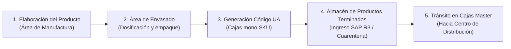
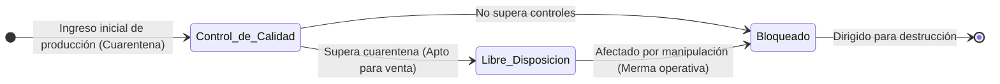

# Producción: Yanbal

> **Navegación:**
> - [[Índice de información]] | [[Transcripción original]] | [[Aclaración adicional del entrevistado]]
> - Módulos relacionados: [[Información general de la empresa]] | [[Transporte y logística]] | [[Inventario y almacén]] | [[Trazabilidad]] | [[Sistemas y tecnología]] | [[Problemas y necesidades]] | [[Actores y responsabilidades]]

---

## 1. Procesos Productivos y Secuencia de Etapas

De acuerdo con lo expuesto en la entrevista por el Ing. Joao Condorpusa Mendoza [TO 0:52–1:09; 1:40–1:55], la etapa productiva comprende tres fases consecutivas:

### Etapa 1: Elaboración del Producto
- Se encuentra a cargo del **área de manufactura** [TO 1:40].
- Consiste en la formulación y preparación de los productos de las distintas familias cosméticas y afines [TO 1:48; 4:30–4:45].

### Etapa 2: Área de Envasado
- El producto elaborado se transfiere al **área de envasado** [TO 1:01; 1:48].
- Aquí se envasan las unidades y se acondicionan para su posterior almacenamiento.

### Etapa 3: Empaque y Cajas Mono SKU
- Los productos procedentes de manufactura y envasado se consolidan exclusivamente en **cajas mono SKU** [TO 3:20].
- Cada caja contiene unidades de un único código de producto; no se manejan cajas mixtas a la salida de producción [TO 3:10–3:20].
- Las cajas llegan identificadas desde manufactura mediante un **Código UA** (*Unidad de Almacenamiento*) [TO 7:11–7:26].

> [!NOTE]
> **Delimitación del Problema Central (`[AC]`):**
> El proceso productivo y de manufactura de Yanbal se ejecuta de manera regular y no presenta fallas sistémicas. El problema central delimitado en el proyecto corresponde a la **trazabilidad y seguimiento de las entregas de productos desde la fábrica hacia sus distribuidoras y otras sedes o destinos** `[AC]`.

---

## 2. Estatus del Producto en SAP R3

El inventario productivo ingresa formalmente por sistema al área de almacén mediante el ERP **SAP R3** [TO 8:12–8:35]. Dentro de SAP se controlan los estados de cada producto en base a su configuración, distinguiéndose **tres estados principales** [TO 2:34; 10:16–10:55]:

| Estado del Producto en SAP | Definición Operativa según la Entrevista | Condición para Pedidos |
| :--- | :--- | :--- |
| **Libre Disposición** | Todo el stock liberado en SAP apto y disponible para ser atendido en un pedido comercial [TO 10:02–10:16]. | **Disponible para la venta.** |
| **Control de Calidad** | Productos que se encuentran pasando un período de **cuarentena** [TO 10:55]. Al superar dicha cuarentena, son calificados y liberados a libre disposición [TO 10:55]. | **Bloqueado temporalmente.** |
| **Bloqueado** | Producto retenido por alguna condición diferente al control de calidad [TO 10:26–10:33]. Incluye producto afectado por la manipulación de la operación que va a ser dirigido para destrucción por ser considerado **merma operativa** [TO 10:33–10:49]. | **No disponible (baja/destrucción).** |

---

## 3. Identificación y Trazabilidad en Planta

- **Código UA (Unidad de Almacenamiento):** Identificador asignado a las cajas desde el área de manufactura [TO 7:11–7:26].
- **Captura por Radiofrecuencia (RF):** Los códigos son escaneados mediante terminales de radiofrecuencia para ingresar los productos al almacén y al sistema SPY [TO 7:28–7:44].
- **Cajas Master Selladas:** Durante el tránsito desde el almacén hacia el Centro de Distribución, las cajas se mantienen selladas, sin considerar saldos ni aperturas para redistribución previa [TO 3:40–3:52].

---

## 4. Situación Operativa Relacionada: El Registro de Merma

Aunque no forma parte del problema central de trazabilidad externa de entregas, el entrevistado explicó una dificultad interna relacionada con el sinceramiento de existencias:
- **Merma operativa acumulada:** Se genera durante las actividades de preparación y manipulación en almacén [TO 12:38–12:50].
- **Desfase de hasta 6 horas:** Esta merma se acumula durante la jornada laboral y se actualiza recién en la última parte del turno [TO 12:50–13:18].
- **Impacto potencial:** Cuando un SKU mantiene bajo nivel de inventario, la falta de actualización simultánea entre el físico y el sistema comercial puede provocar quiebres de stock y registrarse como una **venta perdida** [TO 13:26–14:14].

---

## 5. Clasificación Epistemológica del Módulo

- **Hechos confirmados (✅):**
  - Secuencia: manufactura $\rightarrow$ envasado $\rightarrow$ almacén de productos terminados [TO 0:52–1:09; 1:40–1:55].
  - Agrupación estricta en cajas mono SKU identificadas con código UA desde manufactura [TO 3:20; 7:11–7:26].
  - Los 3 estatus principales en SAP R3: libre disposición, control de calidad (cuarentena) y bloqueado (merma para destrucción) [TO 10:16–10:55].
  - Cajas master selladas sin saldos durante el traslado [TO 3:40–3:52].
  - Desfase de hasta 6 horas en el registro de merma operativa con riesgo de quiebre de stock [TO 12:38–14:14].
- **Interpretaciones del equipo (🔷):**
  - Modelado del diagrama de estados en SAP como una máquina de estados finitos.
- **Dudas o información no confirmada (❓):**
  - Duración exacta del período de cuarentena en control de calidad.
  - Procedimiento físico y periodicidad de la destrucción de productos bloqueados.
  - Flujo y proveedores de materia prima (no abordados en la entrevista).
