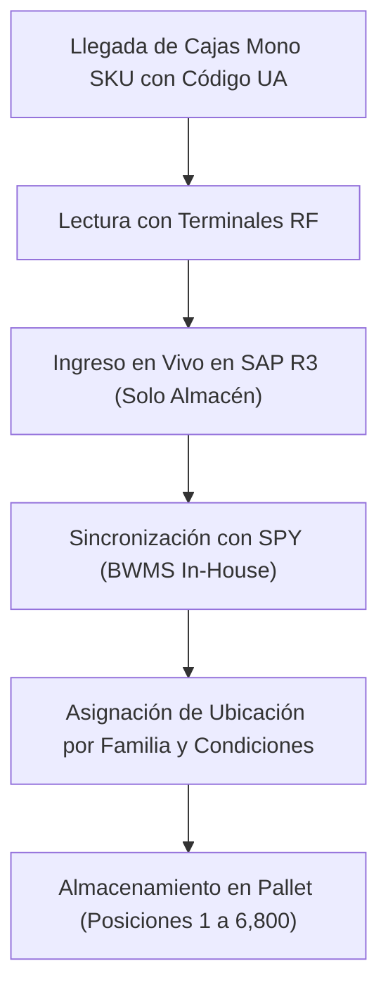

# Inventario y Almacén: Yanbal

> **Navegación:**
> - [[Índice de información]] | [[Transcripción original]] | [[Aclaración adicional del entrevistado]]
> - Módulos relacionados: [[Información general de la empresa]] | [[Producción]] | [[Transporte y logística]] | [[Trazabilidad]] | [[Sistemas y tecnología]] | [[Problemas y necesidades]] | [[Actores y responsabilidades]]

---

## 1. Dimensiones, Infraestructura y Capacidad Declarada

El almacén de Yanbal cuenta con las siguientes características técnicas expresadas directamente por el entrevistado [TO 5:36–6:58]:

- **Superficie total:** **15.000 metros cuadrados** ($m^2$) [TO 6:05].
- **Capacidad de posiciones:** Capacidad para albergar **alrededor de 6.800 posiciones de almacenamiento** (unidades de almacenamiento), las cuales se concentran en **pallets** [TO 6:05–6:13].
- **Capacidad instalada:** Diseñada para **2 millones de cajas mono SKU** [TO 6:17–6:32].
- **Capacidad óptima operativa:** Se maneja **alrededor de un 85%** como capacidad óptima para permitir la redistribución y movimientos requeridos para una mejor conformación del *layout* [TO 6:32–6:58].

> [!NOTE]
> *(Interpretación del equipo 🔷: El margen del 15% restante funciona como holgura de maniobra operativa para reubicaciones y reabastecimiento interno).*

---

## 2. Organización Física (*Layout*) y Criterios de Ubicación

La distribución física de las existencias se organiza en función de dos factores principales [TO 4:30–5:18]:

1. **Agrupación por familias de producto:**  
   Los productos se segregan por familias: *cosméticos, dermatológicos, cuidado personal, joyerías y fragancias* [TO 4:30–4:45].
2. **Acondicionamiento especial según normativa:**  
   Para productos de índole **farmacéutica o de droguería**, se dispone de zonas con condiciones técnicas controladas [TO 5:02–5:18]:
   - **Temperatura controlada:** Para resguardar la estabilidad físico-química del producto.
   - **Hermeticidad:** Para asegurar la inocuidad y aislamiento ambiental.

---

## 3. Flujo de Ingreso y Asignación de Ubicaciones

El procedimiento para ubicar las cajas entrantes sigue una secuencia sistematizada [TO 7:01–7:48; 8:12–9:12]:

1. **Recepción con Código UA:** Las cajas llegan desde manufactura identificadas individualmente con su **Código UA** (*Unidad de Almacenamiento*) [TO 7:11–7:26].
2. **Captura por Radiofrecuencia (RF):** Los códigos son leídos en el muelle de recepción mediante terminales de radiofrecuencia [TO 7:28].
3. **Registro en SAP R3:** El ingreso se procesa en el ERP SAP R3 de manera online y en vivo. El entrevistado puntualiza: *«El SAP solamente es manejado por almacén»* [TO 8:12–8:55].
4. **Sincronización con SPY:** SAP R3 se sincroniza con el BWMS in-house **SPY** (*Sistema de Picking de Yanbal*) [TO 8:55–9:12].
5. **Determinación de ubicación:** El sistema SPY asigna la ubicación disponible óptima según la familia del producto y los requerimientos de almacenamiento (temperatura/hermeticidad) [TO 7:35–7:54].

---

## 4. Control de Stock, Estados y Reportes en SAP R3

El inventario disponible para atender pedidos es exclusivamente aquel liberado en SAP [TO 10:02–10:16]:

### A. Estatus Principales de Inventario en SAP [TO 10:16–10:55]
- **Libre Disposición:** Stock aprobado por calidad habilitado para atender órdenes comerciales.
- **Control de Calidad:** Lotes en período de cuarentena a la espera de dictamen de liberación.
- **Bloqueado:** Existencias inhabilitadas por motivos operativos (principalmente merma acumulada por manipuleo para destrucción).

### B. Herramientas de Consulta y Rastreo en SAP [TO 11:30–12:14]
El ERP emite reportes analíticos para la gestión de almacén que permiten:
- Consultas personalizadas por tipo de producto y por familia de productos [TO 11:38].
- Consulta de existencias por ubicación física exacta en el almacén [TO 11:38].
- Rastreo de productos y cantidades específicas contenidas dentro de una Unidad de Almacenamiento (UA) o ubicación [TO 11:45–11:53].
- Resúmenes consolidados de todo el inventario de un código o familia disponible en almacén [TO 11:59–12:07].
- Diferenciación inmediata del stock según su estatus operativo (libre, calidad, bloqueado) [TO 12:07–12:14].

---

## 5. Situación Operativa: Desfase de Merma Operativa

Durante la preparación de pedidos y manipulación en almacén ocurre deterioro fortuito de unidades [TO 12:38–14:14]:
- **Acumulación durante la jornada:** La merma física no se digita inmediatamente, sino que se acumula a lo largo del turno [TO 12:50–12:59].
- **Desfase de hasta 6 horas:** El sinceramiento en el sistema se efectúa en la última parte de la jornada laboral [TO 12:59–13:18].
- **Riesgo comercial:** Si un código se encuentra con nivel bajo de stock, el sistema comercial continúa asumiéndolo como libre disposición, lo que puede originar quiebres de inventario y convertirse en una **venta perdida** [TO 13:26–14:14].

> [!IMPORTANT]
> Esta situación de inventario está circunscrita a la actualización diferida de mermas en almacén y no debe interpretarse como una crisis general de abastecimiento en Yanbal.

---

## 6. Clasificación Epistemológica del Módulo

- **Hechos confirmados (✅):**
  - Almacén de 15.000 m², capacidad de ~6.800 posiciones de pallets y 2 millones de cajas mono SKU [TO 6:05–6:32].
  - 85% de capacidad óptima para maniobras de layout [TO 6:32–6:58].
  - Agrupación por familias y acondicionamiento con temperatura controlada y hermeticidad para droguería [TO 4:30–5:18].
  - SAP R3 operado exclusivamente por almacén y sincronizado con SPY [TO 8:50–9:12].
  - Lectura de código UA con terminales de RF [TO 7:28].
  - Reportes de SAP por producto, familia, ubicación, UA y estatus [TO 11:30–12:14].
  - Desfase de merma operativa de hasta 6 horas [TO 13:08–13:18].
- **Interpretaciones del equipo (🔷):**
  - Relación entre Almacén de PT y Centro de Distribución: la entrevista los menciona como etapas contiguas del flujo productivo/logístico, compartiendo posiblemente el mismo complejo físico de 15.000 m².
- **Dudas o información no confirmada (❓):**
  - Si el registro final de merma en SAP se hace por terminales móviles o terminales fijas de escritorio.
  - Periodicidad y método de inventarios físicos rotativos o generales.
