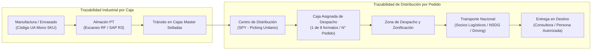

# Trazabilidad: Yanbal

> **Navegación:**
> - [[Índice de información]] | [[Transcripción original]] | [[Aclaración adicional del entrevistado]]
> - Módulos relacionados: [[Información general de la empresa]] | [[Producción]] | [[Transporte y logística]] | [[Inventario y almacén]] | [[Sistemas y tecnología]] | [[Problemas y necesidades]] | [[Actores y responsabilidades]]

---

## 1. Definición del Problema Central de Trazabilidad

> [!IMPORTANT]
> **Problema Central del Negocio (`[AC]`):**
> La dificultad medular de trazabilidad radica en el **seguimiento de las entregas de productos desde la fábrica hacia sus distribuidoras y otras sedes o destinos correspondientes** `[AC]`. Consiste en la dificultad de conocer y monitorear el recorrido físico y el estado de las entregas una vez que los productos salen de la fábrica.
>
> **Sustento y Evidencia en la Entrevista Original (`[TO]`):**
> En la entrevista original, el Ing. Joao Condorpusa confirma que el mayor reto operativo de la cadena logística es la actualización de los estados de entrega en tiempo real:
> - Actualmente, el sistema de tracking arroja una trazabilidad con un **desfase promedio de 2 horas** (hasta dos horas) [TO 23:41–24:09; s2 0:49].
> - Esto genera un **margen de desconocimiento** sobre la situación real del pedido [TO 24:09–24:18].
> - Dificulta la respuesta oportuna ante reclamos o consultas formuladas por los clientes a través del área de servicio al cliente [TO 24:18–24:36].
> - Se suma la incertidumbre cuando la entrega es recibida en destino por una **persona autorizada** y no directamente por el titular, dato que no se refleja de inmediato en la trazabilidad [TO 24:40–25:01].
> - La meta declarada por el negocio es aminorar ese desfase para contar con una sincronización en vivo o con un margen **menor a 30 minutos** [TO 23:29; s2 0:57–1:07].

---

## 2. Niveles de Trazabilidad Identificados en la Cadena

La entrevista describe dos niveles complementarios de seguimiento a lo largo del flujo logístico:

### A. Trazabilidad Industrial por Caja (Código UA)
- **Ámbito:** Aplica desde la salida del área de manufactura y envasado hasta el almacenamiento y posterior traslado al Centro de Distribución [TO 7:11–7:26; 3:40–3:52].
- **Identificador:** **Código UA** (*Unidad de Almacenamiento*) asignado a cada caja master mono SKU [TO 7:11–7:26].
- **Captura:** Lectura mediante **terminales de radiofrecuencia (RF)** para registrar ingresos y controlar posiciones en racks en SAP R3 y SPY [TO 7:28–7:44].

### B. Trazabilidad Comercial y de Distribución (Número de Pedido)
- **Ámbito:** Rige la preparación de pedidos unitarios, empaque en uno de los 8 formatos de caja, zonificación, despacho y distribución nacional hacia el cliente final [TO 16:30–18:11].
- **Identificador:** **Número de Pedido** [TO 16:34; 18:22].
- **Información vinculada:** Amarra datos personales, dirección de entrega (distrito, región, provincia, ciudad principal/alejada), tareas de recolección en picking y datos del socio logístico [TO 16:34–18:11].

---

## 3. Claves de Consulta e Información Disponible para el Usuario

Para realizar el seguimiento del pedido, el sistema permite la consulta mediante dos llaves primarias [TO 21:57–22:28]:

1. **Número de Pedido:** Identificador directo de la orden generada [TO 22:03].
2. **Código de Consultor / Cliente:** Identificador de la consultora («para nosotros un consultor o una consultora es nuestro cliente») [TO 22:03–22:11].

Con estas dos informaciones, el usuario puede conocer [TO 22:16–22:28]:
- El **estatus actual** del pedido (Facturado, En preparación, Despachado, En ruta, Entregado) [TO 18:41–19:53; 22:16].
- La **etapa** en que se encuentra el pedido dentro del flujo [TO 22:19].
- El **momento estimado de entrega**, en función de las promesas de servicio (24 horas para Lima Metropolitana, hasta 7 días para provincias) [TO 22:28–22:54].

---

## 4. Brechas y Puntos Críticos de Trazabilidad Identificados

El análisis contrastado evidencia tres limitaciones en el seguimiento actual:

| Brecha de Trazabilidad | Causa y Evidencia [TO] | Impacto en la Operación |
| :--- | :--- | :--- |
| **Desfase de hasta 2 horas en tracking** | Retardo en la transmisión de datos desde los sistemas de transporte hacia el sistema central [TO 23:41–24:09; s2 0:49]. | Ventana de desinformación donde el pedido ya se entregó físicamente pero en el sistema figura aún en tránsito. |
| **Incertidumbre en recepción por terceros** | Ausencia de confirmación inmediata de los datos del receptor real en destino [TO 24:40–25:01]. | Si recibe una persona autorizada y no la consultora titular, esta última formula reclamos innecesarios creyendo que el pedido no llegó. |
| **Desfase de hasta 6 horas en merma física** | Registro diferido de productos dañados en almacén al final de la jornada [TO 12:38–13:26]. | Desalineamiento temporal entre el inventario físico disponible y el stock visualizado en la plataforma comercial. |

---

## 5. Clasificación Epistemológica del Módulo

- **Hechos confirmados (✅):**
  - Dos llaves maestras de trazabilidad: Código UA (para cajas mono SKU) y Número de Pedido (para la atención comercial) [TO 7:11–7:26; 16:30–16:34].
  - Consulta de seguimiento mediante Número de Pedido y Código de Consultor/Cliente [TO 21:57–22:11].
  - Información mostrada: estatus del pedido, etapa y promesa de entrega (24h Lima / 7d provincias) [TO 22:16–22:54].
  - Desfase del sistema de tracking de 2 horas y brecha de visibilidad al recibir una persona autorizada [TO 23:41–25:01].
  - Meta de reducir la latencia de actualización a menos de 30 minutos [TO 23:29; s2 1:07].
- **Hechos confirmados por fuente complementaria (`[AC]`):**
  - El problema central está en el seguimiento de las entregas desde la fábrica hacia las distribuidoras y otras sedes o destinos.
- **Interpretaciones del equipo (🔷):**
  - División conceptual en dos capas: «Trazabilidad industrial por caja» y «Trazabilidad comercial por pedido».
- **Dudas o información no confirmada (❓):**
  - Si el cliente final puede visualizar la ubicación por GPS del vehículo o únicamente hitos de cambio de estado.
  - Alcance exacto y naturaleza legal/operativa de las «distribuidoras» mencionadas en la aclaración `[AC]`.
