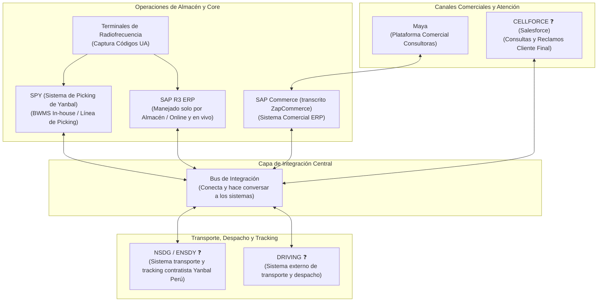

# Sistemas y Tecnología: Ecosistema Yanbal

> **Navegación:**
> - [[Índice de información]] | [[Transcripción original]] | [[Aclaración adicional del entrevistado]]
> - Módulos relacionados: [[Información general de la empresa]] | [[Producción]] | [[Transporte y logística]] | [[Inventario y almacén]] | [[Trazabilidad]] | [[Problemas y necesidades]] | [[Actores y responsabilidades]]

---

## 1. Mapa del Ecosistema de Sistemas y Software

En la entrevista con el Ing. Joao Condorpusa Mendoza se expuso la arquitectura tecnológica que soporta la operación de la cadena de suministro y distribución en Yanbal Perú [TO 2:18–3:02; 8:12–9:37; 14:40–15:16; 27:03–29:09]:

---

## 2. Catálogo de Sistemas Identificados en la Entrevista

A continuación se detalla cada software con su evidencia textual y la terminología rigurosamente verificada:

### 1. SAP R3 (ERP a Nivel Productivo)
- **Denominación en entrevista:** «sistema SAP, es una ERP» [TO 2:25], «SAP a nivel productivo, R3» [TO 8:20], «SAP R3» [TO 27:17].
- **Ámbito operativo:** Manejado **únicamente por el área de almacén** [TO 8:50–8:55]. Opera de manera «online y en vivo» [TO 8:20].
- **Funciones:** Registro de ingresos por sistema, control de estatus de productos (*libre disposición, control de calidad, bloqueado/merma*) y emisión de reportes de inventario por producto, familia, ubicación y UA [TO 8:35; 10:16; 11:30–12:14].

### 2. Maya
- **Denominación en entrevista:** «plataforma comercial denominada Maya» [TO 14:49].
- **Función:** Captura inicial de pedidos realizada por consultoras y consultores [TO 14:43–14:49]. Se conecta con el sistema comercial para canalizar las compras a la cadena logística.

### 3. SAP Commerce
- **Denominación en entrevista:** «sistema comercial de Zap mismo, ZapCommerce» [TO 14:57].
- **Función:** Plataforma comercial de SAP que recibe las compras de Maya y las transmite hacia el gestor de picking a través del bus de integración [TO 14:49–15:16].

### 4. Bus de Integración
- **Denominación en entrevista:** «bus de integración que nosotros manejamos para todos nuestros sistemas» [TO 15:06], «bus de integración que amarra todos estos sistemas y hace que converse cada uno entre ellos» [TO 28:59–29:09].
- **Función:** Middleware corporativo que permite la interconexión bidireccional de datos entre las plataformas comerciales, de almacén, transporte y atención al cliente, evitando silos de información.

### 5. SPY (*Sistema de Picking de Yanbal*)
- **Denominación en entrevista:** «BWMS que manejamos también dentro del centro de distribución, un BWMS de desarrollo in-house para Yanbal, llamado SPY por las siglas de sistema de picking de Yanbal» [TO 9:04–9:12]. Transcrito también como *Spy* [TO 15:16] y *Spike* [TO 17:12].
- **Función:** Gestor del picking de pedidos en el Centro de Distribución. Recibe los pedidos del bus, calcula pesos y volumetrías teóricas para asignar 1 de los 8 tipos de cajas disponibles, y elabora las tareas para que la caja recorra la línea de preparación y recolecte los productos [TO 15:16–17:20].

### 6. NSDG / ENSDY (*Sistema de Transporte y Tracking*)
- **Denominación en entrevista:** 
  - Como sistema de transporte: «denominado NSDG, es un desarrollo generado por un contratista pero elaborado para la operación Perú de la cadena de distribución de Yanbal» [TO 9:21–9:37].
  - Como sistema de tracking: «Para el tracking de pedidos se maneja a través del sistema de trackeo denominado ENSDY» [TO 28:00–28:10].
- **Nota y registro de discrepancia (❓):** En la entrevista se mencionan ambas denominaciones fonéticas (*NSDG* y *ENSDY*). Con la evidencia disponible, se registra como hipótesis probable que se trate del mismo software desarrollado por el contratista para transporte y tracking en Yanbal Perú, o de dos módulos complementarios de una misma suite. Requiere confirmación con la jefatura.

### 7. DRIVING (*Sistema de Transporte y Despacho*)
- **Denominación en entrevista:** «de transporte y despacho se maneja DRIVING. DRIVING es un sistema externo bastante conocido, es utilizado en diversas cadenas logísticas de otros sectores, no solamente el sector cosmético, sino también el sector de alimentos, el sector minero» [TO 28:10–28:28].
- **Función:** Herramienta especializada de mercado para la administración del transporte, despacho y monitoreo de flotas.

### 8. CELLFORCE (*Servicio al Cliente*)
- **Denominación en entrevista:** «específicamente denominado CELLFORCE para hacer este tipo de gestiones de consultas, reclamos y otro tipo de trámites con el cliente final» [TO 28:44].
- **Nota y registro de duda (❓ / 🔷):** En la documentación previa se asumió directamente que corresponde al CRM comercial *Salesforce*. Por fidelidad textual, se registra como hecho la denominación textual **CELLFORCE** dada por el entrevistado, señalando como interpretación plausible del equipo que se trate de Salesforce adaptado a la operación corporativa.

### 9. Terminales de Radiofrecuencia (RF)
- **Denominación en entrevista:** «terminales de radiofrecuencia» [TO 7:28].
- **Función:** Dispositivos para la captura en campo de los códigos UA en cajas master para alimentar a SAP R3 y a SPY [TO 7:28–7:44].

---

## 3. Clasificación de la Arquitectura: 3 Sistemas Propios vs 4 Externos

El entrevistado señaló expresamente [TO s2 1:57–2:20]:
> *«Tres de los sistemas han sido adaptados específicamente para la operación de Yanbal, así que esas tres se cumplen con la facilidad de uso y los otros cuatro sistemas que manejamos son de proveedores que se han hecho las adaptaciones para que se integren de forma adecuada a nuestros tres sistemas internos.»*

> [!WARNING]
> **Aclaración crítica sobre la clasificación (🔷 Hecho vs Interpretación):**
> El entrevistado **no listó explícitamente cuáles son los 3 internos y cuáles los 4 externos**. 
> La distribución comúnmente aceptada en el equipo es una **interpretación fundada (🔷)**:
> - **Candidatos a sistemas propios/adaptados (3):** SPY (desarrollo in-house expreso [TO 9:04]), NSDG/ENSDY (desarrollado por contratista específicamente para Yanbal Perú [TO 9:33]) y SAP R3 (adaptado para almacén Yanbal).
> - **Candidatos a sistemas de proveedores externos (4):** DRIVING (sistema externo expreso [TO 28:16]), CELLFORCE (software externo de atención al cliente), SAP Commerce (motor comercial) y Maya (plataforma comercial).

---

## 4. Requerimientos Declarados para Nuevos Desarrollos

El Ing. Condorpusa detalló las prioridades no funcionales que debe considerar cualquier solución para integrarse con la arquitectura de Yanbal [TO s2 0:29–2:20]:

| Criterio | Requerimiento Expresado | Meta Puntual en la Entrevista |
| :--- | :--- | :--- |
| **Rapidez / Latencia** | Conseguir una mejor conexión entre sistemas que brinde una respuesta con menor desfase temporal [TO s2 0:29–0:40]. | Reducir el desfase actual de **2 horas** a una comunicación en simultáneo o con un **desfase máximo permisible de media hora (30 minutos)** [TO s2 0:49–1:16]. |
| **Disponibilidad y Capacidad** | Soportar la operación nacional sin interrupciones [TO s2 1:19–1:24]. | Capacidad de procesamiento para **manejar grandes volúmenes de data** (2 millones de cajas instaladas, cobertura nacional) [TO s2 1:24]. |
| **Seguridad Informática** | Blindaje de la cadena de suministro ante vulneraciones [TO s2 1:37–1:49]. | Pasar formalmente la **validación por seguridad informática** corporativa para evitar vulnerabilidades o contingencias [TO s2 1:37–1:49]. |
| **Facilidad de Uso e Integración** | Mantener la usabilidad actual de las herramientas de almacén y transporte [TO s2 1:53–2:20]. | Integración fluida mediante el **bus de integración** corporativo sin entorpecer los flujos operativos existentes [TO 28:59–29:09]. |

---

## 5. Clasificación Epistemológica del Módulo

- **Hechos confirmados (✅):**
  - Existencia e integración vía bus de: SAP R3, Maya, SAP Commerce, SPY, NSDG/ENSDY, DRIVING, CELLFORCE y terminales RF [TO 2:18–3:02; 8:12–9:37; 14:40–15:16; 27:03–29:09].
  - SAP R3 manejado únicamente por el área de almacén [TO 8:50–8:55].
  - SPY desarrollado in-house para Yanbal para gestión de picking [TO 9:04–9:12].
  - NSDG desarrollado por contratista para la operación Perú [TO 9:33–9:37].
  - DRIVING como sistema externo utilizado en diversos sectores [TO 28:16–28:28].
  - CELLFORCE para servicio al cliente [TO 28:44].
  - Meta de integración con desfase $\le 30$ minutos y validación de seguridad informática [TO s2 0:57–1:49].
- **Interpretaciones del equipo (🔷):**
  - Atribución exacta de qué 3 sistemas corresponden al grupo in-house y cuáles 4 al de proveedores externos.
  - Asimilación fonética de CELLFORCE como el producto comercial Salesforce.
- **Dudas o información no confirmada (❓):**
  - Si NSDG y ENSDY son el mismo aplicativo o dos módulos distintos del contratista.
  - Tecnologías y protocolos de mensajería del bus de integración corporativo.
