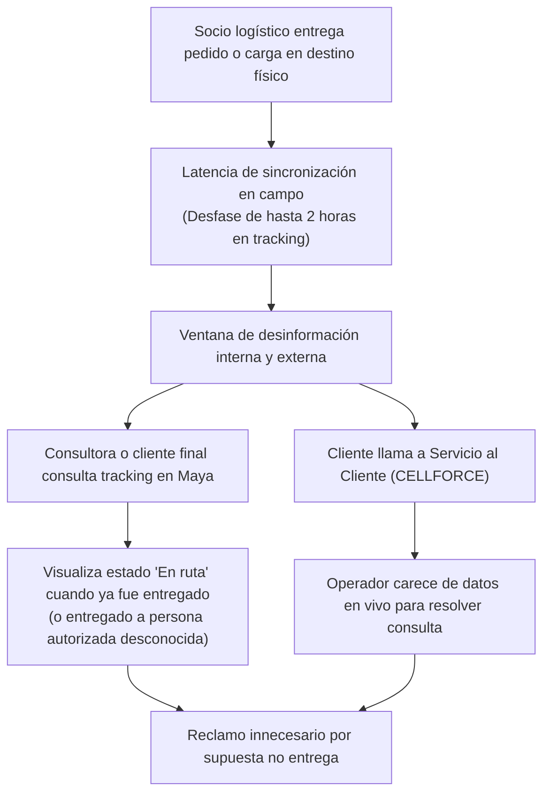

# Problemas y Necesidades: Diagnóstico Operativo Yanbal

> **Navegación:**
> - [[Índice de información]] | [[Transcripción original]] | [[Aclaración adicional del entrevistado]]
> - Módulos relacionados: [[Información general de la empresa]] | [[Producción]] | [[Transporte y logística]] | [[Inventario y almacén]] | [[Trazabilidad]] | [[Sistemas y tecnología]] | [[Actores y responsabilidades]]

---

## 0. Definición del Problema Central del Proyecto

> [!IMPORTANT]
> **Problema Central Identificado (`[AC]`):**
> La dificultad central de la organización para el alcance de este proyecto es la **trazabilidad y el seguimiento de las entregas de productos desde la fábrica hacia sus distribuidoras y otras sedes o destinos correspondientes** `[AC]`. La dificultad reside en conocer y hacer seguimiento al recorrido físico y al estado de las entregas una vez que los productos salen de la fábrica.
>
> **Enfoque de Alcance Empresarial:**
> No se debe presentar a Yanbal como una compañía que sufra problemas generalizados de producción, inventario, ventas o gestión empresarial. La empresa cuenta con una infraestructura consolidada (15.000 m², SAP R3, WMS in-house y cobertura nacional). La documentación debe mantener su foco delimitado en resolver la **falta o dificultad de trazabilidad y seguimiento de las entregas**.

---

## 1. Matriz de Problemas y Situaciones Identificadas

A continuación se clasifican los problemas operacionales distinguiendo aquellos directamente vinculados al problema central de trazabilidad de aquellas situaciones operativas complementarias:

| Código | Descripción de la Situación | Clasificación | Proceso Afectado | Sistemas | Evidencia Textual |
| :---: | :--- | :--- | :--- | :--- | :--- |
| **PR-03** | **Desfase de hasta 2 horas en el sistema de tracking de entregas** | **Problema Central (Trazabilidad)** | Despacho, transporte y entrega nacional | NSDG / ENSDY, DRIVING, CELLFORCE | «nuestro mayor reto ahora es hacer las actualizaciones de los estados de forma en vivo… actualmente nuestro sistema de tracking nos arroja una trazabilidad o un estatus de seguimiento en promedio de dos horas» [TO 23:16–23:50; s2 0:49]. |
| **PR-04** | **Margen de desconocimiento sobre la situación real del pedido** | **Problema Central (Trazabilidad)** | Monitoreo logístico y atención al cliente | CELLFORCE, Maya | «eso nos da un margen de desconocimiento… acerca de la situación del pedido y también nos incurre en otros aspectos como para poder responder ante algún reclamo o ante la consulta del mismo cliente final a través de nuestro servicio al cliente» [TO 24:09–24:36]. |
| **PR-05** | **Falta de visibilidad cuando la entrega la recibe una persona autorizada** | **Problema Central (Trazabilidad)** | Entrega en destino final | NSDG, CELLFORCE | «No necesariamente el cliente final es el que recibe la entrega del pedido, sino puede ser alguna persona autorizada y el cliente final, al hacer la trazabilidad a través de nuestro sistema, no necesariamente tiene esa información» [TO 24:40–25:01]. |
| **PR-01** | **Desfase de hasta 6 horas en actualización de merma operativa** | **Situación Complementaria (Inventario Interno)** | Preparación de pedidos y almacén | SAP R3, SPY | «esta merma operativa es acumulada en un día laboral… el registro o la actualización en el sistema pasa a la última parte de esta jornada laboral, en este caso podemos tener un desfase de hasta seis horas» [TO 12:43–13:26]. |
| **PR-02** | **Riesgo eventual de quiebre de stock y venta perdida en SKUs bajos** | **Situación Complementaria (Inventario Interno)** | Comercialización y facturación | Maya, SAP Commerce, SAP R3 | «esto nos puede golpear de alguna forma cuando tenemos algún tipo de nivel bajo de inventario para algún código… al no contar con una actualización en simultáneo… esto se puede generar como una venta perdida» [TO 13:26–14:14]. |

> [!WARNING]
> **Aclaración sobre el código ~~PR-06~~ de versiones preliminares:**
> En borradores previos se listaba un supuesto «*PR-06: Cuello de botella en la evaluación de retornos por siniestro*». Tras contrastar rigurosamente con [[Transcripción original]], **dicho problema carece de sustento**. El entrevistado describió la doble evaluación (calidad y seguridad patrimonial) como el procedimiento ordinario formal para el retorno de carga [TO 20:48–21:35], sin calificarlo en ningún momento como un cuello de botella o problema operativo. En consecuencia, ha sido **retirado** para no inventar problemas no manifestados por la fuente.

---

## 2. Análisis Detallado del Problema Central de Trazabilidad (PR-03, PR-04, PR-05)

- **Causa identificada:** Los sistemas móviles y plataformas de transporte (DRIVING / NSDG) tardan un lapso de hasta 2 horas en sincronizar los eventos de entrega efectiva hacia el bus corporativo [TO 23:41–24:09; s2 0:49].
- **Consecuencias operativas:**
  1. Incertidumbre sobre el estatus real de las entregas que salieron de fábrica hacia los destinos [TO 24:09–24:18; `[AC]`].
  2. Dificultad para responder con certeza ante requerimientos de servicio al cliente [TO 24:29–24:36].
  3. Desalineamiento informativo en entregas recibidas por terceros autorizados en el domicilio [TO 24:40–25:01].

---

## 3. Matriz de Necesidades Declaradas por el Negocio

En respuesta a las dificultades descritas, el entrevistado formuló las necesidades prioritarias para el sistema [TO s2 0:29–2:20]:

| Código | Necesidad Expresada por el Entrevistado | Meta / Criterio de Éxito Concreto | Prioridad |
| :---: | :--- | :--- | :---: |
| **NEC-01** | **Conexión integrada con menor desfase temporal en tracking** | Reducir el desfase actual de **2 horas** a una comunicación en simultáneo o con un **desfase máximo permisible de media hora (30 minutos)** [TO s2 0:57–1:16]. | **ALTA (Principal reto declarado)** |
| **NEC-02** | **Sincronización simultánea entre inventario físico y comercial** 🔷 | *(Derivada de la situación complementaria)* Acortar la brecha de hasta 6 horas en el sincerado de merma operativa para salvaguardar SKUs con inventario crítico [TO 13:08–14:14]. | **MEDIA** |
| **NEC-03** | **Disponibilidad y manejo de grandes volúmenes de data** | Soportar la carga de la cadena nacional (2 millones de cajas instaladas, cobertura en los 24 departamentos) con alta estabilidad operativa [TO s2 1:19–1:24]. | **MEDIA-ALTA** |
| **NEC-04** | **Superación de auditorías de Seguridad Informática** | Cumplir estrictamente con la validación de seguridad informática corporativa para prevenir vulnerabilidades y contingencias en la cadena [TO s2 1:37–1:49]. | **ALTA** |
| **NEC-05** | **Preservación de Usabilidad y Conectividad con el Bus** | Integración transparente con los sistemas existentes (SPY, SAP, Driving, NSDG) mediante el bus corporativo, garantizando interfaces sencillas para roles operativos [TO s2 1:53–2:20]. | **MEDIA** |

---

## 4. Clasificación Epistemológica del Módulo

- **Hechos confirmados (✅):**
  - Desfase de tracking de hasta 2 horas como mayor reto actual [TO 23:16–23:50; s2 0:49].
  - Margen de desconocimiento que impacta la atención al cliente y reclamos [TO 24:09–24:36].
  - Falta de información inmediata cuando recibe una persona autorizada [TO 24:40–25:01].
  - Meta de comunicación simultánea o desfase $\le 30$ minutos [TO s2 0:57–1:16].
  - Requisitos de gran volumen de data y validación por seguridad informática [TO s2 1:19–1:49].
  - Desfase de 6 horas en merma con riesgo de venta perdida [TO 12:43–14:14].
- **Hechos confirmados por fuente complementaria (`[AC]`):**
  - El problema central está en la trazabilidad y seguimiento de entregas desde la fábrica hacia distribuidoras y otras sedes o destinos.
- **Interpretaciones del equipo (🔷):**
  - Formulación de NEC-02 como necesidad complementaria de sincronización física-comercial.
- **Dudas o información no confirmada (❓):**
  - Cantidad cuantitativa mensual de quejas por entregas a personas autorizadas.
  - El supuesto «cuello de botella en logística inversa» (retirado por falta de sustento).
