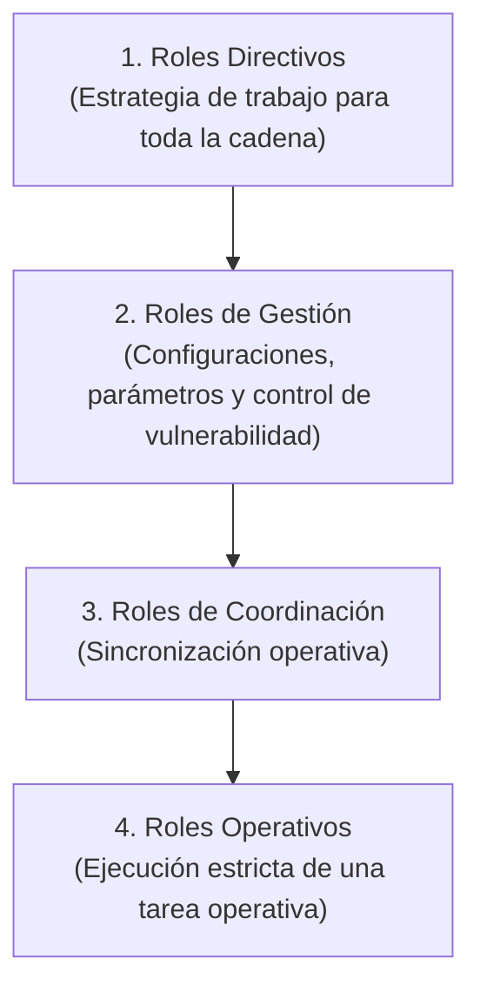

# Actores y Responsabilidades: Yanbal

> **Navegación:**
> - [[Índice de información]] | [[Transcripción original]] | [[Aclaración adicional del entrevistado]]
> - Módulos relacionados: [[Información general de la empresa]] | [[Producción]] | [[Transporte y logística]] | [[Inventario y almacén]] | [[Trazabilidad]] | [[Sistemas y tecnología]] | [[Problemas y necesidades]]

---

## 1. Niveles Jerárquicos y Gobernanza de Roles

En la entrevista, el Ing. Joao Condorpusa explicó que la cadena logística de Yanbal opera mediante una estructura segmentada de permisos y atribuciones según la responsabilidad asignada [TO 25:34–26:43]:

| Nivel Jerárquico | Atribuciones Declaradas en la Entrevista | Restricciones y Alcance | Evidencia Textual |
| :--- | :--- | :--- | :--- |
| **Roles Directivos** | «netamente plantean la estrategia de trabajo para toda la cadena» | Definición estratégica; no ejecutan tareas transaccionales diarias. | [TO 26:43] |
| **Roles de Gestión** | «se pueden hacer modificaciones, tal vez configuraciones o parámetros que nosotros atribuimos a este tipo de rol para hacer más permisible o menos permisible la vulneración de la cadena logística» | Control de políticas y reglas en sistemas. | [TO 26:18–26:35] |
| **Roles de Coordinación** | Coordinación operativa entre las distintas fases de la cadena logística. | Sincronización entre almacén, picking y transportistas. | [TO 25:38–25:51] |
| **Roles Operativos** | «tienen la limitación de solamente ejecutar una tarea operativa, como se puede entender» | Ejecución directa (escaneo RF, picking físico, estiba). Tienen restringida la alteración de parámetros o configuraciones maestras. | [TO 26:09] |

---

## 2. Catálogo de Actores y Roles Mencionados

### A. Liderazgo del Área
#### Ing. Joao Condorpusa Mendoza
- **Cargo verificado:** Encargado del Área de Distribución de Yanbal (Perú) [TO 0:19–0:21].
- **Responsabilidad:** Supervisión de los procesos de distribución, transporte nacional, monitoreo de socios logísticos, cumplimiento de lead times y búsqueda de mejoras en la integración de tracking.

---

### B. Actores Internos y Áreas Involucradas

#### 1. Personal del Área de Manufactura
- **Área:** Área de manufactura [TO 1:40].
- **Actividad:** A cargo de la formulación y elaboración de los productos [TO 1:40–1:48].

#### 2. Personal del Área de Envasado
- **Área:** Área de envasado [TO 1:01; 1:48].
- **Actividad:** Envasado de productos y consolidación en cajas mono SKU identificadas con Código UA [TO 1:01; 3:20; 7:11–7:26].

#### 3. Personal del Área de Almacén (Productos Terminados)
- **Área:** Área de almacén de productos terminados [TO 1:09; 1:55].
- **Actividad:** Recepción de cajas mediante terminales RF, registro en SAP R3 (área exclusiva que maneja este ERP [TO 8:50]), custodia de posiciones de pallets e inspección de pedidos retornados en base a calidad y seguridad patrimonial [TO 8:35; 20:48–21:15].

#### 4. Personal de Picking en Centro de Distribución
- **Área:** Centro de distribución [TO 2:01; 4:01].
- **Actividad:** Apertura de cajas master, recolección unitaria de artículos siguiendo las instrucciones del sistema SPY y consolidación en uno de los 8 formatos de caja [TO 4:01–4:19; 15:59–17:20].

#### 5. Personal de la Zona de Despacho
- **Área:** Zona de despacho [TO 17:26; 19:04].
- **Actividad:** Zonificación de pedidos consolidados para los 24 departamentos y entrega formal a los transportistas [TO 19:04–19:23].

#### 6. Agentes de Servicio al Cliente
- **Función:** Servicio al cliente [TO 24:36; 28:35].
- **Actividad:** Atención de consultas y reclamos de las consultoras y clientes sobre el estatus de sus pedidos utilizando el sistema CELLFORCE [TO 24:36; 28:44].

---

### C. Actores Externos de la Cadena

#### 7. Proveedores Logísticos Asociados (Socios de Transporte)
- **Naturaleza:** Empresas terceras contratistas de transporte [TO 1:24; 18:02; 20:30].
- **Actividad:** Traslado físico por vía terrestre, bimodal o aérea en los 24 departamentos, reporte de eventos en el sistema de transporte, registro de incidencias y ejecución de logística inversa [TO 19:15–19:30; 20:25–20:55].

#### 8. Contratista de TI (Desarrollador de NSDG)
- **Naturaleza:** Empresa externa proveedora de software [TO 9:33–9:37].
- **Actividad:** Desarrollo y soporte del sistema de transporte NSDG adaptado específicamente para la operación Perú de Yanbal [TO 9:33–9:37].

#### 9. Consultoras y Consultores Independientes de Yanbal
- **Naturaleza:** Clientes de Yanbal («para nosotros un consultor o una consultora es nuestro cliente») [TO 22:11].
- **Actividad:** Colocación de pedidos comerciales en la plataforma Maya y recepción de productos [TO 14:49; 21:35; 22:11].

#### 10. Clientes Finales y Personas Autorizadas
- **Naturaleza:** Destinatarios en el punto final de entrega [TO 1:24; 24:40–24:45].
- **Actividad:** Recepción de los paquetes en domicilio [TO 24:40–24:45].

---

## 3. Matriz de Relacionamiento y Traspaso de Información

| Emisor / Entrega | Receptor / Recibe | Bien / Información Intercambiada | Soporte / Sistema | Evidencia |
| :--- | :--- | :--- | :--- | :--- |
| **Manufactura** | **Envasado** | Producto a granel elaborado | Flujo operativo interno | [TO 1:40–1:48] |
| **Envasado** | **Almacén PT** | Cajas mono SKU con Código UA | Terminales RF $\rightarrow$ SAP R3 | [TO 7:11–7:44; 8:35] |
| **Almacén PT** | **Centro de Distribución** | Cajas master selladas sin saldos | Tránsito físico | [TO 3:40–4:01] |
| **Consultora** | **Canal Comercial** | Orden de compra | Maya $\rightarrow$ SAP Commerce | [TO 14:43–14:57] |
| **Canal Comercial** | **SPY (CD)** | Pedidos para picking | Bus de integración | [TO 14:57–15:16] |
| **SPY (CD)** | **Zona de Despacho** | Caja consolidada (1 de 8) rotulada | Número de Pedido | [TO 16:30–17:34] |
| **Zona de Despacho** | **Socio Logístico** | Carga zonificada por departamentos | Sistema DRIVING / NSDG | [TO 17:41–18:02; 28:10] |
| **Socio Logístico** | **Consultora / Autorizada** | Entrega física del pedido | Confirmación de entrega | [TO 19:44–19:53; 24:40] |
| **Socio Logístico** | **Almacén** | Retorno físico por entrega fallida | Flujo de logística inversa | [TO 20:25–20:55] |
| **Servicio al Cliente** | **Cliente / Consultora** | Absolución de consultas y reclamos | CELLFORCE $\leftrightarrow$ Bus | [TO 24:36; 28:44–29:09] |

---

## 4. Clasificación Epistemológica del Módulo

- **Hechos confirmados (✅):**
  - Los 4 niveles jerárquicos de roles (directivos, gestión, coordinación, operativos) y sus alcances [TO 25:34–26:43].
  - Ing. Joao Condorpusa Mendoza como Encargado del Área de Distribución de Yanbal [TO 0:19–0:21].
  - Áreas confirmadas: Manufactura, Envasado, Almacén de PT, Centro de Distribución y Zona de Despacho [TO 1:40–2:05; 17:26].
  - Consultoras consideradas los clientes principales de Yanbal [TO 22:11].
  - Socios logísticos para transporte multimodal y contratista para desarrollo de NSDG [TO 1:24; 9:33–9:37; 19:26–19:30].
  - Receptor en destino puede ser el titular o una persona autorizada [TO 24:40–24:45].
- **Interpretaciones del equipo (🔷):**
  - Mapeo de la matriz de actores para análisis de Casos de Uso del Negocio (CUN) y Casos de Uso de Sistema (CUS).
- **Dudas o información no confirmada (❓):**
  - No se mencionan formalmente como departamentos autónomos «Control de Calidad», «Seguridad Patrimonial» ni «Seguridad Informática»; en la entrevista se alude a evaluaciones o validaciones bajo esos criterios funcionales.
  - Se eliminó el enlace roto a una nota inexistente que figuraba en versiones previas.
