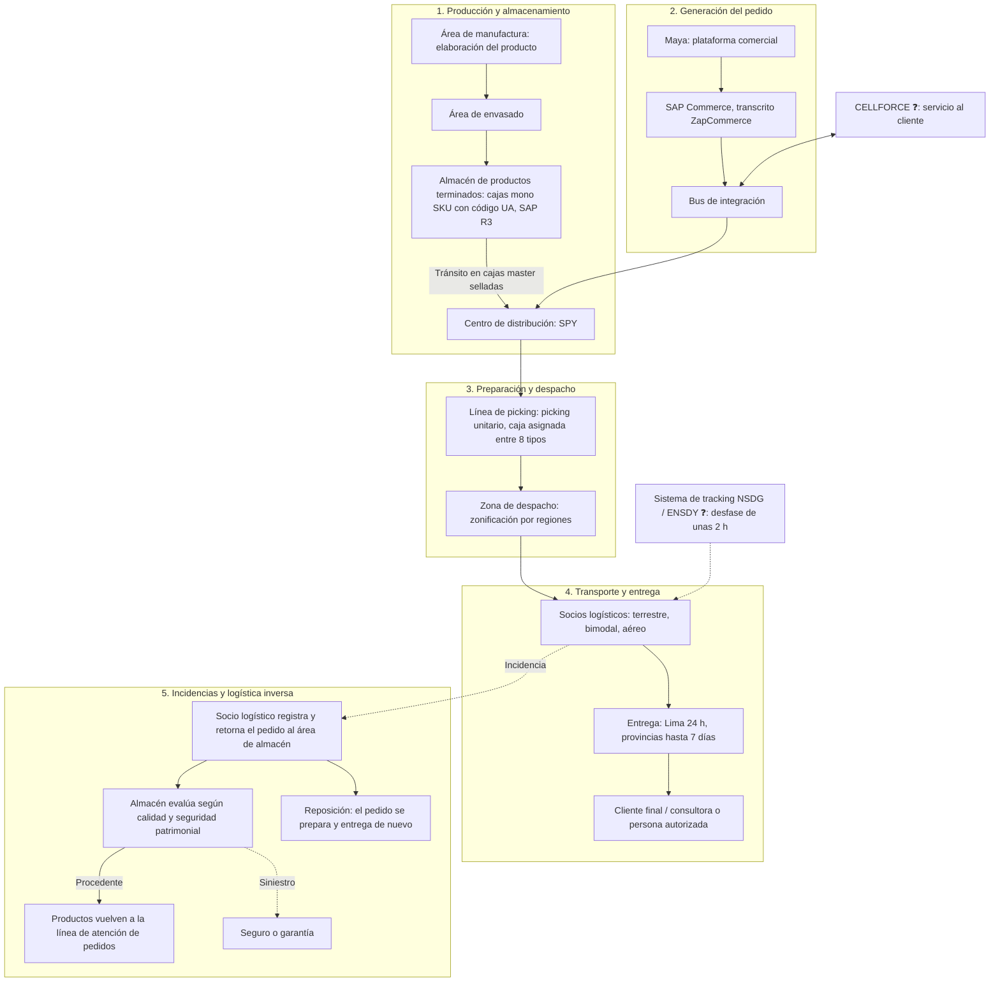

# Base de Conocimiento de Arquitectura Empresarial: Yanbal

> **Mapa de Contenidos (MOC)**
> Esta base de conocimiento organiza la información obtenida en la entrevista al **Ing. Joao Condorpusa Mendoza**, encargado del área de distribución de **Yanbal** [TO 0:19–0:21], para el proyecto académico de **Arquitectura Empresarial (sistema web de logística, inventario y trazabilidad)** [TO 0:08–0:14]. Yanbal es una empresa del **sector cosmético** [TO 4:35–4:45; 28:22] y la operación descrita corresponde a la **operación Perú** de su cadena de distribución [TO 9:37].

> [!NOTE]
> **Fuentes y convención de citas**
> - `[TO mm:ss]`: marca de tiempo en [[Transcripción original]], la **fuente principal y de solo lectura**. A partir de la marca 29:50 la grabación reinicia sus marcas; ese segundo tramo se cita como `[TO s2 m:ss]`.
> - `trascrito.text`: transcripción automática en bruto. Se conserva intacta.
> - `ENTREVISTA.mp4`: mencionada en la ficha de [[Transcripción original]]. ❓ **No está en esta carpeta**, por lo que no se ha podido consultar.
> - `[AC]`: [[Aclaración adicional del entrevistado]]. Es una **fuente complementaria obtenida fuera de la entrevista**.
> - ✅ hecho confirmado · 🔷 interpretación del equipo · ❓ duda o dato no confirmado.
> - Los nombres y términos verificados están en el [[Glosario de nombres y términos]].

---

## Problema central del proyecto

> [!IMPORTANT]
> **El problema identificado es la dificultad de trazabilidad y seguimiento de las entregas de productos desde la fábrica hacia las distribuidoras y otras sedes o destinos** `[AC]`. Es decir, conocer el recorrido y el estado de las entregas una vez que los productos salen de la fábrica.
>
> **Respaldo en la entrevista original:** el entrevistado señala como su «mayor reto» actualizar en vivo los **estados de los pedidos**. Hoy el sistema de tracking los actualiza con un desfase de unas **2 horas**, lo que genera un «margen de desconocimiento» sobre la situación del pedido y dificulta responder a reclamos y consultas [TO 23:16–25:10]. Su «principal necesidad» es una mejor conexión entre sistemas, con un desfase máximo de **30 minutos** [TO 29:30–s2 1:16].
>
> **Fuera de este foco:** la documentación **no** presenta a Yanbal como una empresa con problemas generales de producción, inventario, ventas o gestión. La situación de merma operativa (PR-01/PR-02) es un dato real de la entrevista, pero se registra como **situación complementaria** y no como problema central. Ver [[Problemas y necesidades]].

> [!WARNING]
> **Decisión de alcance del proyecto «H-16», pendiente de validar** 🔷❓
> Una versión anterior de este índice decía: *«Todo el levantamiento de información y diseño funcional del sistema **Y-Trace** abarca exclusiva y estrictamente la **distribución troncal B2B** (Centro de Distribución → Puntos/Agencias Departamentales). **Se excluye** todo proceso B2C, última milla o reparto domiciliario a consultoras finales.»*
> - **No proviene de la entrevista.** Los términos «Y-Trace», «B2B», «troncal», «agencias departamentales» y «H-16» no aparecen en [[Transcripción original]], y el documento de origen de «H-16» no está en esta carpeta.
> - **Choca con la entrevista**, que describe el seguimiento de pedidos hasta el **cliente final / consultora** [TO 19:44–19:53; 21:57–22:54].
> - **Coincide en parte con la aclaración** `[AC]`, que sitúa el problema en las entregas hacia «distribuidoras y otras sedes o destinos».
> - Se conserva como **decisión del equipo** y debe validarse. Ver [[Matriz de inconsistencias]], INC-08.

---

## 1. Índice modular de navegación

```
Entrevista/
├── 📁 00 - Fuente/
│   ├── 📄 [[Transcripción original]] ──────────── Fuente principal (solo lectura)
│   └── 📄 [[Aclaración adicional del entrevistado]] ─ Fuente complementaria [AC], fuera de la entrevista
├── 📁 01 - Empresa/
│   └── 📄 [[Información general de la empresa]] ── Contexto, familias de productos, áreas mencionadas
├── 📁 02 - Transporte/
│   └── 📄 [[Transporte y logística]] ──────────── Despacho, zonificación, estados del pedido, logística inversa
├── 📁 03 - Producción/
│   └── 📄 [[Producción]] ──────────────────────── Manufactura, envasado, cajas mono SKU, estados en SAP R3
├── 📁 04 - Inventario/
│   └── 📄 [[Inventario y almacén]] ───────────── Almacén (15.000 m², ~6.800 posiciones), SAP R3, merma operativa
├── 📁 05 - Trazabilidad/
│   └── 📄 [[Trazabilidad]] ────────────────────── Problema central, número de pedido, tracking y brechas
├── 📁 06 - Sistemas/
│   └── 📄 [[Sistemas y tecnología]] ───────────── SAP R3, SAP Commerce, Maya, SPY, NSDG/ENSDY, DRIVING, CELLFORCE, bus
├── 📁 07 - Problemas/
│   └── 📄 [[Problemas y necesidades]] ─────────── Problema central, situaciones complementarias y necesidades
├── 📁 08 - Actores/
│   └── 📄 [[Actores y responsabilidades]] ─────── Tipos de rol, áreas y actores confirmados
├── 📁 09 - Revisión documental/
│   ├── 📄 [[Inventario documental]]
│   ├── 📄 [[Matriz de inconsistencias]]
│   ├── 📄 [[Glosario de nombres y términos]]
│   ├── 📄 [[Informe final de revisión]]
│   └── 📄 [[Registro de cambios y reversión]]
├── 📄 trascrito.text ─────────────────────────── Transcripción automática en bruto (intacta)
└── 📄 buscar mas informacion.md ─────────────── Nota de investigación externa sin fuente (no verificada)
```

---

## 2. Diagrama macro del flujo de valor y de información

El diagrama solo incluye elementos mencionados en la entrevista. Las etiquetas con «❓» señalan nombres o relaciones por confirmar.



---

## 3. Matrices de relacionamiento cruzado

### A. Áreas → actividades confirmadas → responsables mencionados

| Área o unidad | Actividades confirmadas | Evidencia | Personas o roles mencionados | Nota detallada |
| :--- | :--- | :--- | :--- | :--- |
| **Área de manufactura** | Elaboración del producto. Las cajas llegan identificadas desde esta área con el código UA. | [TO 1:40; 7:11–7:26] | Ninguno | [[Producción]] |
| **Área de envasado** | Etapa siguiente a la elaboración. | [TO 1:01; 1:48] | Ninguno | [[Producción]] |
| **Área de almacén / almacén de productos terminados** | Ingreso de productos en SAP (es la única área que usa SAP). Evalúa los pedidos retornados según calidad y seguridad patrimonial. | [TO 1:55; 8:20–8:55; 20:48–21:15] | Ninguno | [[Inventario y almacén]] |
| **Centro de distribución** | Apertura de cajas master, picking unitario, preparación y atención de pedidos. | [TO 2:01–2:05; 4:01–4:19] | Ninguno | [[Inventario y almacén]] |
| **Zona de despacho** | Recibe el pedido preparado y lo zonifica por regiones. | [TO 17:26; 19:04–19:15] | Ninguno | [[Transporte y logística]] |
| **Área de distribución** | Solo se menciona como el cargo del entrevistado. Sus funciones no se detallaron. | [TO 0:19–0:21] | [[Actores y responsabilidades#Ing. Joao Condorpusa Mendoza\|Ing. Joao Condorpusa Mendoza]], encargado | [[Actores y responsabilidades]] |
| **Socios logísticos** (externos) | Transporte y entrega; registro de incidencias; retorno del pedido por logística inversa. | [TO 1:24; 20:25–20:55] | Ninguno | [[Transporte y logística]] |
| **Servicio al cliente** | Atiende consultas y reclamos, incluidos los relacionados con el estatus del pedido. | [TO 24:29–24:36; 28:35–28:44] | Ninguno | [[Sistemas y tecnología]] |

❓ La entrevista **no confirma** que existan como áreas «Control de Calidad», «Seguridad Patrimonial», «Comercial y Ventas» ni «Seguridad Informática/TI». Ver [[Glosario de nombres y términos]].

---

### B. Sistemas → uso confirmado

| Sistema (forma usada) | Cómo se menciona en la entrevista | Uso confirmado | Evidencia | Enlace |
| :--- | :--- | :--- | :--- | :--- |
| **SAP R3** | «sistema SAP, es una ERP»; «SAP R3» | Estados del producto; inventario a nivel de almacén; reportes | [TO 2:25; 8:12–8:50; 10:16; 11:30; 27:03] | [[Sistemas y tecnología#SAP R3\|SAP R3]] |
| **SAP Commerce** 🔷 | «sistema comercial de Zap mismo, ZapCommerce» | Se integra con Maya | [TO 14:49–14:57] | [[Sistemas y tecnología#SAP Commerce\|SAP Commerce]] |
| **Maya** | «plataforma comercial denominada Maya» | Generación del pedido | [TO 14:43–14:49] | [[Sistemas y tecnología#Maya\|Maya]] |
| **Bus de integración** | «bus de integración» | Conecta todos los sistemas | [TO 14:57; 16:58; 28:59–29:09] | [[Sistemas y tecnología#Bus de integración\|Bus de integración]] |
| **SPY** | «BWMS de desarrollo in-house… llamado SPY por las siglas de sistema de picking de Yanbal» | Gestor de picking de pedidos en el centro de distribución | [TO 9:04–9:12; 15:06; 17:03; 27:43] | [[Sistemas y tecnología#SPY\|SPY]] |
| **NSDG / ENSDY** ❓ | «sistema de transporte… NSDG» [9:21–9:33]; «sistema de trackeo denominado ENSDY» [28:00] | Transporte / tracking de pedidos | [TO 9:21–9:37; 28:00] | [[Sistemas y tecnología#NSDG\|NSDG]] |
| **DRIVING** ❓ (grafía por confirmar) | «de transporte y despacho se maneja DRIVING»; «sistema externo» | Transporte y despacho | [TO 28:10–28:28] | [[Sistemas y tecnología#DRIVING\|DRIVING]] |
| **CELLFORCE** ❓ | «específicamente denominado CELLFORCE» | Servicio al cliente: consultas, reclamos y trámites | [TO 28:35–28:44] | [[Sistemas y tecnología#CELLFORCE\|CELLFORCE]] |
| **Terminales de radiofrecuencia** | «terminales de radiofrecuencia» | Captura de los códigos UA | [TO 7:28] | [[Sistemas y tecnología#Terminales de radiofrecuencia\|Terminales RF]] |

---

### C. Problema central, situaciones relacionadas y necesidades

| Código | Situación | Evidencia | Clasificación | Necesidad relacionada |
| :--- | :--- | :--- | :--- | :--- |
| — | **Problema central:** trazabilidad y seguimiento de las entregas desde la fábrica hacia distribuidoras y otras sedes o destinos | `[AC]` | Fuente complementaria | [[Problemas y necesidades#NEC-01\|NEC-01]] |
| [[Problemas y necesidades#PR-03\|PR-03]] | El sistema de tracking actualiza el estatus del pedido con un desfase de unas 2 horas | [TO 23:16–24:09] | ✅ Vinculado al problema central | NEC-01 |
| [[Problemas y necesidades#PR-04\|PR-04]] | «Margen de desconocimiento» sobre la situación del pedido; afecta la respuesta a reclamos y consultas | [TO 24:09–24:36] | ✅ Vinculado al problema central | NEC-01 |
| [[Problemas y necesidades#PR-05\|PR-05]] | El receptor puede ser una persona autorizada, y el cliente que consulta la trazabilidad no necesariamente tiene esa información | [TO 24:40–24:52] | ✅ Vinculado al problema central | NEC-01 |
| [[Problemas y necesidades#PR-01\|PR-01]] | La merma operativa se registra al final de la jornada, con un desfase de hasta 6 horas | [TO 12:38–13:26] | ✅ Situación complementaria de inventario | [[Problemas y necesidades#NEC-02\|NEC-02]] 🔷 |
| [[Problemas y necesidades#PR-02\|PR-02]] | Riesgo de quiebre de stock y venta perdida derivado del desfase anterior | [TO 13:26–14:14] | ✅ Situación complementaria de inventario | NEC-02 🔷 |
| ~~PR-06~~ | *Retirado: el entrevistado no lo planteó como problema.* | — | ❌ Sin respaldo | — |

---

## 4. Cuadro maestro de cifras verificadas

| Métrica | Valor dicho por el entrevistado | Evidencia | Observación |
| :--- | :--- | :--- | :--- |
| Superficie del almacén | 15.000 m² | [TO 5:54–6:05] | ❓ No se precisa si es el almacén de productos terminados o el centro de distribución. |
| Posiciones de almacenamiento | «alrededor de 6.800», concentradas en pallets | [TO 6:05–6:13] | Mismo almacén que la fila anterior. |
| Capacidad instalada | 2 millones de cajas mono SKU | [TO 6:17–6:32] | |
| Capacidad óptima de ocupación | «alrededor de un 85 %» | [TO 6:32–6:58] | 🔷 El 15 % restante como margen es un cálculo del equipo. |
| Tipos de caja para pedidos | 8 | [TO 15:59–16:17] | Asignados según el consolidado de peso y volumetría teóricos del pedido. |
| Cobertura geográfica | 24 departamentos del país | [TO 19:15–19:23] | |
| Modalidades de envío | Terrestre, bimodal (transcrito «biomodal») y aérea | [TO 19:26–19:30] | ❓ No se detallaron ámbitos ni criterios de cada modalidad. |
| Promesa de entrega en Lima | 24 horas («todo Lima metropolitana») | [TO 22:47] | |
| Promesa de entrega en provincias | «hasta un rango de siete días» | [TO 22:54] | |
| Desfase actual del tracking | «en promedio de dos horas» / «hasta dos horas» | [TO 23:41–24:09; s2 0:49] | El entrevistado usa las dos expresiones. |
| Desfase objetivo | Menor a media hora; «desfase máximo permisible de media hora, de 30 minutos» | [TO 23:29; s2 0:57–1:07] | Lo expresa el entrevistado. |
| Desfase en el registro de merma | «hasta seis horas» | [TO 13:08–13:18] | Situación complementaria (PR-01). |
| Composición tecnológica | 3 sistemas propios adaptados + 4 sistemas de proveedores | [TO s2 1:57–2:20] | ❓ El entrevistado **no dijo cuáles** son los 3 ni los 4. Ver [[Sistemas y tecnología]]. |
