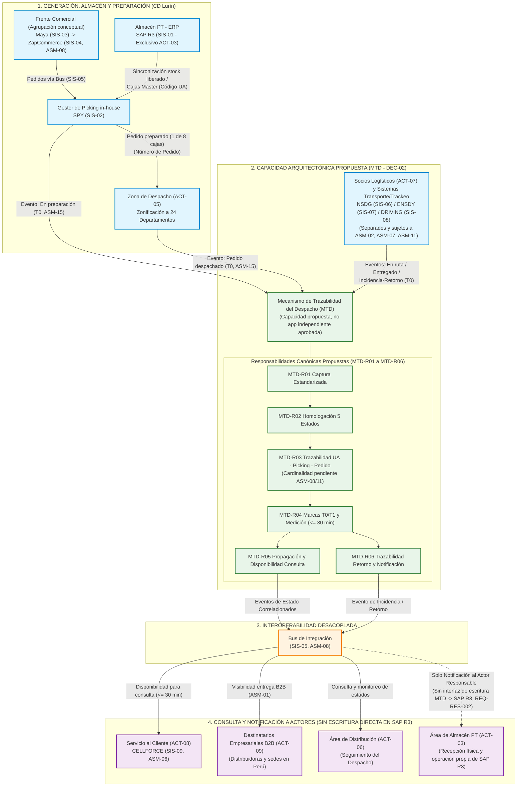

# 2. FASE A: VISIÓN DE LA ARQUITECTURA

> **Ubicación oficial:** [`02_Fase_A_Vision_de_Arquitectura/02_Fase_A_Vision_Arquitectura_Completa.md`](02_Fase_A_Vision_Arquitectura_Completa.md)  
> **Índice Maestro:** [`INDICE_GENERAL.md`](../INDICE_GENERAL.md)  
> **Artefactos Relacionados:** [`01_Fase_Preliminar_Completa.md`](../01_Fase_Preliminar/01_Fase_Preliminar_Completa.md) | [`01_5_Matriz_Maestra_Requerimientos.md`](../01_Fase_Preliminar/01_5_Matriz_Maestra_Requerimientos.md) | [`00_1_Glosario_Canonico_y_Nomenclatura.md`](../00_Referencias_Glosario_y_Decisiones/00_1_Glosario_Canonico_y_Nomenclatura.md) | [`00_2_Catalogo_Maestro_Actores_y_Sistemas.md`](../00_Referencias_Glosario_y_Decisiones/00_2_Catalogo_Maestro_Actores_y_Sistemas.md) | [`00_3_Registro_Supuestos_Incertidumbres_y_Decisiones.md`](../00_Referencias_Glosario_y_Decisiones/00_3_Registro_Supuestos_Incertidumbres_y_Decisiones.md)

---

## 2.1. Visión y objetivos estratégicos del proyecto

### 2.1.1. Contexto corporativo institucional y misión de Unique S.A. (Yanbal Perú)

La corporación **Yanbal**, operando legalmente en el territorio peruano bajo la razón social **Unique S.A.** (RUC N.° **20100102413** `[Fuente Pública]`), constituye una de las organizaciones líderes en la industria cosmética, de perfumería, cuidado personal, cosméticos, productos dermatológicos y joyería fina de América Latina. Fundada en Lima en 1967 por Fernando Belmont Anderson, la organización opera bajo la marca y corporación internacional Yanbal, articulando su modelo de negocio en la venta directa multinivel y canales digitales respaldados por una red de distribución que transporta los productos desde sus plantas industriales y centros logísticos en Lima Metropolitana hacia las diversas regiones del país `[Fuente Pública]`.

La misión corporativa de la organización se orienta a transformar positivamente la vida de las personas mediante la belleza y la oportunidad de desarrollo empresarial independiente, lo cual impone un compromiso inexcusable con la excelencia operativa, la puntualidad en el abastecimiento y la transparencia informativa en toda su cadena logística. En este marco, la promesa de servicio logístico hacia sus redes de distribución nacional comprende *lead times* de entrega de **24 horas para Lima Metropolitana** y de **hasta 7 días para provincias** (`[TO 22:38–22:54]`), abasteciendo a los **24 departamentos del territorio peruano** (`[TO 19:15–19:23]`), precisándose que la aplicabilidad exacta de estos plazos a las entregas B2B hacia distribuidoras y sedes se mantiene sujeta a validación operativa (`ASM-01`).

---

### 2.1.2. Diagnóstico del problema estratégico y la brecha de visibilidad en el despacho

A pesar de contar con una infraestructura de almacenamiento de clase mundial en Lurín —con un almacén de **15,000 $\text{m}^2$**, aproximadamente **6,800 posiciones de almacenamiento en pallets** y capacidad física estática instalada para **2 millones de cajas mono SKU** (`[TO 5:54–6:58]`, precisándose según `ASM-10` que esta cifra corresponde a capacidad de almacenamiento físico y no a la carga transaccional o eventos diarios)—, la operación logística de transporte y despacho presenta una brecha crítica en la actualización de la información de trazabilidad.

La evidencia obtenida a través de la entrevista con el Encargado del Área de Distribución (`[TO 23:41–24:09; s2 0:49]`) y su posterior aclaración oficial (`[AC]`) diagnostica los siguientes puntos críticos:
1. **Desfase crítico de actualización:** El sistema de seguimiento de envíos arroja el estado de los pedidos con un retardo documentado tanto como *«en promedio de dos horas»* (`[TO 23:41–23:50]`) como con un *«desfase de hasta dos horas»* (`[TO 24:01–24:09; s2 0:49]`).
2. **Margen de desconocimiento operativo:** Este retardo temporal crea un *«margen de desconocimiento»* (`[TO 24:09–24:18]`) durante el cual el Área de Distribución (`ACT-06`) y el Área de Servicio al Cliente (`ACT-08`) ignoran el paradero físico exacto y la situación operativa del pedido en tránsito.
3. **Pérdida de capacidad de respuesta ante consultas y reclamos:** Cuando las distribuidoras o destinatarios empresariales (`ACT-09`) experimentan dudas o demoras y se comunican a través del sistema de servicio al cliente `CELLFORCE` (`SIS-09`), los operadores carecen de datos en tiempo cuasi-real para responder con certidumbre (`[TO 24:18–24:36]`), lo que deteriora la confianza en la red comercial.
4. **Vulnerabilidad en la gestión de excepciones e incidencias:** Ante extravíos, siniestros en ruta o retornos por dirección errónea, la detección tardía de la incidencia retrasa la activación de los protocolos de logística inversa (`[TO 20:18–21:35]`) y la respuesta oportuna hacia Almacén (`ACT-03`).

---

### 2.1.3. Visión estratégica To-Be: El Mecanismo de Trazabilidad del Despacho (MTD)

Frente a este escenario, la **Visión To-Be** del proyecto no consiste en adquirir software aislado ni en imponer una aplicación monolítica que ignore las inversiones tecnológicas previas de Yanbal. La visión se articula como un **Plan de Mejora Arquitectónica Integral** que introduce el **Mecanismo de Trazabilidad del Despacho (`MTD`)** como una **capacidad arquitectónica lógica propuesta** (y no como una aplicación independiente aprobada), transversal e integrada en el ecosistema existente (`DEC-02`, `REQ-ARQ-001`).

```
                              VISIÓN ESTRATÉGICA TO-BE
 +-----------------------------------------------------------------------------------+
 |  "Consolidar un ecosistema desacoplado, seguro e interoperable que capture,      |
 |  correlacione, propague y habilite la consulta de los eventos operativos de       |
 |  despacho y transporte B2B con un desfase de hasta 30 minutos (<= 30 min),        |
 |  mejorando la visibilidad de los pedidos desde el Centro de Distribución de Lurín |
 |  hasta su recepción formal en distribuidoras y sedes empresariales en los         |
 |  24 departamentos del Perú, fortaleciendo la calidad de atención y la gobernanza  |
 |  logística sin alterar los sistemas transaccionales consolidados."                |
 +-----------------------------------------------------------------------------------+
```

Esta visión se sustenta en tres pilares arquitectónicos:
- **Reducción sustantiva de la latencia:** Reducir la brecha informativa referida testimonialmente en ~2 horas a un desfase máximo permisible de **hasta 30 minutos** (`[TO 23:29; s2 0:57–1:07]`), proponiendo instrumentar la distinción objetiva entre el momento de ocurrencia del evento ($T_0$) y su disponibilidad en sistema ($T_1$) (`DEC-03`, `DEC-05`).
- **Interoperabilidad desacoplada y preservación de sistemas:** Articular a través del `Bus de Integración` (`SIS-05`, `ASM-08`) los sistemas mencionados individualmente en la entrevista —`SAP R3` (`SIS-01`), `SPY` (`SIS-02`), `Maya` (`SIS-03`), `ZapCommerce` (`SIS-04`, sin asumir equivalencia oficial con *SAP Commerce* `ASM-08`), `NSDG` (`SIS-06`) y `ENSDY` (`SIS-07`) (mantenidos separados sin asumir identidad ni dualidad confirmada `ASM-02`), `DRIVING` (`SIS-08`, `ASM-07`) y `CELLFORCE` (`SIS-09`, `ASM-06`)—, respetando la coexistencia referida en `[TO s2 1:57–2:20]` («tres sistemas internos adaptados y cuatro sistemas de proveedores adaptados») sin presentar como confirmada una clasificación nominal cerrada ni un número definitivo de sistemas o interfaces (`ASM-09`, `ASM-11`, `PAE-01`, `PAE-02`).
- **Gobernanza rigurosa y validación de seguridad:** Asegurar que toda interfaz de intercambio supere la validación de Seguridad Informática (`ACT-11`, `[TO s2 1:37–1:49]`, `REQ-RNF-003`) y mantenga trazabilidad verificable bajo el estándar TOGAF ADM.

---

## 2.2. Alcance, limitaciones y restricciones del proyecto

De conformidad con los principios `PAE-01` a `PAE-08` y las decisiones formalizadas en la Fase Preliminar (`DEC-02`, `DEC-04`), el alcance del proyecto se delimita de manera rigurosa, transparente y verificable.

### 2.2.1. Frontera operativa incluida (In-Scope — Alcance B2B Primario)

El alcance del plan de mejora arquitectónica comprende de manera exclusiva los siguientes componentes, etapas y flujos:

1. **Ámbito territorial:** Cobertura de los despachos originados en las instalaciones de Lima Metropolitana (Centro de Distribución Lurín) con destino a las distribuidoras y destinos empresariales ubicados en los **24 departamentos del territorio peruano** (`[AC]`, `[TO 19:15–19:23]`, `DEC-04`).
2. **Cadena física y lógica de preparación y despacho:**
   - La preparación de pedidos (*picking* y *packing*) en el Centro de Distribución mediante el gestor *in-house* `SPY` (`SIS-02`), amarrando las unidades al `Número de Pedido` y asignando uno de los 8 tipos de cajas (`[TO 15:06–17:26]`).
   - El tránsito hacia la Zona de Despacho y la **zonificación de pedidos** (`ACT-05`, `PROC-03`) según departamento y socio logístico asignado (`[TO 17:26–18:26]`).
   - La generación y formalización del evento `Pedido despachado` (`[TO 19:44]`).
3. **Transporte multimodal y entrega B2B:**
   - La transferencia de custodia a los socios logísticos asociados (`ACT-07`) para transporte en modalidades **terrestre, bimodal y aérea** (`[TO 1:24, 19:23–19:30]`).
   - La captura y propagación de eventos discretos del estado `Pedido en ruta` y de sus puntos de control en ruta (`[TO 18:41–19:53]`).
   - La entrega formal y confirmación de recepción en las **distribuidoras y sedes empresariales correspondientes** (`ACT-09`, `[AC]`, `DEC-04`), registrando el estado `Pedido entregado`.
4. **Logística inversa ante incidencias en ruta:**
   - Captura oportuna de eventos de rechazo, dirección no habida, siniestro o daño en transporte (`[TO 20:18–20:55]`).
   - Trazabilidad del retorno del pedido hacia las instalaciones de Lurín y notificación de retorno al Área de Almacén (`ACT-03`), a quien competen la recepción física y la evaluación posterior en base a calidad y seguridad patrimonial (`[TO 20:55–21:35]`), sin que el `MTD` asuma gestión de inventario, evaluación de calidad, reposición, seguros ni escrituras directas sobre `SAP R3` (`REQ-RES-002`).
5. **Visibilidad en canales de atención:**
   - Disponibilidad oportuna de la información de trazabilidad en el sistema `CELLFORCE` (`SIS-09`) para que el Área de Servicio al Cliente (`ACT-08`) atienda oportunamente a los interesados (`[TO 24:18–24:36]`).

---

### 2.2.2. Frontera operativa excluida (Out-of-Scope)

Quedan formalmente excluidos del alcance del proyecto los siguientes aspectos:

1. **Distribución secundaria a consumidoras finales (B2C masivo):** La distribución y entrega capilar que realizan las distribuidoras independientes hacia las consultoras o consumidoras finales (`[AC]`, `DEC-04`, `REQ-RES-001`).
2. **Gestión comercial interna de distribuidoras:** Procesos de cobranza, comisiones, créditos o administración contable interna de las distribuidoras comerciales.
3. **Comercio electrónico general no vinculado al despacho de la red:** Plataformas de venta digital externa no integradas al modelo de distribución de Yanbal Perú.
4. **Inventario interno de fábrica y desfase de mermas operativas:** El registro diferido de hasta 6 horas de la merma operativa en el almacén de Lurín (`[TO 12:38–14:14]`, `ASM-04`), al corresponder a un proceso interno de control de stock entre Almacén y Finanzas, no forma parte del problema de trazabilidad del despacho B2B.
5. **Flota vehicular propietaria y hardware de rastreo:** Yanbal Perú no posee flota propia de distribución (`ASM-05`, `REQ-RES-004`). Se excluye expresamente la compra, instalación o financiamiento de dispositivos telemáticos GPS en vehículos de terceros contratados por los socios logísticos.
6. **Desarrollo de sistemas aplicativos monolíticos o redundantes:** Queda excluida la construcción de un nuevo ERP, un nuevo sistema WMS o un nuevo aplicativo móvil/web aislado que duplique las funciones de `SAP R3`, `SPY`, `Maya`, `ZapCommerce` o `CELLFORCE` (`DEC-02`, `REQ-ARQ-001`).

---

### 2.2.3. Limitaciones operativas y de infraestructura

El diseño arquitectónico asume y gestiona las siguientes condiciones de contorno:
- **Conectividad celular en geografía nacional (Hipótesis y Riesgo `ASM-16`, `RSK-06`):** Se formula como hipótesis técnica y riesgo operativo que tramos terrestres o bimodales en zonas alejadas de la sierra y selva puedan presentar cobertura celular intermitente (`ASM-16`, `RSK-06`), requiriendo prever que la captura de eventos contemple mecanismos asíncronos de almacenamiento local (*store-and-forward*) por parte de los operadores de transporte (`[TO 19:23–19:30]`).
- **Heterogeneidad e incertidumbre de plataformas de transporte y seguimiento (`ASM-02`, `ASM-07`):** En el tramo de transporte y seguimiento se mencionan `NSDG` (`SIS-06`), `ENSDY` (`SIS-07`) y el sistema externo `DRIVING` (`SIS-08`), permaneciendo pendiente de validación qué plataformas operan directamente los socios logísticos (`ACT-07`) y mediante qué mecanismo reportan sus eventos hacia el ecosistema de Yanbal (`ASM-02`, `ASM-07`), por lo que se requiere definir contratos de intercambio estandarizados (`REQ-INT-002`) sin presuponer protocolos técnicos específicos antes de las Fases C y D.
- **Línea base estadística en consolidación:** La línea base actual de latencia (~2 horas, referida en la entrevista tanto como promedio cuanto como tope de hasta dos horas) proviene de declaraciones testimoniales cualitativas y no de un repositorio analítico consolidado (`ASM-03`, `ASM-13`). El empleo de estadísticos descriptivos como $P_{95}$ se mantiene únicamente como una alternativa de medición pendiente de evaluación y validación (`DEC-03`, `DEC-05`).

---

### 2.2.4. Restricciones obligatorias del proyecto

Las decisiones de diseño deben respetar de manera vinculante las cuatro restricciones identificadas en la Matriz Maestra (`01_5`):

| Código | Restricción Obligatoria | Fundamento Operativo y Metodológico |
| :--- | :--- | :--- |
| **`REQ-RES-001`** | **Frontera operativa B2B:** El MTD debe circunscribirse al seguimiento desde el CD de Lurín hasta distribuidoras y destinos empresariales en Perú, excluyendo la distribución secundaria a consultoras finales. | Aclaración complementaria del entrevistado (`[AC]`) y Decisión Formal `DEC-04`. |
| **`REQ-RES-002`** | **Operación exclusiva de SAP R3 por Almacén:** Ningún flujo del `MTD` asumirá una interfaz de escritura directa hacia `SAP R3` ni permitirá el ingreso o modificación de inventario por personal ajeno al Área de Almacén (`ACT-03`); ante incidencias o retornos se representa la notificación al actor responsable (`ACT-03`). | Declaración explícita del entrevistado: *«El SAP solamente es manejado por almacén»* (`[TO 8:50–8:55]`). |
| **`REQ-RES-003`** | **Integridad física de cajas master mono SKU:** La trazabilidad primaria debe respetar la regla física de tránsito de cajas master selladas sin saldos desde manufactura hacia el CD. | Regla operativa declarada: *«todas las cajas se manejan a través de cajas master, o sea, cajas selladas sin considerar saldos o algún tipo de retiro para redistribución»* (`[TO 3:40–3:52]`). |
| **`REQ-RES-004`** | **Modelo de transporte tercerizado sin imposición de hardware:** Las soluciones de seguimiento deben operar sobre el ecosistema de proveedores logísticos asociados (`ACT-07`), sin presuponer flota propia ni telemetría GPS continua vehicular. | Modalidades de transporte multimodal tercerizado documentadas en `[TO 1:24, 19:23–19:30]` y Supuesto `ASM-05`. |

---

## 2.3. Metas de negocio y objetivos SMART

De conformidad con el estándar TOGAF ADM (Fase A) y las directrices de formulación no ambigua de ISO/IEC/IEEE 29148, se proponen **ocho objetivos estratégicos SMART (`OBJ-01` a `OBJ-08`)**. Para mantener rigor epistémico absoluto (`PAE-08`, `DEC-03`, `DEC-05`), en todos los objetivos e indicadores de esta fase se distinguen tres niveles:
1. **Meta operativa respaldada por la entrevista (`[TO 23:29; s2 0:57–1:07]`):** Reducir el desfase de actualización de estados del despacho a un máximo de **hasta 30 minutos** ($\le 30\text{ min}$), frente al retardo referido testimonialmente en ~2 horas (`ASM-03`).
2. **Propuestas adicionales del equipo de arquitectura (`[Propuesta Arquitectónica]`):** La instrumentación de marcas $T_0/T_1$, los indicadores `KPI-01` a `KPI-08`, las metas porcentuales (valores de referencia del $100\%$, $\ge 98\%$, $\ge 99.9\%$, tasa de error $< 0.1\%$), promedios intermedios ($\le 15\text{ min}$), percentiles descriptivos ($P_{95}$) y plazos referenciales del ciclo ADM. Ninguno de estos porcentajes o umbrales se presenta como un compromiso corporativo aprobado.
3. **Estado de validación formal (`ASM-13`, `ASM-14`):** A la fecha existen **cero (0) metas o calendarios formalmente aprobados por Yanbal Perú**; la totalidad de `OBJ-01` a `OBJ-08` y sus plazos continúan **pendientes de validación formal** con `ACT-06`, `ACT-11`, `ACT-12` y `ACT-13`.

---

### `OBJ-01`: Establecimiento de la línea base empírica de latencia de eventos
- **Enunciado:** Instrumentar o muestrear sistemáticamente las marcas temporales de ocurrencia operativa ($T_0$) y de disponibilidad en sistema ($T_1$) de los eventos del despacho B2B para establecer la línea base empírica de latencia entre el inicio y el cierre de la Fase C (ventana referencial propuesta de hasta seis semanas; **calendario todavía no validado por Yanbal Perú según `ASM-14`**).
- **Desglose SMART:**
  - **S (Específico):** Identificar y registrar $T_0$ y $T_1$ en los puntos de emisión y disponibilidad de eventos de preparación, despacho y transporte para medir $\Delta T = T_1 - T_0$ y diagnosticar el origen técnico del retardo (`ASM-03`).
  - **M (Medible):** Línea base actual: **«No disponible; pendiente de medición»** (referencia testimonial: desfase «en promedio de dos horas» / «de hasta dos horas» en `[TO 23:41–24:09; s2 0:49]`). Como propuesta arquitectónica (`KPI-01`), se plantea cubrir los puntos de emisión de los estados del despacho que resulten confirmados en el levantamiento con `ACT-06` y `ACT-12` (meta propuesta pendiente de validación, condicionada a `ASM-13`).
  - **A (Alcanzable):** Viable mediante inspección de trazas existentes en el `Bus de Integración` (`SIS-05`) / sistemas de seguimiento o muestreo controlado acordado con `ACT-06` y `ACT-12` (`RSK-01`).
  - **R (Relevante):** Aborda directamente la incertidumbre sobre la latencia actual y su causa técnica raíz registrada en **`ASM-03`** (condicionada al acceso a datos operativos de **`ASM-13`**), permitiendo verificar objetivamente cualquier mejora posterior (`DEC-03`, `DEC-05`).
  - **T (Temporal):** **Hito inicial único:** inicio de la Fase C (tras la autorización de acceso/muestreo operativo de `ASM-13`). **Hito final único:** cierre de la Fase C (Arquitectura de Sistemas de Información), estimándose entre ambos hitos una ventana referencial propuesta de hasta 6 semanas. **Este plazo y el calendario general aún no han sido validados por Yanbal Perú (`ASM-14`).**
- **Trazabilidad:** `REQ-NEG-002`, `REQ-RNF-001`, `REQ-ARQ-003`, `DEC-03`, `DEC-05`, `ASM-03`, `ASM-13`, `ASM-14`, `RSK-01`, capacidad `MTD-R04`.
- **KPI Asociado:** `KPI-01` (Latencia Promedio de Actualización — propuesto).
- **Factor Crítico:** `FCE-02`, `FCE-06`.
- **Estado de Validación:** **Propuesto (Pendiente de validación con `ACT-06`, `ACT-12` y `ACT-13`)**.
- **Responsable de Medición y Validación:** `ACT-12` (TI y Arquitectura), `ACT-06` (Distribución) y `ACT-14` (Equipo Consultor de Arquitectura).

---

### `OBJ-02`: Reducción del desfase de actualización de estados a hasta 30 minutos ($\le 30\text{ min}$)
- **Enunciado:** Reducir el desfase entre la ocurrencia física de los eventos de despacho/transporte B2B ($T_0$) y su disponibilidad en el sistema de seguimiento ($T_1$) al umbral de **hasta 30 minutos** ($\Delta T \le 30\text{ min}$, meta operativa respaldada por la entrevista `[TO 23:29; s2 0:57–1:07]`), verificando su viabilidad en el cierre de la validación piloto propuesta para la Fase G (**calendario pendiente de validación según `ASM-14`**).
- **Desglose SMART:**
  - **S (Específico):** Asegurar que el intervalo $\Delta T = T_1 - T_0$ en los eventos discretos del despacho B2B se reduzca desde el retardo testimonial de ~2 horas hasta el margen máximo de 30 minutos (`REQ-NEG-002`, `REQ-RNF-001`).
  - **M (Medible):** Línea base actual: **«No disponible; pendiente de medición»** (`ASM-03`, `ASM-13`). **Meta respaldada por la entrevista:** $\Delta T \le 30\text{ min}$ (`[TO 23:29; s2 0:57–1:07]`). **Propuestas adicionales pendientes de validación (`KPI-01`, `KPI-02`, `DEC-03`, `DEC-05`):** los criterios porcentuales de cumplimiento agregado (tanto la referencia teórica del $100\%$ de eventos sin excepciones como un eventual umbral operativo $\ge 98\%$ con tolerancia por conectividad en ruta `ASM-16`), promedios intermedios ($\le 15\text{ min}$) y percentiles descriptivos ($P_{95}$) **son propuestas analíticas del equipo y no compromisos corporativos aprobados**.
  - **A (Alcanzable):** Factible mediante mejoras de integración orientada a eventos entre los socios logísticos (`ACT-07`), los sistemas de transporte/seguimiento y el `Bus de Integración` (`SIS-05`) (`[TO s2 0:29–1:16]`).
  - **R (Relevante):** Atiende el problema central del proyecto al reducir el «margen de desconocimiento» de hasta 2 horas descrito en `[TO 23:41–24:18]`.
  - **T (Temporal):** Hito objetivo propuesto al cierre de la validación piloto en Fase G (cronograma no validado por Yanbal Perú, `ASM-14`).
- **Trazabilidad:** `REQ-NEG-002`, `REQ-RNF-001`, `REQ-INT-002`, `REQ-ARQ-003`, `REQ-RES-004`, `PAE-04`, `ASM-03`, `ASM-13`, `ASM-14`, `ASM-16`, `DEC-03`, `DEC-05`, capacidades `MTD-R01`, `MTD-R04`.
- **KPI Asociado:** `KPI-01` y `KPI-02` (propuestos).
- **Factor Crítico:** `FCE-01`, `FCE-02`.
- **Estado de Validación:** **Meta de $\le 30\text{ min}$ respaldada en entrevista; criterios porcentuales, estadísticos y plazos propuestos (Pendiente de validación formal con `ACT-06` y `ACT-13`)**.
- **Responsable de Medición y Validación:** `ACT-06` (Distribución) y `ACT-12` (TI y Arquitectura).

---

### `OBJ-03`: Consistencia y trazabilidad secuencial de los cinco estados del pedido y sus atributos logísticos
- **Enunciado:** Homologar y preservar en el diseño To-Be la secuencia de los cinco estados documentados del pedido (`Pedido facturado`, `Elaboración o en preparación`, `Pedido despachado`, `Pedido en ruta`, `Pedido entregado`) junto con sus atributos logísticos asociados y su trazabilidad respecto de almacén y picking, al cierre de la especificación de la Fase C (**calendario pendiente de validación según `ASM-14`**).
- **Desglose SMART:**
  - **S (Específico):** Definir el catálogo canónico de cinco estados (`MTD-R02`), conservar asociados al `Número de Pedido` el formato de caja (1 de 8), destino geográfico y socio logístico (`REQ-FUN-004`), y definir la relación de trazabilidad entre `Código UA`, líneas de picking y `Número de Pedido` dejando su cardinalidad pendiente de validación (`REQ-ARQ-002`, `MTD-R03`). La regla de software que bloquee saltos de estado fuera de orden se plantea expresamente como propuesta arquitectónica sujeta a validación (`REQ-FUN-001`).
  - **M (Medible):** Línea base actual: **«No disponible; pendiente de medición»** (`ASM-02`, `ASM-13`, `ASM-15`). Como propuesta arquitectónica (`KPI-03`), se plantea verificar la integridad secuencial sobre los pedidos auditados (el valor objetivo del $100\%$ es una propuesta técnica de diseño, no un compromiso corporativo aprobado).
  - **A (Alcanzable):** Se sustenta en los cinco estados y atributos descritos en `[TO 15:30–19:53]`.
  - **R (Relevante):** Evita discrepancias semánticas o vacíos de estado entre preparación, despacho, transporte y consulta (`REQ-NEG-001`, `REQ-FUN-001`, `REQ-FUN-004`).
  - **T (Temporal):** Hito propuesto al cierre de la Fase C (cronograma sujeto a validación, `ASM-14`).
- **Trazabilidad:** `REQ-NEG-001`, `REQ-FUN-001`, `REQ-FUN-004`, `REQ-ARQ-002`, `REQ-RES-003`, `PAE-03`, `ASM-02`, `ASM-08`, `ASM-11`, `ASM-15`, capacidades `MTD-R01`, `MTD-R02`, `MTD-R03`.
- **KPI Asociado:** `KPI-03` (Tasa de Integridad de la Secuencia de Estados — propuesto).
- **Factor Crítico:** `FCE-01`, `FCE-04`, `FCE-05`.
- **Estado de Validación:** **Propuesto (Pendiente de validación con `ACT-06` y `ACT-12`)**.
- **Responsable de Medición y Validación:** `ACT-06` (Distribución) y `ACT-12` (TI y Arquitectura).

---

### `OBJ-04`: Interoperabilidad desacoplada y preservación del ecosistema existente sin duplicación funcional
- **Enunciado:** Especificar contratos de integración desacoplados articulados con el `Bus de Integración` (`SIS-05`) para las interfaces de trazabilidad que resulten confirmadas en el ecosistema actual de Yanbal Perú, preservando la facilidad de uso y evitando crear aplicaciones autónomas redundantes, al cierre de las Fases C y D (**calendario pendiente de validación según `ASM-14`**).
- **Desglose SMART:**
  - **S (Específico):** Definir contratos estandarizados de intercambio de eventos entre los sistemas que se confirmen en el inventario de Fase C (`4.2.1`, `4.2.4`), respetando la configuración referida en `[TO s2 1:57–2:20]` («3 sistemas internos adaptados y 4 de proveedores») sin asumir de antemano un número cerrado de sistemas o interfaces (`ASM-02`, `ASM-06` a `ASM-09`, `ASM-11`), sin duplicar funciones transaccionales (`REQ-ARQ-001`) y sin escrituras directas sobre `SAP R3` (`REQ-RES-002`).
  - **M (Medible):** Línea base actual: **«No disponible; pendiente de medición»** (`ASM-08`, `ASM-09`, `ASM-11`). Como propuesta arquitectónica (`KPI-04`), se plantea evaluar la proporción de interfaces de trazabilidad validadas en Fase C que queden cubiertas por contratos estandarizados sin redigitación manual (`REQ-RNF-004`), con cero (0) aplicaciones transaccionales duplicadas (meta propuesta pendiente de validación, no compromiso aprobado).
  - **A (Alcanzable):** Se apoya en la existencia declarada del `Bus de Integración` (`SIS-05`) que conecta los sistemas de la empresa (`[TO 14:57–15:06, 28:59–29:09]`).
  - **R (Relevante):** Cumple los principios `PAE-01`, `PAE-02` y `PAE-07`, así como la decisión `DEC-02`.
  - **T (Temporal):** Hito propuesto al cierre de la especificación técnica en Fase D (cronograma sujeto a validación, `ASM-14`).
- **Trazabilidad:** `REQ-NEG-001`, `REQ-INT-001`, `REQ-INT-002`, `REQ-INT-003`, `REQ-INT-004`, `REQ-RNF-004`, `REQ-ARQ-001`, `REQ-ARQ-002`, `REQ-RES-002`, `PAE-01`, `PAE-02`, `PAE-07`, `DEC-02`, `ASM-02`, `ASM-06` a `ASM-09`, `ASM-11`, capacidades `MTD-R01`, `MTD-R05`.
- **KPI Asociado:** `KPI-04` (Índice de Cobertura de Estandarización de Interfaces — propuesto).
- **Factor Crítico:** `FCE-02`, `FCE-04`, `FCE-05`, `FCE-06`.
- **Estado de Validación:** **Propuesto (Pendiente de validación con `ACT-12` y `ACT-06`)**.
- **Responsable de Medición y Validación:** `ACT-12` (TI y Arquitectura) y `ACT-16` (Proveedores de Software).

---

### `OBJ-05`: Disponibilidad oportuna de estados de seguimiento para Servicio al Cliente (`CELLFORCE`)
- **Enunciado:** Habilitar que los cambios de estado del despacho B2B se propaguen y queden disponibles para consulta del Área de Servicio al Cliente (`ACT-08`) en `CELLFORCE` (`SIS-09`) dentro de la ventana objetivo de **hasta 30 minutos** tras su ocurrencia operativa, verificándolo en la validación piloto propuesta para la Fase G (**calendario pendiente de validación según `ASM-14`**).
- **Desglose SMART:**
  - **S (Específico):** Propagar a través del `Bus de Integración` (`SIS-05`) los estados actualizados, etapa y promesa de entrega (*lead time* regional) hacia el entorno de consulta de `CELLFORCE` (`SIS-09`, sujeto a `ASM-06` y `ASM-08`), incluyendo de forma condicionada el receptor autorizado únicamente si se valida `ASM-01` (`REQ-FUN-003`).
  - **M (Medible):** Línea base actual: **«No disponible; pendiente de medición»** (referencia testimonial: margen de desconocimiento de hasta ~2 h que afecta consultas y reclamos en `[TO 24:09–24:36]`). **Referencia de la entrevista:** actualización en $\le 30\text{ min}$. **Propuesta adicional pendiente de validación (`KPI-05`):** los umbrales porcentuales de disponibilidad oportuna en `CELLFORCE` (referencia teórica del $100\%$ o umbral operativo propuesto $\ge 98\%$) constituyen propuestas analíticas no aprobadas corporativamente.
  - **A (Alcanzable):** `CELLFORCE` (`SIS-09`) ya opera para consultas, reclamos y trámites (`[TO 28:35–28:44]`) conectado al ecosistema vía el bus (`[TO 28:59–29:09]`).
  - **R (Relevante):** Satisface directamente `REQ-NEG-003`, permitiendo a `ACT-08` responder con certidumbre consultas y reclamos sobre los despachos.
  - **T (Temporal):** Hito propuesto al cierre de la validación piloto en Fase G (cronograma pendiente de validación, `ASM-14`).
- **Trazabilidad:** `REQ-NEG-003`, `REQ-FUN-002`, `REQ-FUN-003` *(condicionado a `ASM-01`)*, `REQ-INT-003`, `REQ-RNF-004`, `PAE-01`, `PAE-03`, `ASM-01`, `ASM-06`, `ASM-08`, capacidad `MTD-R05`.
- **KPI Asociado:** `KPI-05` (Oportunidad de Disponibilidad de Estados en Servicio al Cliente — propuesto).
- **Factor Crítico:** `FCE-02`, `FCE-05`.
- **Estado de Validación:** **Propuesto (Pendiente de validación con `ACT-08`, `ACT-06` y `ACT-12`)**.
- **Responsable de Medición y Validación:** `ACT-08` (Servicio al Cliente) y `ACT-06` (Distribución).

---

### `OBJ-06`: Trazabilidad de eventos de incidencia y notificación de retorno en logística inversa
- **Enunciado:** Garantizar en el diseño To-Be el registro trazable de los eventos de incidencia en transporte, inicio de logística inversa por el socio logístico (`ACT-07`) y notificación de retorno al Área de Almacén (`ACT-03`), respetando estrictamente la frontera funcional del `MTD`, al cierre de la especificación de la Fase C (**calendario pendiente de validación según `ASM-14`**).
- **Desglose SMART:**
  - **S (Específico):** Capturar y correlacionar la causal de incidencia (retraso, daño, pérdida o rechazo), el evento de retorno a cargo de `ACT-07` y la notificación al actor responsable en Almacén (`ACT-03`) (`MTD-R06`), **sin asumir una interfaz de escritura directa hacia `SAP R3` (`REQ-RES-002`) ni funciones de administración de inventario, evaluación de calidad/seguridad patrimonial, reposición de pedidos o gestión de seguros** (`REQ-FUN-005`).
  - **M (Medible):** Línea base actual: **«No disponible; pendiente de medición»** (`ASM-02`, `ASM-07`, `ASM-13`). Como propuesta arquitectónica (`KPI-06`), se plantea medir la proporción de incidencias con retorno que cuentan con trazabilidad completa de causal, tránsito de retorno y notificación a `ACT-03` (el valor de referencia del $100\%$ es una propuesta técnica sujeta a validación, no un compromiso aprobado).
  - **A (Alcanzable):** El procedimiento operativo de retorno con `ACT-07` y `ACT-03` ya existe (`[TO 20:18–21:35]`); el `MTD` aporta visibilidad oportuna de sus eventos.
  - **R (Relevante):** Satisface `REQ-NEG-004` y `REQ-FUN-005`, evitando que pedidos con entrega fallida o siniestro queden sin trazabilidad de cierre.
  - **T (Temporal):** Hito propuesto al cierre de la especificación funcional y de datos en Fase C (cronograma sujeto a validación, `ASM-14`).
- **Trazabilidad:** `REQ-NEG-004`, `REQ-FUN-005`, `REQ-INT-002`, `REQ-RES-002`, `PAE-04`, `PAE-05`, `PAE-06`, `ASM-02`, `ASM-07`, `ASM-13`, `ASM-14`, `DEC-02`, capacidad `MTD-R06`.
- **KPI Asociado:** `KPI-06` (Cobertura de Trazabilidad en Retornos de Logística Inversa — propuesto).
- **Factor Crítico:** `FCE-01`.
- **Estado de Validación:** **Propuesto (Pendiente de validación con `ACT-06` y `ACT-03`)**.
- **Responsable de Medición y Validación:** `ACT-06` (Distribución) y `ACT-03` (Almacén).

---

### `OBJ-07`: Superación de la validación de Seguridad Informática corporativa y segregación de permisos
- **Enunciado:** Cumplir los controles de seguridad informática, protección de interfaces con terceros y segregación de permisos por nivel de rol que establezca el Área de Seguridad Informática (`ACT-11`) para los flujos del `MTD`, antes de la autorización de despliegue en Fase G (**calendario pendiente de validación según `ASM-14`**).
- **Desglose SMART:**
  - **S (Específico):** Someter toda interfaz propuesta de captura, integración y consulta a la validación de Seguridad Informática (`[TO s2 1:37–1:49]`) y verificar la segregación de acciones por nivel de rol (`[TO 25:34–26:43]`, `REQ-RES-002`, `ASM-15`).
  - **M (Medible):** Línea base actual: **«No disponible; pendiente de medición»** (`ASM-10`, `ASM-13`). La exigencia cualitativa de superar la validación de Seguridad Informática está respaldada en `[TO s2 1:37–1:49]`; la métrica cuantitativa (`KPI-07`: porcentaje de controles aprobados con propuesta de $100\%$ y $0$ vulnerabilidades críticas o altas no mitigadas) constituye una **propuesta técnica pendiente de validación con `ACT-11`** (`ASM-10`).
  - **A (Alcanzable):** Incorporando desde las Fases C y D los estándares corporativos de autenticación, cifrado y control de accesos que defina `ACT-11`.
  - **R (Relevante):** Atiende la exigencia directa de `[TO s2 1:37–1:49]` (`REQ-RNF-003`) y mitiga `RSK-04`.
  - **T (Temporal):** Hito propuesto previo a la autorización de implementación/piloto en Fase G (cronograma sujeto a validación, `ASM-14`).
- **Trazabilidad:** `REQ-RNF-003`, `REQ-RES-002`, `PAE-05`, `ASM-10`, `ASM-15`, `DEC-07`, `RSK-04`.
- **KPI Asociado:** `KPI-07` (Índice de Conformidad en Validación de Seguridad Informática — propuesto).
- **Factor Crítico:** `FCE-03`.
- **Estado de Validación:** **Exigencia de validación respaldada en entrevista; métrica y umbrales propuestos (Pendiente de validación con `ACT-11` y `ACT-12`)**.
- **Responsable de Medición y Validación:** `ACT-11` (Seguridad Informática) y `ACT-12` (TI y Arquitectura).

---

### `OBJ-08`: Capacidad y estabilidad de procesamiento ante el volumen real de eventos del despacho nacional
- **Enunciado:** Asegurar que la arquitectura seleccionada para el `MTD` soporte los volúmenes reales de pedidos, eventos de trazabilidad y picos de campaña de la distribución nacional hacia los 24 departamentos sin superar la ventana de hasta 30 minutos, una vez levantados los datos operativos reales de carga con TI (`ASM-10`), en las pruebas de desempeño propuestas para la Fase E/F (**dimensionamiento y calendario pendientes de validación según `ASM-10` y `ASM-14`**).
- **Desglose SMART:**
  - **S (Específico):** Levantar con `ACT-12` y `ACT-06` los datos reales de pedidos diarios, eventos por pedido y picos de cierre de campaña para dimensionar y validar la capacidad de procesamiento (`REQ-RNF-002`). **Se deja expresamente establecido que la cifra de 2 millones de cajas mono SKU (`[TO 6:17–6:32]`) representa capacidad física estática de almacenamiento en almacén y no transacciones diarias ni volumen de eventos, por lo que no se deriva de ella ningún requisito de procesamiento (`ASM-10`).**
  - **M (Medible):** Línea base actual: **«No disponible; pendiente de medición»** (`ASM-10`, `ASM-13`). El dimensionamiento cuantitativo permanece pendiente hasta contar con métricas reales de pedidos, eventos y picos de carga; umbrales técnicos preliminares como tasa de procesamiento oportuno $\ge 99.9\%$ o error $< 0.1\%$ (`KPI-08`) **son propuestas técnicas exploratorias sujetas a validación empírica y no compromisos aprobados**.
  - **A (Alcanzable):** Mediante patrones de mensajería desacoplada y dimensionamiento basado en mediciones reales sobre la infraestructura que se evalúe en las Fases D y E.
  - **R (Relevante):** Atiende la necesidad expresada en `[TO s2 1:19–1:24]` («gran capacidad para poder manejar volúmenes de data de mayor capacidad», `REQ-RNF-002`, `PAE-06`).
  - **T (Temporal):** Dimensionamiento pendiente de levantamiento en Fase C/D y verificación propuesta en pruebas de carga previas a migración en Fase E/F (cronograma no validado por Yanbal Perú, `ASM-14`).
- **Trazabilidad:** `REQ-RNF-002`, `REQ-ARQ-001`, `PAE-06`, `ASM-10`, `ASM-13`, `ASM-14`, transversal a `MTD-R01` a `MTD-R05`.
- **KPI Asociado:** `KPI-08` (Tasa de Procesamiento Oportuno bajo Carga Operativa Nacional — propuesto y sujeto a levantamiento `ASM-10`).
- **Factor Crítico:** `FCE-02`, `FCE-06`.
- **Estado de Validación:** **Propuesto; dimensionamiento técnico pendiente de datos reales de pedidos, eventos y picos (`ASM-10`)**.
- **Responsable de Medición y Validación:** `ACT-12` (TI y Arquitectura) y `ACT-14` (Equipo Consultor de Arquitectura).

---

## 2.4. Factores críticos de éxito (FCE)

Los **Factores Críticos de Éxito (`FCE-01` a `FCE-06`)** representan aquellas condiciones organizacionales, técnicas y de gestión que deben cumplirse para que el plan de mejora alcance los objetivos propuestos, alineados con el catálogo canónico de objetivos (`OBJ-01` a `OBJ-08`) y con el registro maestro de riesgos (`RSK-01` a `RSK-06` en [`00_3`](../00_Referencias_Glosario_y_Decisiones/00_3_Registro_Supuestos_Incertidumbres_y_Decisiones.md)).

| Código | Factor Crítico de Éxito | Descripción y Condiciones Necesarias | Objetivos Asociados | Riesgos Mitigados |
| :--- | :--- | :--- | :---: | :---: |
| **`FCE-01`** | **Alineación y compromiso oportuno de socios logísticos externos (`ACT-07`)** | Los proveedores logísticos asociados (`ACT-07`) deben adoptar los contratos de intercambio de eventos definidos, registrar oportunamente la marca de ocurrencia operativa ($T_0$) en los hitos de ruta, entrega o retorno, y habilitar la trazabilidad acordada con Distribución (`ACT-06`). | `OBJ-02`, `OBJ-03`, `OBJ-06` | `RSK-02`, `RSK-06` |
| **`FCE-02`** | **Capacidad de articulación e interoperabilidad del Bus de Integración (`SIS-05`)** | El Área de TI y Arquitectura (`ACT-12`) debe confirmar las propiedades del `Bus de Integración` (`SIS-05`, `ASM-08`) y asegurar su disponibilidad y rendimiento para propagar eventos de trazabilidad hacia seguimiento y `CELLFORCE` (`SIS-09`) sin cuellos de botella ni integraciones duplicadas. | `OBJ-01`, `OBJ-02`, `OBJ-04`, `OBJ-05`, `OBJ-08` | `RSK-01`, `RSK-03` |
| **`FCE-03`** | **Superación de la validación de Seguridad Informática (`ACT-11`) y segregación de permisos** | Establecer mecanismos de autenticación, cifrado y control de accesos por nivel de rol que satisfagan los criterios de validación de Seguridad Informática (`ACT-11`, `[TO s2 1:37–1:49]`, `ASM-10`, `ASM-15`) y respeten la operación exclusiva de `SAP R3` por Almacén (`REQ-RES-002`). | `OBJ-07` | `RSK-04` |
| **`FCE-04`** | **Trazabilidad lógica entre identificadores de almacén, picking y pedido (`Código UA`, líneas de picking y `Número de Pedido`)** | Preservar una relación de trazabilidad lógica verificable entre el `Código UA` de las cajas mono SKU en almacén (`SAP R3` `SIS-01`), las líneas y tareas de preparación en `SPY` (`SIS-02`) y el `Número de Pedido` empleado en despacho, transporte y consulta (`REQ-ARQ-002`), **sin afirmar una relación uno a uno ni una correspondencia unívoca no confirmada por las fuentes y dejando la cardinalidad exacta pendiente de validación técnica (`ASM-08`, `ASM-11`)**. | `OBJ-03`, `OBJ-04` | `RSK-03` |
| **`FCE-05`** | **Preservación de simplicidad y ergonomía operativa en planta, despacho, ruta y atención** | Las interfaces de captura y consulta no deben introducir sobrecargas manuales ni pasos redundantes de redigitación para operarios de picking (`ACT-04`), despacho (`ACT-05`), transportistas (`ACT-07`) ni Servicio al Cliente (`ACT-08`), preservando la facilidad de uso declarada (`[TO s2 1:57–2:20]`, `REQ-RNF-004`). | `OBJ-03`, `OBJ-04`, `OBJ-05` | `RSK-02` |
| **`FCE-06`** | **Gobernanza activa y validación formal de supuestos, alcance e incertidumbres** | Asegurar la participación de Distribución (`ACT-06`), TI (`ACT-12`) y Roles Directivos (`ACT-13`) para validar el alcance B2B (`REQ-RES-001`), el acceso a trazas operativas (`ASM-13`) y las incertidumbres `ASM-01` a `ASM-16` antes de comprometer decisiones tecnológicas definitivas. | `OBJ-01`, `OBJ-04`, `OBJ-08` | `RSK-01`, `RSK-03`, `RSK-05`, `RSK-06` |

---

## 2.5. Indicadores clave de rendimiento (KPIs estratégicos)

Para evaluar objetivamente el avance hacia los objetivos `OBJ-01` a `OBJ-08`, se proponen **ocho Fichas Técnicas de Indicadores (`KPI-01` a `KPI-08`)**. Conforme a `DEC-03`, `DEC-05` y `PAE-08`, todas las fichas observan estrictamente la siguiente distinción epistémica:
- **Meta operativa respaldada por la entrevista (`[TO 23:29; s2 0:57–1:07]`):** Reducir el desfase de actualización de los estados del despacho a un margen de **hasta 30 minutos** ($\le 30\text{ min}$). Asimismo, la entrevista respalda cualitativamente la exigencia de superar la validación de Seguridad Informática (`[TO s2 1:37–1:49]`) y de manejar mayores volúmenes de datos (`[TO s2 1:19–1:24]`).
- **Propuestas adicionales del equipo de arquitectura (`[Propuesta Arquitectónica]`, `DEC-05`):** La definición matemática de `KPI-01` a `KPI-08`, los porcentajes de referencia o tolerancia ($100\%$, $\ge 98\%$, $\ge 99.9\%$), el promedio operativo intermedio ($\le 15\text{ min}$), los estadísticos descriptivos ($P_{95}$, $\Delta T_{\max}$) y las bandas de semáforo son **propuestas analíticas para instrumentar la medición y nunca se presentan como compromisos corporativos ya aprobados**.
- **Estado de validación y líneas base (`ASM-03`, `ASM-10`, `ASM-13`):** **Ninguna meta cuantitativa ha sido formalmente validada todavía por Yanbal Perú** (todas figuran como pendientes de validación externa), y toda línea base carente de medición empírica se registra como **`«No disponible; pendiente de medición»`**.

---

### `KPI-01`: Latencia Promedio de Actualización de Eventos ($\overline{\Delta T}$)

| Atributo                         | Especificación Técnica                                                                                                                                                                                                                                                                                                                                                                                                                      |
| :------------------------------- | :------------------------------------------------------------------------------------------------------------------------------------------------------------------------------------------------------------------------------------------------------------------------------------------------------------------------------------------------------------------------------------------------------------------------------------------ |
| **Código y Nombre:**             | **`KPI-01` — Latencia Promedio de Actualización de Eventos de Despacho (Propuesto)**                                                                                                                                                                                                                                                                                                                                                        |
| **Objetivo Relacionado:**        | `OBJ-01` (Línea base empírica) y `OBJ-02` (Reducción del desfase a $\le 30\text{ min}$)                                                                                                                                                                                                                                                                                                                                                     |
| **Propósito de Negocio:**        | Cuantificar el retardo temporal medio transcurrido entre la ocurrencia operativa de un evento discreto de preparación, despacho o transporte ($T_0$) y su disponibilidad efectiva en el sistema de seguimiento ($T_1$).                                                                                                                                                                                                                     |
| **Fórmula de Cálculo:**          | $$\Delta T_i = T_{1,i} - T_{0,i} \quad \Longrightarrow \quad \overline{\Delta T} = \frac{1}{N} \sum_{i=1}^{N} \Delta T_i$$<br>Donde $T_{0,i}$ es la marca temporal de ocurrencia operativa del evento $i$, $T_{1,i}$ ($T_{1,i} \ge T_{0,i}$) es la marca temporal en que el evento $i$ queda disponible en el sistema de seguimiento, y $N \ge 1$ es el total de eventos auditados en el periodo.                                           |
| **Unidad de Medida:**            | Minutos ($\text{min}$).                                                                                                                                                                                                                                                                                                                                                                                                                     |
| **Fuente de Datos:**             | Trazas temporales $T_0/T_1$ capturadas en los puntos de emisión, `Bus de Integración` (`SIS-05`) y sistema de seguimiento (sujeto a levantamiento según `ASM-02`, `ASM-03`, `ASM-08`, `ASM-13`).                                                                                                                                                                                                                                            |
| **Frecuencia de Medición:**      | Diaria (seguimiento operativo) y Semanal (consolidado de gestión) — propuesta.                                                                                                                                                                                                                                                                                                                                                              |
| **Responsable Canónico:**        | `ACT-12` (TI y Arquitectura) y `ACT-06` (Distribución).                                                                                                                                                                                                                                                                                                                                                                                     |
| **Línea Base Actual:**           | **«No disponible; pendiente de medición»** (referencia testimonial cualitativa: retardo *«en promedio de dos horas»* / *«de hasta dos horas»* según `[TO 23:41–24:09; s2 0:49]`; incertidumbre estadística y causal registrada en `ASM-03`, condicionada a `ASM-13`).                                                                                                                                                                       |
| **Referencia y Meta Propuesta:** | • **Meta respaldada por la entrevista:** desfase de actualización de **hasta 30 minutos** (`[TO 23:29; s2 0:57–1:07]`), lo que exige como condición necesaria $\overline{\Delta T} \le 30\text{ min}$.<br>• **Propuesta adicional del equipo (`DEC-05`):** umbral medio operativo propuesto $\overline{\Delta T} \le 15\text{ min}$ para conservar holgura frente al tope de $30\text{ min}$ (propuesta analítica, no compromiso aprobado). |
| **Estado de Validación:**        | **Pendiente de validación formal con `ACT-06` y `ACT-12` (`ASM-03`, `ASM-13`)**.                                                                                                                                                                                                                                                                                                                                                            |
| **Semáforo Propuesto:**          | • **Verde:** $\overline{\Delta T} \le 15\text{ min}$<br>• **Amarillo:** $15\text{ min} < \overline{\Delta T} \le 30\text{ min}$<br>• **Rojo:** $\overline{\Delta T} > 30\text{ min}$                                                                                                                                                                                                                                                        |

---

### `KPI-02`: Proporción de Eventos Actualizados dentro de hasta 30 Minutos ($\% \text{SLA}_{30}$)

| Atributo | Especificación Técnica |
| :--- | :--- |
| **Código y Nombre:** | **`KPI-02` — Proporción de Eventos dentro de la Ventana de Latencia ($\le 30\text{ min}$) (Propuesto)** |
| **Objetivo Relacionado:** | `OBJ-02` (Reducción del desfase de actualización a hasta 30 minutos) |
| **Propósito de Negocio:** | Medir qué porcentaje del total de eventos discretos del despacho B2B se actualiza y queda disponible dentro del margen de hasta 30 minutos referido en la entrevista. |
| **Fórmula de Cálculo:** | $$\% \text{SLA}_{30} = \left( \frac{1}{N} \sum_{i=1}^{N} \mathbb{I}(\Delta T_i \le 30\text{ min}) \right) \times 100\%$$<br>Donde $\Delta T_i = T_{1,i} - T_{0,i}$, $\mathbb{I}(\cdot) \in \{0,1\}$ es la función indicatriz ($1$ si $\Delta T_i \le 30\text{ min}$ y $0$ si $\Delta T_i > 30\text{ min}$), y $N \ge 1$ es el total de eventos auditados. Complementariamente se reportan $\Delta T_{\max} = \max_i \Delta T_i$ y el percentil 95 ($P_{95} = \inf \{ t \in \mathbb{R} : \hat{F}_{\Delta T}(t) \ge 0.95 \}$) **únicamente como estadísticos descriptivos** (`DEC-03`, `DEC-05`). |
| **Unidad de Medida:** | Porcentaje ($\%$). |
| **Fuente de Datos:** | Registros auditables $T_0/T_1$ de eventos de despacho y transporte articulados con el `Bus de Integración` (`SIS-05`) y los sistemas de transporte/seguimiento que se confirmen (`ASM-02`, `ASM-07`, `ASM-08`). |
| **Frecuencia de Medición:** | Semanal y Mensual — propuesta. |
| **Responsable Canónico:** | `ACT-06` (Distribución) y `ACT-12` (TI y Arquitectura), con reporte a `ACT-13`. |
| **Línea Base Actual:** | **«No disponible; pendiente de medición»** (referencia testimonial: operación con desfase de ~2 horas según `[TO 23:41–24:09; s2 0:49]`; `ASM-03`, `ASM-13`). |
| **Referencia y Meta Propuesta:** | • **Meta respaldada por la entrevista:** ventana de actualización de **hasta 30 minutos** ($\Delta T_i \le 30\text{ min}$, `[TO 23:29; s2 0:57–1:07]`).<br>• **Propuestas adicionales del equipo (`DEC-03`, `DEC-05`):** los umbrales porcentuales sobre el conjunto de eventos —tanto la referencia teórica de $100\%$ bajo lectura literal sin excepciones como un umbral operativo propuesto $\ge 98\%$ con tolerancia acotada por conectividad remota (`ASM-16`)— y el seguimiento descriptivo de $P_{95}$ **son propuestas pendientes de evaluación y no compromisos corporativos aprobados**. |
| **Estado de Validación:** | **Meta de $\le 30\text{ min}$ respaldada en entrevista; porcentajes, $P_{95}$ y semáforo pendientes de validación con `ACT-06` y `ACT-13` (`DEC-05`, `ASM-03`, `ASM-13`)**. |
| **Semáforo Propuesto:** | • **Verde:** $\% \text{SLA}_{30} \ge 98\%$ (o $100\%$ si `ACT-06` adopta tolerancia cero)<br>• **Amarillo:** $90\% \le \% \text{SLA}_{30} < 98\%$<br>• **Rojo:** $\% \text{SLA}_{30} < 90\%$ |

---

### `KPI-03`: Tasa de Integridad de la Secuencia de Estados ($\text{TIE}$)

| Atributo | Especificación Técnica |
| :--- | :--- |
| **Código y Nombre:** | **`KPI-03` — Tasa de Integridad de la Secuencia Canónica de Estados (Propuesto)** |
| **Objetivo Relacionado:** | `OBJ-03` (Consistencia y trazabilidad secuencial de los cinco estados del pedido) |
| **Propósito de Negocio:** | Medir la proporción de pedidos B2B cuya traza de estados respeta sin omisiones, inversiones cronológicas ni contradicciones la secuencia operativa de cinco estados descrita en la entrevista. |
| **Fórmula de Cálculo:** | $$\text{TIE} = \left( \frac{N_{\text{válidos}}}{N_{\text{pedidos\_auditados}}} \right) \times 100\%$$<br>Donde $N_{\text{pedidos\_auditados}} \ge 1$ es el total de pedidos B2B evaluados en el periodo y $N_{\text{válidos}}$ es el número de pedidos cuyos eventos registrados respetan en orden cronológico no decreciente la secuencia `Pedido facturado` $\rightarrow$ `Elaboración o en preparación` $\rightarrow$ `Pedido despachado` $\rightarrow$ `Pedido en ruta` $\rightarrow$ `Pedido entregado` (o un prefijo válido para pedidos aún en curso / transición documentada a logística inversa ante incidencia). |
| **Unidad de Medida:** | Porcentaje ($\%$). |
| **Fuente de Datos:** | Registros históricos de eventos de estado asociados al `Número de Pedido` a través de los sistemas del ecosistema y del `MTD` (`ASM-02`, `ASM-08`, `ASM-15`). |
| **Frecuencia de Medición:** | Semanal — propuesta. |
| **Responsable Canónico:** | `ACT-12` (TI y Arquitectura) y `ACT-06` (Distribución). |
| **Línea Base Actual:** | **«No disponible; pendiente de medición»** (sin repositorio analítico auditado ni confirmación de qué actor/sistema registra cada estado según `ASM-02`, `ASM-13`, `ASM-15`). |
| **Referencia y Meta Propuesta:** | • **Evidencia en entrevista:** secuencia operativa de cinco estados del pedido (`[TO 18:41–19:53]`).<br>• **Propuesta adicional del equipo:** valor objetivo de referencia $\text{TIE} = 100\%$ y regla de software para validar o bloquear saltos de estado fuera de orden (`REQ-FUN-001`), formulados como **propuesta técnica pendiente de validación y no como compromiso aprobado**. |
| **Estado de Validación:** | **Pendiente de validación formal con `ACT-06` y `ACT-12` (`ASM-02`, `ASM-15`)**. |
| **Semáforo Propuesto:** | • **Verde:** $\text{TIE} = 100\%$<br>• **Amarillo:** $98\% \le \text{TIE} < 100\%$<br>• **Rojo:** $\text{TIE} < 98\%$ |

---

### `KPI-04`: Índice de Cobertura de Estandarización de Interfaces de Trazabilidad ($\text{ICI}$)

| Atributo | Especificación Técnica |
| :--- | :--- |
| **Código y Nombre:** | **`KPI-04` — Índice de Cobertura de Estandarización de Interfaces de Trazabilidad (Propuesto)** |
| **Objetivo Relacionado:** | `OBJ-04` (Interoperabilidad desacoplada sin duplicación funcional) |
| **Propósito de Negocio:** | Evaluar qué proporción de las interfaces de trazabilidad que resulten confirmadas en el ecosistema logístico opera mediante contratos estandarizados articulados con el `Bus de Integración` (`SIS-05`) sin redigitación manual. |
| **Fórmula de Cálculo:** | $$\text{ICI} = \left( \frac{I_{\text{estandarizadas}}}{I_{\text{requeridas}}} \right) \times 100\%$$<br>Donde $I_{\text{requeridas}} \ge 1$ es el conjunto de interfaces de intercambio de eventos de trazabilidad **que resulten formalmente confirmadas en el levantamiento de la Fase C (`4.2.1`, `4.2.4`)**, e $I_{\text{estandarizadas}}$ es el subconjunto cubierto por contratos estandarizados a través del `Bus de Integración` (`SIS-05`) sin transferencia manual.<br>**Nota de rigor sobre el catálogo (`ASM-02`, `ASM-06` a `ASM-09`, `ASM-11`):** No se presenta como confirmada una cantidad definitiva de sistemas ni de interfaces; se distinguen los sistemas mencionados individualmente en la entrevista (`SAP R3` `SIS-01`, `SPY` `SIS-02`, `Maya` `SIS-03`, `ZapCommerce` `SIS-04` —sin asumir equivalencia oficial con *SAP Commerce*—, `Bus de Integración` `SIS-05`, `NSDG` `SIS-06` y `ENSDY` `SIS-07` —mantenidos separados sin asumir que sean el mismo sistema—, `DRIVING` `SIS-08` y `CELLFORCE` `SIS-09`), la alusión general a «3 sistemas internos adaptados y 4 de proveedores» (`ASM-09`) y las agrupaciones lógicas propuestas para el análisis. |
| **Unidad de Medida:** | Porcentaje ($\%$). |
| **Fuente de Datos:** | Catálogo validado de aplicaciones e interfaces de la Fase C (`4.2.1`, `4.2.4`) sobre el `Bus de Integración` (`SIS-05`). |
| **Frecuencia de Medición:** | Por hito de fase arquitectónica (Fases C, D, E y G) — propuesta. |
| **Responsable Canónico:** | `ACT-12` (TI y Arquitectura) y `ACT-14` (Equipo Consultor). |
| **Línea Base Actual:** | **«No disponible; pendiente de medición»** (el número real y detalle técnico de las interfaces actuales permanece sujeto a confirmación con TI según `ASM-02`, `ASM-06` a `ASM-09`, `ASM-11` y `ASM-13`). |
| **Referencia y Meta Propuesta:** | • **Propuesta adicional del equipo:** alcanzar cobertura estandarizada sobre las interfaces $I_{\text{requeridas}}$ que se validen en Fase C (valor de referencia propuesto $\text{ICI} = 100\%$ y $0$ aplicaciones transaccionales duplicadas, `REQ-ARQ-001`), **como propuesta arquitectónica y no como compromiso aprobado sobre un conteo cerrado**. |
| **Estado de Validación:** | **Propuesto; inventario de interfaces $I_{\text{requeridas}}$ y meta pendientes de validación con `ACT-12` (`ASM-02`, `ASM-06`–`ASM-09`, `ASM-11`)**. |
| **Semáforo Propuesto:** | • **Verde:** $\text{ICI} = 100\%$ sobre $I_{\text{requeridas}}$ validado<br>• **Amarillo:** $80\% \le \text{ICI} < 100\%$<br>• **Rojo:** $\text{ICI} < 80\%$ |

---

### `KPI-05`: Oportunidad de Disponibilidad de Estados en Servicio al Cliente ($\text{ODS}$)

| Atributo | Especificación Técnica |
| :--- | :--- |
| **Código y Nombre:** | **`KPI-05` — Oportunidad de Disponibilidad de Estados en Servicio al Cliente (`CELLFORCE`) (Propuesto)** |
| **Objetivo Relacionado:** | `OBJ-05` (Disponibilidad oportuna de estados para Servicio al Cliente en `CELLFORCE`) |
| **Propósito de Negocio:** | Medir qué porcentaje de los eventos de cambio de estado del despacho B2B se propaga y queda efectivamente disponible para consulta de `ACT-08` en `CELLFORCE` (`SIS-09`) dentro de la ventana de hasta 30 minutos desde su ocurrencia operativa, eliminando el margen de desconocimiento en la atención de consultas y reclamos. |
| **Fórmula de Cálculo:** | $$\text{ODS} = \left( \frac{1}{N_{\text{ev}}} \sum_{j=1}^{N_{\text{ev}}} \mathbb{I}\!\left(T_{1,\text{CF},j} - T_{0,j} \le 30\text{ min}\right) \right) \times 100\%$$<br>Donde $N_{\text{ev}} \ge 1$ es el total de eventos de cambio de estado del despacho auditados en el periodo, $T_{0,j}$ es el instante de ocurrencia operativa del evento $j$, y $T_{1,\text{CF},j}$ ($T_{1,\text{CF},j} \ge T_{0,j}$) es el instante en que dicho evento queda sincronizado y disponible para consulta en `CELLFORCE` (`SIS-09`). Equivalentemente, al momento de consultar un pedido en `CELLFORCE`, no existe ningún evento físico ocurrido hace más de $30\text{ min}$ pendiente de reflejarse en pantalla. |
| **Unidad de Medida:** | Porcentaje ($\%$). |
| **Fuente de Datos:** | Trazas de propagación entre el `Bus de Integración` (`SIS-05`) y `CELLFORCE` (`SIS-09`, sujeto a `ASM-06` y `ASM-08`) contrastadas con $T_{0,j}$. |
| **Frecuencia de Medición:** | Mensual (y semanal durante validación piloto) — propuesta. |
| **Responsable Canónico:** | `ACT-08` (Servicio al Cliente) y `ACT-06` (Distribución), con soporte de `ACT-12`. |
| **Línea Base Actual:** | **«No disponible; pendiente de medición»** (referencia testimonial: margen de desconocimiento de hasta ~2 horas que afecta consultas y reclamos según `[TO 24:09–24:36]`; `ASM-03`, `ASM-06`, `ASM-13`). |
| **Referencia y Meta Propuesta:** | • **Meta respaldada por la entrevista:** ventana de actualización de estados de **hasta 30 minutos** (`[TO 23:29; s2 0:57–1:07]`) para dar respuesta oportuna ante reclamos y consultas (`[TO 24:09–24:36]`).<br>• **Propuestas adicionales del equipo (`DEC-05`):** los umbrales porcentuales sobre $N_{\text{ev}}$ —tanto la referencia teórica de $100\%$ como un umbral operativo propuesto $\ge 98\%$— y el semáforo de gestión **son propuestas analíticas y no compromisos corporativos aprobados**. |
| **Estado de Validación:** | **Pendiente de validación formal con `ACT-08`, `ACT-06` y `ACT-12` (`ASM-06`, `ASM-13`)**. |
| **Semáforo Propuesto:** | • **Verde:** $\text{ODS} \ge 98\%$ (o $100\%$ si se valida tolerancia cero)<br>• **Amarillo:** $90\% \le \text{ODS} < 98\%$<br>• **Rojo:** $\text{ODS} < 90\%$ |

---

### `KPI-06`: Cobertura de Trazabilidad en Retornos de Logística Inversa ($\text{ETI}$)

| Atributo | Especificación Técnica |
| :--- | :--- |
| **Código y Nombre:** | **`KPI-06` — Cobertura de Trazabilidad de Eventos en Retornos de Logística Inversa (Propuesto)** |
| **Objetivo Relacionado:** | `OBJ-06` (Trazabilidad de eventos de incidencia y notificación de retorno en logística inversa) |
| **Propósito de Negocio:** | Medir la proporción de pedidos afectados por incidencia en transporte con retorno que cuentan con trazabilidad completa de sus eventos (causal de incidencia, inicio/tránsito de logística inversa por `ACT-07` y notificación de retorno a Almacén `ACT-03`), dentro de la frontera estricta del `MTD`. |
| **Fórmula de Cálculo:** | $$\text{ETI} = \left( \frac{N_{\text{retornos\_trazados}}}{N_{\text{incidencias\_retorno}}} \right) \times 100\%$$<br>Donde $N_{\text{incidencias\_retorno}} \ge 1$ es el total de pedidos con incidencia en ruta que activan un proceso de logística inversa en el periodo, y $N_{\text{retornos\_trazados}}$ es el subconjunto que registra de forma correlacionada la causal de incidencia, el evento de retorno a cargo de `ACT-07` y la notificación al Área de Almacén (`ACT-03`), **sin presuponer escrituras directas sobre `SAP R3` (`REQ-RES-002`)**. |
| **Unidad de Medida:** | Porcentaje ($\%$). |
| **Fuente de Datos:** | Registros de eventos de incidencia y retorno de los sistemas de transporte/seguimiento y trazas de notificación hacia `ACT-03` a través del `Bus de Integración` (`SIS-05`), sin asumir interfaz de escritura directa en `SAP R3` (`REQ-RES-002`, `ASM-02`, `ASM-07`). |
| **Frecuencia de Medición:** | Mensual — propuesta. |
| **Responsable Canónico:** | `ACT-06` (Distribución) y `ACT-03` (Almacén). |
| **Línea Base Actual:** | **«No disponible; pendiente de medición»** (procedimiento operativo descrito cualitativamente en `[TO 20:18–21:35]`, sin métricas cuantitativas documentadas según `ASM-02`, `ASM-07`, `ASM-13`). |
| **Referencia y Meta Propuesta:** | • **Propuesta adicional del equipo:** valor de referencia propuesto $\text{ETI} = 100\%$ de incidencias con retorno trazadas hasta la notificación a `ACT-03` (`MTD-R06`, `REQ-NEG-004`, `REQ-FUN-005`), **presentado como propuesta técnica y no como compromiso corporativo aprobado**. |
| **Estado de Validación:** | **Pendiente de validación formal con `ACT-06` y `ACT-03` (`ASM-07`, `ASM-13`)**. |
| **Semáforo Propuesto:** | • **Verde:** $\text{ETI} = 100\%$<br>• **Amarillo:** $95\% \le \text{ETI} < 100\%$<br>• **Rojo:** $\text{ETI} < 95\%$ |

---

### `KPI-07`: Índice de Conformidad en Validación de Seguridad Informática ($\text{ICS}$)

| Atributo | Especificación Técnica |
| :--- | :--- |
| **Código y Nombre:** | **`KPI-07` — Índice de Conformidad en Validación de Seguridad Informática y Permisos (Propuesto)** |
| **Objetivo Relacionado:** | `OBJ-07` (Superación de la validación de Seguridad Informática por `ACT-11` y segregación de permisos) |
| **Propósito de Negocio:** | Cuantificar el grado de cumplimiento de los controles de seguridad, protección de interfaces y segregación de permisos por nivel de rol que defina y audite el Área de Seguridad Informática (`ACT-11`) para los flujos del `MTD`. |
| **Fórmula de Cálculo:** | $$\text{ICS} = \left( \frac{C_{\text{aprobados}}}{C_{\text{evaluados}}} \right) \times 100\%$$<br>Donde $C_{\text{evaluados}} \ge 1$ es el total de controles aplicables evaluados por Seguridad Informática (`ACT-11`) sobre las interfaces y permisos del `MTD`, y $C_{\text{aprobados}}$ es el número de controles aprobados; acompañado del criterio técnico propuesto de aceptación $V_{\text{críticas}} = 0 \land V_{\text{altas}} = 0$ (cero vulnerabilidades críticas o altas no mitigadas). |
| **Unidad de Medida:** | Porcentaje ($\%$). |
| **Fuente de Datos:** | Informes de revisión y dictamen técnico emitidos por el Área de Seguridad Informática (`ACT-11`). |
| **Frecuencia de Medición:** | Por entrega de diseño y previo a cada hito de despliegue — propuesta. |
| **Responsable Canónico:** | `ACT-11` (Seguridad Informática), en coordinación con `ACT-12`. |
| **Línea Base Actual:** | **«No disponible; pendiente de medición»** (los controles cuantitativos específicos de `ACT-11` no se detallan en la entrevista según `ASM-10` y `ASM-13`). |
| **Referencia y Meta Propuesta:** | • **Exigencia respaldada por la entrevista:** obligación de «pasar una validación por seguridad informática para evitar ciertas vulnerabilidades o contingencias» (`[TO s2 1:37–1:49]`, `REQ-RNF-003`).<br>• **Propuesta adicional del equipo:** umbral cuantitativo propuesto de $\text{ICS} = 100\%$ con $V_{\text{críticas}} = 0 \land V_{\text{altas}} = 0$ y semáforo asociado, **formulados como propuesta técnica pendiente de validación y no como compromiso numérico ya aprobado**. |
| **Estado de Validación:** | **Exigencia cualitativa respaldada en entrevista; métrica y umbrales pendientes de validación con `ACT-11` (`ASM-10`, `ASM-15`)**. |
| **Semáforo Propuesto:** | • **Verde:** $\text{ICS} = 100\%$ y $V_{\text{críticas}} = V_{\text{altas}} = 0$<br>• **Amarillo:** $90\% \le \text{ICS} < 100\%$ (solo observaciones medias/bajas en mitigación)<br>• **Rojo:** $\text{ICS} < 90\%$ o presencia de $\ge 1$ vulnerabilidad crítica o alta |

---

### `KPI-08`: Tasa de Procesamiento Oportuno bajo Carga Operativa Nacional ($\text{RCN}$)

| Atributo | Especificación Técnica |
| :--- | :--- |
| **Código y Nombre:** | **`KPI-08` — Tasa de Procesamiento Oportuno bajo Carga Operativa Nacional (Propuesto)** |
| **Objetivo Relacionado:** | `OBJ-08` (Capacidad y estabilidad de procesamiento ante el volumen real de eventos del despacho nacional) |
| **Propósito de Negocio:** | Evaluar la estabilidad y tasa de procesamiento sin pérdida ni degradación del mecanismo de trazabilidad ante los picos reales de pedidos y eventos del despacho nacional (p. ej., cierres de campaña), **una vez que se levanten los datos operativos reales de carga (`ASM-10`)**. |
| **Fórmula de Cálculo:** | $$\text{RCN} = \left( \frac{N_{\text{ev\_procesados\_ok}}}{N_{\text{ev\_pico}}} \right) \times 100\% = \left( 1 - \frac{N_{\text{ev\_fallidos\_o\_degradados}}}{N_{\text{ev\_pico}}} \right) \times 100\%$$<br>Donde $N_{\text{ev\_pico}} \ge 1$ es el total de eventos de trazabilidad emitidos durante un escenario de carga pico definido a partir de datos reales de pedidos, eventos y picos de campaña (`ASM-10`), y $N_{\text{ev\_fallidos\_o\_degradados}}$ es el número de eventos perdidos, rechazados por saturación o degradados por capacidad de integración.<br>**Nota de dimensionamiento (`ASM-10`):** La cifra de 2 millones de cajas mono SKU (`[TO 6:17–6:32]`) representa capacidad física estática de almacenamiento en almacén y **no transacciones diarias ni volumen de eventos**, por lo que no se utiliza para calcular $N_{\text{ev\_pico}}$. |
| **Unidad de Medida:** | Porcentaje ($\%$). |
| **Fuente de Datos:** | Pruebas de carga y métricas operativas del `Bus de Integración` (`SIS-05`) / componentes seleccionados, basadas en el levantamiento real de volúmenes con `ACT-12` y `ACT-06` (`ASM-10`). |
| **Frecuencia de Medición:** | Por ciclo de prueba de carga (Fases D/E) y seguimiento de campañas — propuesta. |
| **Responsable Canónico:** | `ACT-12` (TI y Arquitectura) y `ACT-14` (Equipo Consultor). |
| **Línea Base Actual:** | **«No disponible; pendiente de medición»** (no se cuenta con cifras de pedidos diarios, eventos por pedido ni carga pico; los 2 millones de cajas mono SKU de `[TO 6:17–6:32]` corresponden a almacenamiento físico estático y no a carga de eventos, según `ASM-10` y `ASM-13`). |
| **Referencia y Meta Propuesta:** | • **Exigencia cualitativa en entrevista:** contar con «gran capacidad para poder manejar volúmenes de data de mayor capacidad» (`[TO s2 1:19–1:24]`, `REQ-RNF-002`) preservando la ventana de $\le 30\text{ min}$.<br>• **Propuesta adicional del equipo:** umbral técnico preliminar propuesto $\text{RCN} \ge 99.9\%$ bajo la carga pico real que se levante (`ASM-10`), **presentado como propuesta técnica exploratoria y no como compromiso corporativo aprobado**. |
| **Estado de Validación:** | **Propuesto; dimensionamiento técnico y umbrales pendientes de datos reales de pedidos, eventos y picos de carga con `ACT-12` y `ACT-06` (`ASM-10`, `ASM-13`)**. |
| **Semáforo Propuesto:** | • **Verde:** $\text{RCN} \ge 99.9\%$<br>• **Amarillo:** $99.0\% \le \text{RCN} < 99.9\%$<br>• **Rojo:** $\text{RCN} < 99.0\%$ |

---

## 2.6. Actores interesados y sus necesidades (Stakeholder Map Matrix)

Conforme al catálogo canónico ([`00_2`](../00_Referencias_Glosario_y_Decisiones/00_2_Catalogo_Maestro_Actores_y_Sistemas.md)) y a la decisión `DEC-07`, se presenta la **Matriz Integral de Actores Interesados (`ACT-01` a `ACT-16`)**, clasificándolos según su nivel de interés, poder o influencia, cuadrante de relacionamiento, preocupaciones centrales y requerimientos asociados.

```
                  MATRIZ DE PODER / INTERÉS (TOGAF FASE A)
  Poder / Influencia
      Alto   |  [MANTENER SATISFECHO]             |  [GESTIONAR DE CERCA / CO-DISEÑAR]
             |  • ACT-11 Seguridad Informática    |  • ACT-06 Área de Distribución (Sponsor Op.)
             |  • ACT-13 Roles Directivos         |  • ACT-12 Área de TI y Arquitectura
             |  • ACT-15 Comité Académico UTP     |  • ACT-14 Equipo Consultor de Arquitectura
             +------------------------------------+-------------------------------------------
      Bajo   |  [MONITOREAR CON MÍNIMO ESFUERZO]  |  [MANTENER INFORMADO / DIALOGAR]
             |  • ACT-01 Área de Manufactura      |  • ACT-03 Almacén de Productos Terminados
             |  • ACT-02 Área de Envasado         |  • ACT-04 CD - Picking y Packing
             |  • ACT-10 Persona Autorizada (ASM) |  • ACT-05 Zona de Despacho
             |                                    |  • ACT-07 Socios Logísticos de Transporte
             |                                    |  • ACT-08 Área de Servicio al Cliente
             |                                    |  • ACT-09 Destinatarios Empresariales (B2B)
             |                                    |  • ACT-16 Proveedores Externos de Software
             +------------------------------------+-------------------------------------------
                                               Bajo                                      Alto
                                                         Nivel de Interés
```

| Código | Actor Canónico | Ámbito | Interés | Poder | Cuadrante | Preocupaciones y Necesidades Clave | Requerimientos Asociados | Estrategia de Gestión y Comunicación |
| :--- | :--- | :---: | :---: | :---: | :---: | :--- | :--- | :--- |
| **`ACT-01`** | Área de Manufactura | Interno | Bajo | Bajo | Monitorear | Asegurar que la producción fluya hacia envasado y almacén respetando el despacho en cajas mono SKU selladas. | `REQ-RES-003` | Monitoreo informativo sin impacto en sus procesos internos. |
| **`ACT-02`** | Área de Envasado | Interno | Bajo | Bajo | Monitorear | Preservar la identificación de cajas master mono SKU selladas mediante `Código UA`. | `REQ-RES-003`, `REQ-ARQ-002` | Mantener informado sobre la trazabilidad documental del `Código UA`. |
| **`ACT-03`** | Área de Almacén de PT | Interno | Alto | Medio | Mantener Informado | Preservar la operación exclusiva de `SAP R3`, recibir notificaciones oportunas de retornos y ejecutar su evaluación con calidad/seguridad patrimonial. | `REQ-RES-002`, `REQ-RES-003`, `REQ-INT-001`, `REQ-NEG-004`, `REQ-FUN-005`, `OBJ-06` | Validación de notificaciones de retorno y respeto estricto de `SAP R3` (sin escrituras directas del `MTD`). |
| **`ACT-04`** | CD — Picking y Packing | Interno | Medio | Bajo | Mantener Informado | Que las tareas de preparación en `SPY` (8 tipos de cajas asociadas al `Número de Pedido`) fluyan sin sobrecarga ni doble digitación. | `REQ-FUN-001`, `REQ-FUN-004`, `REQ-INT-001`, `REQ-RNF-004`, `REQ-ARQ-002`, `REQ-RES-003` | Validación operativa de no intrusión en la línea de picking (`ASM-15`). |
| **`ACT-05`** | Zona de Despacho | Interno | Alto | Medio | Mantener Informado | Zonificación fluida hacia los 24 departamentos y registro oportuno de la salida del pedido hacia el socio logístico. | `REQ-FUN-001`, `REQ-FUN-004`, `REQ-RNF-004`, `REQ-ARQ-002`, `REQ-ARQ-003` | Validación del punto de emisión del estado `Pedido despachado` (`ASM-15`). |
| **`ACT-06`** | Área de Distribución | Interno | Alto | Alto | Gestionar de Cerca | Propietario funcional (propuesto como sponsor operativo `ASM-13`): reducir el desfase de ~2 h a $\le 30\text{ min}$, supervisar transporte y trazabilidad de retornos. | `REQ-NEG-001`..`004`, `REQ-FUN-001`..`005`, `REQ-RNF-001`, `REQ-RES-001`, `REQ-RES-004`, `OBJ-01`..`08` | Sesiones directas de validación de alcance, procesos, líneas base y metas. |
| **`ACT-07`** | Socios Logísticos | Externo | Alto | Medio | Mantener Informado | Mecanismos simples de reporte de eventos de ruta, entrega e incidencias/retornos sin sobrecarga manual ni imposición de hardware vehicular. | `REQ-NEG-002`, `REQ-NEG-004`, `REQ-FUN-001`, `REQ-FUN-005`, `REQ-INT-002`, `REQ-RNF-004`, `REQ-ARQ-003`, `REQ-RES-004` | Mesas de validación operativa y definición de contratos estandarizados de eventos (`ASM-05`, `ASM-07`, `ASM-16`). |
| **`ACT-08`** | Servicio al Cliente | Interno | Alto | Medio | Mantener Informado | Disponer en `CELLFORCE` (`SIS-09`) de estados actualizados en $\le 30\text{ min}$ para atender consultas y reclamos sobre despachos B2B sin incertidumbre. | `REQ-NEG-003`, `REQ-FUN-002`, `REQ-FUN-003` *(sujeto a `ASM-01`)*, `REQ-INT-003`, `REQ-RNF-004` | Validación de necesidades de consulta y sincronización hacia `CELLFORCE` (`ASM-06`). |
| **`ACT-09`** | Destinatarios Empresariales | Externo | Alto | Medio | Mantener Informado | Contar con certidumbre sobre el estado, etapa y promesa de entrega de sus pedidos B2B en los 24 departamentos. | `REQ-NEG-001`, `REQ-NEG-002`, `REQ-FUN-002`, `REQ-FUN-003` *(sujeto a `ASM-01`)*, `REQ-RES-001` | Relevamiento indirecto a través de `ACT-06` y `ACT-08` (`ASM-01`, `DEC-04`). |
| **`ACT-10`** | Persona Autorizada | Externo | Bajo | Bajo | Monitorear | Eventual registro de recepción delegada en destino, únicamente si se confirma su aplicabilidad en entregas B2B. | `REQ-FUN-003`, `ASM-01` | Sujeto a confirmación previa del alcance B2B con `ACT-06` (`ASM-01`). |
| **`ACT-11`** | Seguridad Informática | Interno | Alto | Alto | Mantener Satisfecho | Validar interfaces, autenticación, cifrado y segregación de permisos por nivel de rol para prevenir vulnerabilidades o contingencias. | `REQ-RNF-003`, `REQ-RES-002`, `PAE-05`, `OBJ-07` | Involucramiento temprano desde Fases C y D y dictamen previo a despliegue (`ASM-10`, `ASM-15`). |
| **`ACT-12`** | TI y Arquitectura | Interno | Alto | Alto | Gestionar de Cerca | Asegurar interoperabilidad vía `Bus de Integración` (`SIS-05`), no duplicación funcional, correlación de identificadores y capacidad ante carga real. | `REQ-INT-001`..`004`, `REQ-RNF-001`, `REQ-RNF-002`, `REQ-ARQ-001`..`003`, `OBJ-01`, `OBJ-04`, `OBJ-08` | Co-diseño técnico y levantamiento del catálogo real de sistemas, interfaces y volúmenes (`ASM-02`, `ASM-06`–`ASM-11`). |
| **`ACT-13`** | Roles Directivos | Interno | Medio | Alto | Mantener Satisfecho | Instancia propuesta de aprobación corporativa (`ASM-13`): alineamiento estratégico, alcance, horizonte de inversión y gobernanza. | `REQ-NEG-001`, `REQ-NEG-002`, `PAE-08`, `DEC-02`, `DEC-04`, `DEC-05`, `ASM-13`, `ASM-14` | Presentación ejecutiva de la Visión, metas propuestas y roadmap por fase ADM. |
| **`ACT-14`** | Equipo Consultor | Mixto | Alto | Alto | Gestionar de Cerca | Conducir con rigor metodológico y trazabilidad documental el informe de Arquitectura Empresarial bajo TOGAF ADM e ISO/IEC/IEEE 29148. | Todos los requerimientos (`01_5`), `PAE-01`..`08`, `DEC-DOC-01`, `DEC-01`..`07` | Elaboración, auditoría cruzada y mantenimiento de los artefactos del repositorio. |
| **`ACT-15`** | Comité Académico UTP | Externo | Alto | Alto | Mantener Satisfecho | Verificar coherencia metodológica TOGAF ADM, fidelidad a las fuentes y cumplimiento del Sílabo, Guía Oficial y rúbricas. | `ASM-ACAD-01`, `REQ-RES-001`, Estructura maestra de 9 apartados | Revisiones por etapa y validación del alcance de entregables (`ASM-ACAD-01`). |
| **`ACT-16`** | Proveedores de Software | Externo | Medio | Medio | Mantener Informado | Facilitar especificaciones técnicas y adecuar conectores de sistemas contratados o externos (`NSDG`, `ENSDY`, `DRIVING`, `CELLFORCE` según `ASM-02`, `ASM-06`, `ASM-07`, `ASM-09`). | `REQ-INT-002`, `REQ-INT-003`, `REQ-INT-004`, `REQ-RNF-003`, `REQ-ARQ-001` | Coordinación técnica a través de `ACT-12` para contratos de eventos estandarizados. |

---

## 2.7. Visión de la solución propuesta (Mecanismo de Trazabilidad del Despacho - MTD)

### 2.7.1. Concepto y naturaleza arquitectónica del MTD

El **Mecanismo de Trazabilidad del Despacho (`MTD`)** se define estrictamente como una **capacidad arquitectónica lógica propuesta** dentro del ecosistema de Yanbal Perú —**y no como una aplicación independiente aprobada**, un sistema monolítico ni un desarrollo paralelo redundante (`DEC-02`, `REQ-ARQ-001`, [`00_2`](../00_Referencias_Glosario_y_Decisiones/00_2_Catalogo_Maestro_Actores_y_Sistemas.md))—.

Su propósito se circunscribe a **capturar, correlacionar, propagar y habilitar la consulta** de los eventos de trazabilidad del despacho B2B desde la preparación y despacho en Lima hasta la entrega en los destinos empresariales (o notificación de retorno por incidencia), articulándose con los sistemas y actores existentes a través del `Bus de Integración` (`SIS-05`).

---

### 2.7.2. Matriz de responsabilidades canónicas del MTD (`MTD-R01` a `MTD-R06`)

Las fronteras funcionales de esta capacidad propuesta se delimitan en seis responsabilidades canónicas unificadas con el catálogo maestro [`00_2`](../00_Referencias_Glosario_y_Decisiones/00_2_Catalogo_Maestro_Actores_y_Sistemas.md):

| Código | Responsabilidad Canónica | Descripción Detallada | Principios y Requisitos Relacionados |
| :--- | :--- | :--- | :---: |
| **`MTD-R01`** | **Captura estandarizada de eventos del despacho y transporte** | Recibir y registrar secuencialmente, mediante contratos estandarizados, los eventos discretos de cambio de estado generados en la preparación de pedidos (`SPY` `SIS-02`), zonificación en despacho (`ACT-05`) y transporte/entrega (`ACT-07` / sistemas `NSDG` `SIS-06`, `ENSDY` `SIS-07`, `DRIVING` `SIS-08`, mantenidos diferenciados y sujetos a validación según `ASM-02`, `ASM-07`, `ASM-11`), incluyendo de forma condicionada el receptor autorizado únicamente si se valida `ASM-01`. | `PAE-01`, `PAE-04`, `REQ-FUN-001`, `REQ-FUN-003` *(condicionado a `ASM-01`)*, `REQ-INT-002`, `REQ-RES-004` |
| **`MTD-R02`** | **Homologación y validación semántica de la secuencia de estados** | Normalizar los eventos recibidos al catálogo canónico de cinco estados documentados del pedido (`Pedido facturado`, `Elaboración o en preparación`, `Pedido despachado`, `Pedido en ruta`, `Pedido entregado`); la regla de software que valide transiciones o bloquee saltos de estado fuera de orden se mantiene como propuesta arquitectónica pendiente de validación operativa (`REQ-FUN-001`, `ASM-15`). | `PAE-03`, `REQ-FUN-001`, `REQ-RNF-002` |
| **`MTD-R03`** | **Correlación lógica y trazabilidad de identificadores de dominio** | Mantener la relación de trazabilidad lógica entre el `Código UA` (cajas mono SKU en almacén `SAP R3` `SIS-01`), las líneas y tareas de preparación en `SPY` (`SIS-02`) y el `Número de Pedido` (junto con sus atributos de caja, destino geográfico, socio logístico y código de destinatario empleados en despacho, transporte y consulta), **sin afirmar una relación uno a uno ni una correspondencia unívoca no confirmada por las fuentes y dejando la cardinalidad exacta pendiente de validación (`ASM-08`, `ASM-11`)**. | `PAE-03`, `REQ-FUN-002`, `REQ-FUN-004`, `REQ-ARQ-002`, `FCE-04` |
| **`MTD-R04`** | **Registro de marcas temporales duales y medición de latencia** | Enriquecer cada evento con identificador único, marca temporal de ocurrencia operativa ($T_0$) y marca temporal de disponibilidad en el sistema de seguimiento ($T_1$), calculando objetivamente $\Delta T = T_1 - T_0$ para verificar la meta respaldada en entrevista de actualización en hasta 30 minutos (`DEC-03`, `DEC-05`, `ASM-03`). | `PAE-04`, `PAE-06`, `REQ-NEG-002`, `REQ-INT-002`, `REQ-RNF-001`, `REQ-ARQ-003` |
| **`MTD-R05`** | **Propagación desacoplada y disponibilidad oportuna para consulta** | Propagar los estados validados a través del `Bus de Integración` (`SIS-05`, `ASM-08`) para habilitar su consulta oportuna en `CELLFORCE` (`SIS-09`, `ASM-06`, para `ACT-08`), en las vistas de seguimiento de Distribución (`ACT-06`) y en los canales de consulta de destinatarios empresariales (`ACT-09`, `ASM-01`), sin integraciones manuales, acoplamientos rígidos ni duplicación funcional. | `PAE-01`, `PAE-02`, `PAE-03`, `REQ-NEG-003`, `REQ-FUN-002`, `REQ-INT-003`, `REQ-INT-004`, `REQ-RNF-002` |
| **`MTD-R06`** | **Trazabilidad de incidencias en ruta y notificación de retorno en logística inversa** | Capturar la causal de incidencia en transporte (retraso, daño, pérdida o rechazo) y el evento de inicio/tránsito de retorno gestionado por el socio logístico (`ACT-07`), emitiendo la **notificación de retorno al actor responsable en el Área de Almacén (`ACT-03`)** para su recepción física, **sin asumir una interfaz de escritura directa hacia `SAP R3` (`REQ-RES-002`) ni funciones de administración de inventario, evaluación física de calidad o seguridad patrimonial, reposición de pedidos ni gestión de seguros**. | `PAE-04`, `PAE-05`, `PAE-06`, `REQ-NEG-004`, `REQ-FUN-005`, `REQ-RES-002` |

---

### 2.7.3. Límites estrictos y exclusiones funcionales del MTD

Para preservar la frontera funcional del `MTD` y respetar las responsabilidades de los sistemas y actores existentes, se establecen taxativamente las siguientes exclusiones:
- **No administra inventario ni reemplaza a `SAP R3` (`SIS-01`):** El `MTD` no gestiona stock, ubicaciones, estatus de inventario (`libre disposición`, `control de calidad`, `bloqueado`), lotes ni saldos contables, ni aborda el desfase interno de merma operativa de hasta 6 horas (`ASM-04`).
- **Sin interfaz de escritura directa hacia `SAP R3` (`REQ-RES-002`):** Ningún flujo del `MTD` realiza escrituras directas sobre `SAP R3`. Conforme a `[TO 8:50–8:55]` (*«El SAP solamente es manejado por almacén»*), ante retornos o incidencias el `MTD` representa únicamente la **notificación al actor responsable (`ACT-03`)**, quien opera `SAP R3` dentro de sus procedimientos establecidos.
- **No ejecuta funciones de picking ni packing:** El cálculo y ejecución de tareas de recolección y asignación de cajas permanecen en `SPY` (`SIS-02`).
- **No asume evaluación de calidad de retornos, reposición de pedidos ni seguros:** En logística inversa (`[TO 20:18–21:35]`), el `MTD` se limita a trazar el evento de incidencia/retorno y notificar a `ACT-03`; la evaluación física de calidad y seguridad patrimonial compete a Almacén (`ACT-03`), y la reposición comercial del pedido o activación de seguros/garantías por siniestro permanece en los procesos y sistemas transaccionales correspondientes.
- **No deriva dimensionamiento desde los 2 millones de cajas mono SKU (`ASM-10`):** Dicha cifra corresponde a capacidad física estática de almacenamiento en almacén (`[TO 6:17–6:32]`), no a volumen diario de pedidos ni de eventos.
- **No presupone flota propia ni rastreo GPS continuo (`REQ-RES-004`):** Opera mediante eventos discretos reportados sobre transporte tercerizado (`ASM-05`).
- **No cubre reparto secundario B2C (`REQ-RES-001`, `DEC-04`):** Excluye la distribución posterior desde distribuidoras hacia consumidoras finales.

---

### 2.7.4. Neutralidad tecnológica y principio de "Caja Negra" en Fase A

En observancia de TOGAF ADM, la Fase A formula la visión del `MTD` manteniendo **neutralidad tecnológica** (`DEC-02`). El `MTD` se representa en esta etapa como una **«caja negra» arquitectónica propuesta**, definida por sus responsabilidades de captura, correlación, propagación y consulta (`MTD-R01` a `MTD-R06`), sus fronteras de exclusión y sus atributos de calidad requeridos: ventana de actualización de hasta 30 minutos (`REQ-RNF-001`), validación por Seguridad Informática (`REQ-RNF-003`) y capacidad de procesamiento cuyo dimensionamiento técnico **queda expresamente pendiente hasta disponer de datos reales de pedidos, eventos y picos de carga (`ASM-10`, sin derivarlo de la capacidad física de almacenamiento de 2 millones de cajas mono SKU)**. La evaluación de si esta capacidad se materializará mediante configuración/extensión del `Bus de Integración` (`SIS-05`) y de los sistemas existentes o mediante servicios ligeros complementarios corresponde a las **Fases C, D y E**.

---

### 2.7.5. Diagrama Conceptual de la Visión de la Solución To-Be (`DIAG-01`)

- **Identificador y Título:** **`DIAG-01` — Diagrama Conceptual de la Visión de la Solución Propuesta (Capacidad `MTD`)**
- **Objetivo:** Ilustrar conceptualmente en nivel Visión (Fase A) cómo la capacidad propuesta del `MTD` (`DEC-02`) articula la captura, correlación, propagación y disponibilidad para consulta de eventos respetando los sistemas existentes y emitiendo hacia Almacén (`ACT-03`) únicamente una notificación operativa, **sin asumir una interfaz de escritura directa hacia `SAP R3` (`REQ-RES-002`)**.
- **Apartado de Referencia:** Sección `2.7` de la Fase A.

> **Nota metodológica sobre sistemas y agrupaciones (`ASM-02`, `ASM-06` a `ASM-09`, `ASM-11`):** Los bloques del diagrama representan agrupaciones funcionales conceptuales de nivel Visión (Fase A) y **no fijan un número cerrado de sistemas ni de interfaces confirmadas**. En particular: `Maya` (`SIS-03`) y `ZapCommerce` (`SIS-04`, sin equivalencia oficial confirmada con *SAP Commerce*, `ASM-08`) se muestran en el frente comercial; `NSDG` (`SIS-06`) y `ENSDY` (`SIS-07`) se mantienen diferenciados sin asumir que sean el mismo sistema (`ASM-02`) junto a `DRIVING` (`SIS-08`, `ASM-07`); y las interfaces reales existentes se levantarán en la Fase C (`4.2.1`, `4.2.4`).



---

## 2.8. Entregables y cronograma de desarrollo de la arquitectura

### 2.8.1. Declaración de Trabajo de Arquitectura (Statement of Architecture Work)

> **Estado del Artefacto:** Borrador propuesto (*Draft*) sujeto a revisión y validación formal por las instancias propuestas de gobernanza corporativa (`ACT-06`, `ACT-13`, sujetas a `ASM-13`) y de evaluación académica (`ACT-15`, `ASM-ACAD-01`).

De conformidad con TOGAF ADM, la Declaración de Trabajo de Arquitectura propone el marco preliminar de trabajo entre el **Equipo Consultor de Arquitectura (`ACT-14`)**, el **Área de Distribución propuesta como sponsor operativo (`ACT-06`)**, el **Área de TI y Arquitectura (`ACT-12`)**, los **Roles Directivos propuestos como instancia aprobadora (`ACT-13`)** y el **Comité Académico Evaluador (`ACT-15`)**:

- **Título del Proyecto:** Plan de Mejora Arquitectónica para la Trazabilidad del Despacho B2B de Yanbal Perú (Unique S.A.).
- **Alcance de la Declaración:** Desarrollo estructurado por etapas de la Fase Preliminar y las Fases A a H de TOGAF ADM conforme al índice maestro de nueve apartados ([`INDICE_GENERAL.md`](../INDICE_GENERAL.md)), circunscrito al despacho B2B en el Perú (`DEC-04`, `REQ-RES-001`).
- **Criterios de Aceptación Propuestos (en estado de borrador, sujetos a validación):** Trazabilidad coherente de los 24 requerimientos registrados en la Matriz Maestra ([`01_5`](../01_Fase_Preliminar/01_5_Matriz_Maestra_Requerimientos.md)) respetando su estado epistémico (`DEC-01`, `DEC-06`), conformidad con la validación de Seguridad Informática (`ACT-11`, `REQ-RNF-003`), sustento arquitectónico para alcanzar la ventana de actualización de hasta 30 minutos (`DEC-03`, `DEC-05`), y alineación con el Sílabo, Guía Oficial y rúbricas del curso (`ASM-ACAD-01`).

---

### 2.8.2. Estructura de entregables y alineación académica (`ASM-ACAD-01`)

Para atender de manera transparente la discrepancia académica documentada en **`ASM-ACAD-01`** entre el Sílabo/Guía Oficial y el documento [`08-guia-metodologica-proyecto-arquitectura.md`](../../pdf-trascritos/08-guia-metodologica-proyecto-arquitectura.md), se conserva intacta la estructura maestra de **nueve apartados** ([`INDICE_GENERAL.md`](../INDICE_GENERAL.md)) distinguiendo tres niveles de alcance académico:

| Clasificación de Alcance Académico | Fases TOGAF ADM | Apartados y Artefactos del Informe | Estado en el Proyecto |
| :--- | :--- | :--- | :---: |
| **Base Acumulativa / Etapa 1** | Fase Preliminar | Apartado 1 completo (`1.1` a `1.5`), Registros Maestros `00_1`, `00_2`, `00_3` y fuente única de la Matriz Maestra `01_5`. | **Completado y Auditado** |
| **Núcleo Indispensable APF2** *(Sílabo y Guía Oficial)* | Fases A y B + brechas y diagramas asociados | **Apartado 2 (`2.1` a `2.8`, Fase A: Visión de Arquitectura)** y **Apartado 3 (`3.1` a `3.8`, Fase B: Arquitectura de Negocio, procesos AS-IS/TO-BE, diagrama de actividades, diagrama de secuencia y análisis de brechas)**. | **Fases A y B Desarrolladas y Auditadas (Sujetas a revisión)** |
| **Alcance Extendido APF2 / Consolidación Proyecto Final (`PROY`)** *(Sujeto a confirmación de rúbrica `ASM-ACAD-01`)* | Fases C, D, E, F, G y H + Anexos pertinentes | Apartados 4 (Fase C: Datos y Aplicaciones), 5 (Fase D: Tecnología), 6 (Fase E: Oportunidades y Soluciones), 7 (Fase F: Planificación de la Migración), 8 (Fase G: Gobierno de la Implementación), 9 (Fase H: Gestión del Cambio) y Anexos Técnicos condicionados a pertinencia. | **Pendiente de etapas posteriores (Sujeto a `ASM-ACAD-01`)** |

---

### 2.8.3. Cronograma metodológico propuesto de desarrollo arquitectónico

> **Advertencia sobre validación de calendario (`ASM-14`):** Las ventanas semanales del siguiente cuadro constituyen una **propuesta metodológica de planificación académica** para el desarrollo documental del ciclo ADM. **Yanbal Perú no ha definido ni validado todavía fechas calendario, cronograma de implementación ni presupuesto**, los cuales permanecen pendientes de definición y validación externa (`ASM-14`, Fase F `7.3`–`7.4`).

| Fase ADM | Apartado del Informe | Nombre de la Fase / Hito | Entregables Principales conforme al Índice Maestro | Ventana Referencial Propuesta *(No validada por Yanbal, `ASM-14`)* |
| :---: | :---: | :--- | :--- | :---: |
| **Preliminar** | Apartado 1 | Fase Preliminar: Contexto, Principios y Requerimientos | Registros `00_1`, `00_2`, `00_3`, Fase Preliminar `01` (`1.1`–`1.5`) y Matriz Maestra única `01_5`. | Semanas 1 a 3 *(Etapa 1 auditada)* |
| **Fase A** | **Apartado 2** | **Visión de Arquitectura (Etapa 2)** | **Documento `02_Fase_A_Vision_Arquitectura_Completa.md` (`2.1` a `2.8`), propuestas `OBJ-01..08`, `FCE-01..06` y `KPI-01..08`.** | **Semanas 4 a 5 *(Etapa 2 auditada)*** |
| **Fase B** | **Apartado 3** | **Arquitectura de Negocio** | **Documento `03_Fase_B_Arquitectura_Negocio_Completa.md` (`3.1` a `3.8`), casos de uso `CUN-01..06`, diagramas `DIAG-02..06`, servicios `SNB-01..06` y análisis de brechas `GAP-01..08`.** | **Semanas 6 a 8 *(Fase B desarrollada)*** |
| **Fase C** | Apartado 4 | Arquitectura de Sistemas de Información | Arquitectura de datos: entidades, modelo lógico, diccionario, calidad e intercambio (`4.1.1`–`4.1.5`); aplicaciones: inventario, componentes propuestos, diagrama de componentes UML, integración y matriz requerimientos-componentes (`4.2.1`–`4.2.5`). | Semanas 9 a 11 *(Propuesto)* |
| **Fase D** | Apartado 5 | Arquitectura Tecnológica | Infraestructura actual y propuesta, componentes de red/base, middleware/alojamiento, seguridad/rendimiento, diagrama de despliegue UML y justificación (`5.1`–`5.7`). | Semanas 12 a 13 *(Propuesto)* |
| **Fase E** | Apartado 6 | Oportunidades y Soluciones | Oportunidades de mejora, matriz consolidada de brechas, paquetes de trabajo, evaluación de alternativas, solución seleccionada y beneficios (`6.1`–`6.6`). | Semana 14 *(Propuesto)* |
| **Fase F** | Apartado 7 | Planificación de la Migración | Estrategia de transición, priorización multicriterio, roadmap, cronograma estimado, recursos/dependencias, matriz de riesgos (`7.6`) y plan de pruebas (`7.1`–`7.7`). | Semana 15 *(Propuesto)* |
| **Fase G** | Apartado 8 | Gobierno de la Implementación | Modelo de gobernanza, roles de supervisión, estándares y contrato de arquitectura, listas de chequeo, calidad/seguridad y no conformidades (`8.1`–`8.6`). | Semana 16 *(Propuesto)* |
| **Fase H** | Apartado 9 | Gestión del Cambio de Arquitectura | Procedimiento RFC, monitoreo del SLA de trazabilidad, cambios tipo 1, 2 y 3, y mejora continua (`9.1`–`9.5`). | Semana 17 *(Propuesto)* |

---

### 2.8.4. Asignación propuesta de recursos y roles de gobernanza

Para conducir el ciclo ADM se propone el siguiente esquema de articulación basado en el Catálogo Maestro ([`00_2`](../00_Referencias_Glosario_y_Decisiones/00_2_Catalogo_Maestro_Actores_y_Sistemas.md)), dejando expresamente registrado que la designación formal del patrocinador corporativo y de la instancia aprobadora en Yanbal Perú permanece pendiente de confirmación (`ASM-13`):

```
                             GOBERNANZA PROPUESTA DEL PROYECTO
 +-----------------------------------------------------------------------------------+
 |  ROLES DIRECTIVOS PROPUESTOS (ACT-13, ASM-13) + COMITÉ ACADÉMICO UTP (ACT-15)     |
 |  • Validación corporativa propuesta de alcance/metas y evaluación metodológica.   |
 +-----------------------------------------------------------------------------------+
                                          |
                                          v
 +-----------------------------------------------------------------------------------+
 |  EQUIPO CONSULTOR DE ARQUITECTURA EMPRESARIAL (ACT-14)                            |
 |  • Análisis TOGAF ADM, ingeniería de requerimientos, modelado UML y auditoría.    |
 +-----------------------------------------------------------------------------------+
             |                                                    |
             v                                                    v
 +-------------------------------------+  +------------------------------------------+
 |  FRENTE FUNCIONAL Y OPERATIVO       |  |  FRENTE TÉCNICO Y DE SEGURIDAD           |
 |  • ACT-06 (Distribución - Propuesto)|  |  • ACT-12 (TI y Arquitectura de Sistemas)|
 |  • ACT-03 (Almacén de PT)           |  |  • ACT-11 (Seguridad Informática)        |
 |  • ACT-08 (Servicio al Cliente)     |  |  • ACT-16 (Proveedores de Software)      |
 |  • ACT-07 (Socios Logísticos)       |  |                                          |
 +-------------------------------------+  +------------------------------------------+
```

---

### 2.8.5. Agenda de validación y mitigación de supuestos, incertidumbres y riesgos

En cumplimiento de `PAE-08`, la siguiente agenda sincroniza de manera exacta la discrepancia académica (`ASM-ACAD-01`), las dieciséis incertidumbres y supuestos del caso (`ASM-01` a `ASM-16`) y los seis riesgos preliminares de transformación (`RSK-01` a `RSK-06`) con sus definiciones únicas establecidas en el registro maestro [`00_3_Registro_Supuestos_Incertidumbres_y_Decisiones.md`](../00_Referencias_Glosario_y_Decisiones/00_3_Registro_Supuestos_Incertidumbres_y_Decisiones.md):

| Código | Definición Canónica del Supuesto o Incertidumbre (`00_3`) | Fase ADM de Validación | Mecanismo Formal de Resolución | Responsable Principal |
| :---: | :--- | :---: | :--- | :---: |
| **`ASM-ACAD-01`** | Discrepancia sobre el alcance de entregables de APF2 (Sílabo y Guía Oficial: Fases A y B vs. guía metodológica extendida: Fases A–H) | **Previo / Fase B** | Contraste con la rúbrica oficial e instrucciones específicas del docente del curso. | `ACT-15` / `ACT-14` |
| **`ASM-01`** | Diferencia entre `[AC]` y `[TO]` sobre destinatario de la entrega (distribuidoras y otras sedes vs. cliente final/consultora), participación de «Persona Autorizada» (`ACT-10`) y aplicabilidad exacta de *lead times* B2B | **Fase B** | Validación funcional del alcance B2B y de la recepción delegada en destinos empresariales antes de cerrar casos de uso. | `ACT-06` / `ACT-14` |
| **`ASM-02`** | Relación e identidad entre `NSDG` (`SIS-06`) y `ENSDY` (`SIS-07`), e identificación del «sistema de tracking» que presenta el desfase | **Fase B / C** | Contraste del inventario oficial de sistemas de transporte y seguimiento con TI y Distribución. | `ACT-12` / `ACT-06` |
| **`ASM-03`** | Precisión estadística del desfase actual (~2 h como promedio vs. tope máximo), causa técnica raíz del retraso y criterio de medición de la meta ($\le 30\text{ min}$) | **Fase B / C** | Instrumentación o muestreo de marcas $T_0/T_1$ (`OBJ-01`) y acuerdo formal sobre el criterio de medición (`DEC-03`, `DEC-05`). | `ACT-06` / `ACT-12` |
| **`ASM-04`** | Delimitación del desfase de hasta 6 horas en el registro de merma operativa como sinceramiento interno de inventario fuera del problema central del despacho | **Fase B** | Documentación como contexto operativo en el proceso AS-IS (`3.3`) sin desviar el `MTD` a gestión de inventarios. | `ACT-14` / `ACT-15` |
| **`ASM-05`** | Ausencia de flota vehicular propia controlada por Yanbal y modalidad de trazabilidad por eventos operativos discretos (`REQ-RES-004`) | **Fase B / C** | Ratificación del modelo operativo con socios logísticos asociados (`ACT-07`) sin presuponer GPS continuo. | `ACT-06` |
| **`ASM-06`** | Identidad corporativa oficial de `CELLFORCE` (`SIS-09`, *Salesforce* solo como hipótesis fonética) y su interfaz con seguimiento / `Bus de Integración` | **Fase C** | Confirmación técnica del sistema de atención al cliente y su contrato de consulta. | `ACT-12` / `ACT-08` |
| **`ASM-07`** | Alcance funcional de `DRIVING` (`SIS-08`), mecanismo de reporte de los socios logísticos (`ACT-07`) y frontera exacta frente a `NSDG` y `ENSDY` | **Fase B / C** | Levantamiento de flujos de reporte de transporte y especificaciones de integración con TI y Distribución. | `ACT-12` / `ACT-06` |
| **`ASM-08`** | Nombre oficial de `ZapCommerce` (`SIS-04`, *SAP Commerce* como inferencia) y tecnología, protocolos y formatos de mensajes del `Bus de Integración` (`SIS-05`) | **Fase C / D** | Levantamiento de la arquitectura de integración corporativa y contratos de mensajes con TI. | `ACT-12` |
| **`ASM-09`** | Correspondencia nominal cerrada de los «3 sistemas internos adaptados y 4 sistemas de proveedores» referidos en `[TO s2 1:57–2:20]` | **Fase C** | Validación de la matriz nominal del inventario de aplicaciones (`4.2.1`). | `ACT-12` |
| **`ASM-10`** | Métricas cuantitativas reales de volumen de pedidos/eventos y picos de carga (sin derivarlas de los 2M de cajas mono SKU de capacidad física de almacén), criterios de Seguridad Informática y alcance de usabilidad | **Fase C / D** | Levantamiento de volúmenes operativos reales con TI/Distribución y de estándares de seguridad con `ACT-11`. | `ACT-11` / `ACT-12` / `ACT-06` |
| **`ASM-11`** | Relaciones entre `SAP R3` (`SIS-01`), `SPY` (`SIS-02`) y `NSDG` (`SIS-06`) (sujeto gramatical ambiguo en `[TO 8:50–9:37]`) e identidad del BWMS de almacén | **Fase C** | Verificación del mapa real de integraciones entre almacén, picking y transporte (`4.2.4`). | `ACT-12` / `ACT-06` |
| **`ASM-12`** | Valor probatorio y ficha documental incompleta de la aclaración complementaria (`[AC]`) | **Fase B** | Completar datos de registro de `[AC]` y ratificar su delimitación B2B con el informante. | `ACT-14` / `ACT-06` |
| **`ASM-13`** | Confirmación de patrocinador formal, instancia aprobadora corporativa y acceso a datos operativos para medir líneas base (`KPI-01` a `KPI-08`) | **Fase B / C** | Validación de gobernanza y solicitud de muestras o trazas anonimizadas de tiempos. | `ACT-06` / `ACT-13` |
| **`ASM-14`** | Horizonte temporal, fechas calendario y presupuesto de implementación no definidos ni validados todavía por Yanbal Perú | **Fase F** | Definición y validación del roadmap y cronograma estimado en la Fase F (`7.3`, `7.4`). | `ACT-06` / `ACT-13` |
| **`ASM-15`** | Facultades no descritas del nivel de coordinación y asignación confirmada de qué rol o sistema registra cada uno de los cinco estados del pedido | **Fase B / C** | Validación de la matriz RACI de roles y de los puntos de emisión de estados en el proceso de distribución (`3.2`). | `ACT-06` |
| **`ASM-16`** | Hipótesis operativa sobre eventual intermitencia de cobertura celular en rutas terrestres y bimodales remotas (`RSK-06`) | **Fase C / D** | Verificación con socios logísticos (`ACT-07`) y TI (`ACT-12`), previendo mecanismos *store-and-forward*. | `ACT-07` / `ACT-12` |

| Código | Riesgo Preliminar de Transformación (`00_3`) | Fase ADM de Mitigación | Mecanismo Formal de Mitigación Temprana | Responsable Principal |
| :---: | :--- | :---: | :--- | :---: |
| **`RSK-01`** | Imposibilidad de medir una línea base fiable del desfase por falta de marcas $T_0$ / $T_1$ en los sistemas actuales (`ASM-03`, `ASM-13`) | **Fase B / C** | Verificar con `ACT-06` y `ACT-12` qué registros temporales existen o ejecutar muestreo controlado (`OBJ-01`). | `ACT-06` / `ACT-12` |
| **`RSK-02`** | El desfase se origina en el reporte de los socios logísticos (`ACT-07`), fuera del control directo de Yanbal (`ASM-03`, `ASM-07`) | **Fase B / G** | Incorporar el punto de reporte de `ACT-07` en Fase B y definir condiciones de notificación oportuna en el contrato de arquitectura (Fase G). | `ACT-06` / `ACT-07` |
| **`RSK-03`** | Diseño basado en un supuesto erróneo sobre la identidad y las funciones de `NSDG`, `ENSDY` y `DRIVING` (`ASM-02`, `ASM-07`, `ASM-11`) | **Fase B / C** | Resolver `ASM-02`, `ASM-07` y `ASM-11` antes de cerrar componentes e interfaces (`FCE-06`, `FCE-02`), evitando duplicar sistemas (`REQ-ARQ-001`). | `ACT-06` / `ACT-12` |
| **`RSK-04`** | Rechazo o retraso en la validación de Seguridad Informática de nuevas interfaces con terceros (`REQ-RNF-003`) | **Fase C / D / G** | Involucrar a Seguridad Informática (`ACT-11`) desde el diseño de interfaces en Fases C y D (`FCE-03`). | `ACT-11` / `ACT-12` |
| **`RSK-05`** | Alcance B2B mal delimitado (distribuidoras vs. consultoras) que invalide procesos o requisitos (`ASM-01`, `ASM-12`) | **Fase B** | Tratar la ratificación de `ASM-01` y `ASM-12` con `ACT-06` como primer punto de validación (`FCE-06`). | `ACT-06` / `ACT-14` |
| **`RSK-06`** | Eventual intermitencia de conectividad de datos en rutas de transporte remotas (`ASM-16`) | **Fase C / D** | Especificar persistencia temporal local y reintento asíncrono (*store-and-forward*) conservando la marca original $T_0$. | `ACT-12` / `ACT-07` |

---

## Referencias Bibliográficas y Normativas de la Fase A

- **ISO/IEC/IEEE.** (2018). *ISO/IEC/IEEE 29148:2018 — Systems and software engineering — Life cycle processes — Requirements engineering*. International Organization for Standardization. https://www.iso.org/standard/72089.html
- **Object Management Group (OMG).** (2017). *OMG Unified Modeling Language (OMG UML), Version 2.5.1*. https://www.omg.org/spec/UML/
- **The Open Group.** (2022). *The TOGAF Standard, 10th Edition — Architecture Development Method (ADM)*. The Open Group. https://www.opengroup.org/togaf
- **Unique S.A. (Yanbal Perú).** (2026). *Portal Oficial de Yanbal Perú e Información Corporativa*. https://www.yanbal.com/pe
- **Evidencia Primaria del Caso (`[TO]`):** Entrevista al Encargado del Área de Distribución de Yanbal Perú ([`Transcripción original.md`](../../Entrevista/00%20-%20Fuente/Transcripci%C3%B3n%20original.md)).
- **Aclaración Oficial del Caso (`[AC]`):** Delimitación de trazabilidad B2B hacia distribuidoras ([`Aclaración adicional del entrevistado.md`](../../Entrevista/00%20-%20Fuente/Aclaraci%C3%B3n%20adicional%20del%20entrevistado.md)).
- **Catálogo Maestro de Actores y Sistemas:** Documento [`00_2_Catalogo_Maestro_Actores_y_Sistemas.md`](../00_Referencias_Glosario_y_Decisiones/00_2_Catalogo_Maestro_Actores_y_Sistemas.md).
- **Matriz Maestra de Requerimientos:** Documento [`01_5_Matriz_Maestra_Requerimientos.md`](../01_Fase_Preliminar/01_5_Matriz_Maestra_Requerimientos.md).
- **Registro de Supuestos, Incertidumbres y Decisiones:** Documento [`00_3_Registro_Supuestos_Incertidumbres_y_Decisiones.md`](../00_Referencias_Glosario_y_Decisiones/00_3_Registro_Supuestos_Incertidumbres_y_Decisiones.md).

