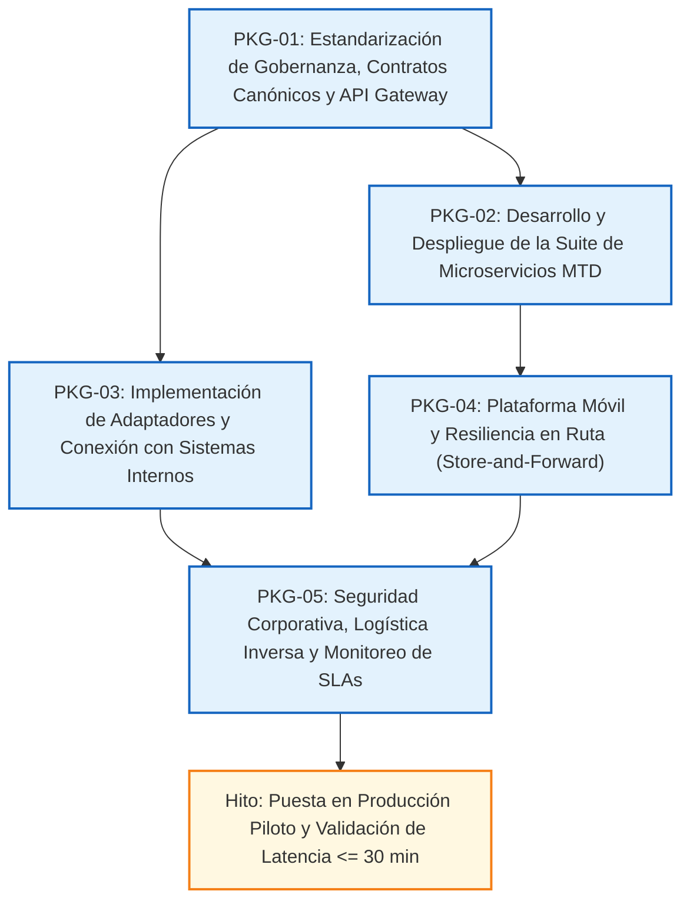

# 6. FASE E: OPORTUNIDADES Y SOLUCIONES
## Consolidación de Brechas, Definición de Paquetes de Trabajo, Evaluación Multicriterio de Alternativas y Selección de la Arquitectura Objetivo para Yanbal Perú (Unique S.A.)

> **Ubicación oficial del documento:** `06_Fase_E_Oportunidades_y_Soluciones/06_Fase_E_Oportunidades_y_Soluciones_Completa.md`  
> **Diagrama asociado (`DIAG-08`):** [`06_Fase_E_Oportunidades_y_Soluciones/diagramas/README_DIAGRAMAS_FASE_E.md`](diagramas/README_DIAGRAMAS_FASE_E.md) | Archivo fuente PlantUML: [`DIAG-08_Arquitectura_Solucion_y_Paquetes_Trabajo.puml`](diagramas/DIAG-08_Arquitectura_Solucion_y_Paquetes_Trabajo.puml)  
> **Marco metodológico:** TOGAF Standard (The Open Group Architecture Framework) — Fase E: Oportunidades y Soluciones (*Opportunities and Solutions*)  
> **Documentos de referencia y gobernanza:** Fase Preliminar, Fase A (Visión de Arquitectura), Fase B (Arquitectura de Negocio), Fase C (Arquitectura de Sistemas de Información), Fase D (Arquitectura Tecnológica), Matriz Maestra de Requerimientos, Catálogo Maestro de Actores y Sistemas, Glosario Canónico y Convenciones de Nomenclatura, y Registro Maestro de Supuestos, Incertidumbres y Decisiones de Arquitectura.  
> **Principio de gobernanza:** Todos los documentos precedentes del repositorio se preservan en modo de lectura como fuentes canónicas de verdad. La Fase E integra de manera exhaustiva las brechas identificadas en los dominios de Negocio, Datos, Aplicaciones y Tecnología, estructurando los paquetes de trabajo de implementación y sustentando la solución arquitectónica seleccionada frente a alternativas descartadas.

---

## Introducción y Objetivos de la Fase E

### 1. Propósito y Alcance Metodológico

La **Fase E de TOGAF ADM (*Opportunities and Solutions*)** representa el puente estratégico entre el diseño conceptual de las arquitecturas de destino (Negocio, Sistemas de Información y Tecnología desarrolladas en las Fases B, C y D) y la planificación práctica de su implementación material (Fase F). Su propósito central consiste en:

1. Evaluar sistemáticamente las oportunidades de mejora derivadas del diagnóstico operativo corporativo.
2. Consolidar el análisis de brechas (*Gap Analysis*) de los cuatro dominios arquitectónicos en una matriz unificada y categorizada.
3. Agrupar las intervenciones necesarias en **Paquetes de Trabajo (*Work Packages*)** lógicos, coherentes y gestionables.
4. Formular y evaluar alternativas de solución técnica frente a criterios rigurosos de alineación estratégica, viabilidad técnica, riesgo y costo total de propiedad (TCO).
5. Seleccionar y fundamentar la arquitectura objetivo definitiva que mejor responda a la problemática central del despacho B2B de Yanbal Perú.
6. Proyectar los beneficios cualitativos y cuantitativos esperados para la compañía, vinculándolos con los objetivos SMART (`OBJ-01` a `OBJ-08`) y los indicadores clave de rendimiento (`KPI-01` a `KPI-08`).

El alcance de la Fase E respeta rigurosamente las fronteras organizacionales y operativas establecidas desde la Fase Preliminar: se circunscribe a la cadena de valor de preparación, despacho y transporte primario B2B desde Lima (Planta y Centro de Distribución de Lurín) hacia distribuidoras y destinos empresariales en los 24 departamentos del territorio peruano (`REQ-RES-001`, `DEC-04`), excluyendo la distribución secundaria capilar hacia consumidoras finales y preservando la regla inviolable de que el ERP `SAP R3` (`SIS-01`) es operado exclusivamente por el Área de Almacén (`ACT-03`, `REQ-RES-002`).

---

## 6.1. Identificación de oportunidades de mejora a partir del diagnóstico

A partir del levantamiento operativo de la cadena logística, los testimonios de los actores clave y el modelado AS-IS desarrollado en las fases precedentes, se identifican oportunidades de transformación estratégica organizadas en cuatro dominios:

```
+----------------------------------------------------------------------------------------------------+
|                         MAPA DE OPORTUNIDADES DE MEJORA ARQUITECTÓNICA                             |
+----------------------------------------------------------------------------------------------------+
|  PROCESOS DE NEGOCIO (FASE B)              |  DATOS E INFORMACIÓN (FASE C)                         |
|  * Reducción de latencia a <= 30 min       |  * Modelo Canónico de 5 Estados Normalizados          |
|  * Eliminación de margen de desconocimiento|  * Sellado Temporal Dual (T0 in situ / T1 central)    |
|  * Protocolo estructurado de retorno       |  * Correlación Lógica (Código UA - Picking - Pedido)  |
|  * Eliminación de doble digitación manual  |  * Registros inmutables con firma de idempotencia    |
|                                            |                                                       |
|--------------------------------------------+-------------------------------------------------------|
|  APLICACIONES E INTEGRACIÓN (FASE C)       |  TECNOLOGÍA E INFRAESTRUCTURA (FASE D)                |
|  * Desacoplamiento mediante Bus SIS-05     |  * API Gateway perimetral con cifrado TLS 1.3         |
|  * Convivencia de 3 sistemas propios y     |  * Resiliencia en ruta mediante Store-and-Forward     |
|    4 de proveedores mediante Adaptadores   |  * Aislamiento físico y lógico de red para SAP R3     |
|  * Suite modular de servicios MTD          |  * Clúster elástico en contenedores autoescalables    |
+----------------------------------------------------------------------------------------------------+
```

### 6.1.1. Oportunidades en Procesos de Negocio
* **Superación del Desfase de Seguimiento:** Transformar la ventana histórica de actualización diferida (documentada testimonial entre ~2 horas y hasta 2 horas) en un flujo cuasi-continuo con latencia máxima permisible de 30 minutos ($\Delta T \le 30\text{ min}$), eliminando la brecha informativa que afecta la coordinación logística y la gestión comercial en los 24 departamentos (`REQ-NEG-002`, `REQ-RNF-001`).
* **Respuesta Oportuna en Canales de Atención:** Dotar a los agentes de Servicio al Cliente (`ACT-08`) de datos actualizados en `CELLFORCE` (`SIS-09`), permitiendo resolver consultas y reclamos en el primer contacto con información fidedigna de ruta y plazo prometido (*lead time* de 24 horas en Lima y hasta 7 días en provincias) (`REQ-NEG-003`, `REQ-FUN-002`).
* **Visibilidad Formal de Logística Inversa:** Reemplazar las comunicaciones telefónicas informales ante incidencias de transporte (daño, robo o dirección errónea) por un circuito estructurado que notifique anticipadamente al Área de Almacén Lurín (`ACT-03`) sobre la carga en retorno para agilizar la recepción física y reposición (`REQ-NEG-004`, `REQ-FUN-005`).
* **Ergonomía y Eficiencia Operativa:** Evitar la reescritura o doble ingreso manual de información en los puntos de transferencia (CD Lurín, básculas y Zona de Despacho), preservando la facilidad de uso alcanzada en los sistemas actuales (`PAE-07`, `REQ-RNF-004`).

### 6.1.2. Oportunidades en Datos e Información
* **Homologación Semántica Canónica:** Establecer un catálogo único e inequívoco de 5 estados del pedido (`Pedido facturado`, `Elaboración o en preparación`, `Pedido despachado`, `Pedido en ruta`, `Pedido entregado`), homologando la heterogeneidad terminológica que emplean los distintos proveedores de transporte (`REQ-FUN-001`, `PAE-03`).
* **Auditoría Temporal Objetiva ($T_0 / T_1$):** Separar técnicamente el momento exacto en que ocurre el hecho físico en ruta ($T_0$) de la hora en que el dato ingresa al sistema corporativo ($T_1$), permitiendo medir con exactitud matemática el desempeño de los transportistas externos (`REQ-ARQ-003`, `OBJ-01`, `KPI-01`).
* **Correlación Multidimensional sin Ruptura:** Mantener la relación lógica trazable entre el `Código UA` de las cajas master mono SKU selladas custodiadas en Lurín, las líneas de preparación ejecutadas en `SPY` (`SIS-02`) y el `Número de Pedido` comercial (`REQ-ARQ-002`, `FCE-04`).
* **Garantía de Calidad e Idempotencia:** Implementar mecanismos de detección de duplicados basados en hashes criptográficos (SHA-256), evitando inconsistencias cuando se transmiten ráfagas de datos en tramos con reconexión celular (`ENT-07`).

### 6.1.3. Oportunidades en Aplicaciones e Integración
* **Interoperabilidad Desacoplada sobre Middleware Corporativo:** Explotar la existencia del `Bus de Integración` (`SIS-05`) mediante patrones asíncronos de publicación y suscripción (Pub/Sub), superando las dependencias punto a punto rígidas (`PAE-01`, `REQ-INT-003`).
* **Preservación del Ecosistema Existente:** Respetar la configuración consolidada de "3 sistemas propios adaptados y 4 sistemas de proveedores" (`REQ-INT-004`), evitando descartar aplicaciones en producción mediante el despliegue de capas adaptadoras anti-corrupción (`ADP-SAP`, `ADP-SPY`, `ADP-LOG`, `ADP-CRM`).
* **Implementación Modular del MTD:** Diseñar el Mecanismo de Trazabilidad del Despacho como una suite de microservicios sin estado orientados a responsabilidades específicas (`MTD-R01` a `MTD-R06`), impidiendo la creación de aplicativos monolíticos redundantes (`REQ-ARQ-001`, `DEC-02`).

### 6.1.4. Oportunidades en Infraestructura y Tecnología
* **Perímetro de Conectividad Seguro (API Management):** Habilitar una puerta de enlace centralizada (*API Gateway*) que estandarice la recepción de datos de transporte bajo protocolos web modernos (REST/JSON) con terminación criptográfica TLS 1.3 y autenticación mutua (mTLS) (`REQ-RNF-003`, `OBJ-07`).
* **Tolerancia a la Geografía Nacional (*Store-and-Forward*):** Dotar a los dispositivos móviles de los socios logísticos de capacidad de persistencia local offline ante pérdidas de cobertura celular en carreteras interprovinciales (`ASM-16`, `RSK-06`).
* **Aislamiento de Cómputo para el ERP:** Proteger la base de datos productiva de `SAP R3` en Lurín contra accesos externos directos, delegando las consultas de solo lectura a réplicas o adaptadores certificados (`REQ-RES-002`).

---

## 6.2. Matriz formal de análisis de brechas consolidada (Gap Analysis B, C y D)

En estricto alineamiento con la técnica de *Gap Analysis* de TOGAF ADM, la siguiente matriz consolida y clasifica todas las brechas identificadas a lo largo de las Fases B (Negocio), C (Datos y Aplicaciones) y D (Tecnología), asignándoles la categoría de acción arquitectónica correspondiente (**Eliminar**, **Crear**, **Modificar** o **Mantener**):

| Código Brecha | Dominio TOGAF | Situación Actual (Línea Base AS-IS) | Situación Objetivo (Arquitectura TO-BE) | Acción TOGAF | Impacto y Complejidad | Requisitos Vinculados |
| :---: | :---: | :--- | :--- | :---: | :---: | :--- |
| **`GAP-01`** | Negocio | Desfase en seguimiento de entregas B2B referido entre ~2 h y hasta 2 h hacia los 24 departamentos. | Actualización de estatus con latencia máxima permisible de hasta 30 minutos ($\Delta T \le 30\text{ min}$). | **Modificar** | **Impacto:** Alto<br>**Complejidad:** Media | `REQ-NEG-001`, `REQ-NEG-002`, `REQ-RNF-001`, `REQ-RES-004` |
| **`GAP-02`** | Negocio / Datos | No existe distinción entre hora del evento ($T_0$) y hora de llegada ($T_1$); línea base no medida. | Estructura canónica de eventos con marcas temporales duales inmutables ($T_0/T_1$) y cálculo de $\Delta T$. | **Crear** | **Impacto:** Alto<br>**Complejidad:** Baja | `REQ-NEG-002`, `REQ-ARQ-003`, `REQ-RNF-001` |
| **`GAP-03`** | Negocio / Datos | Terminología heterogénea entre transportistas; riesgo de saltos de estado desordenados. | Catálogo canónico de 5 estados y motor de validación semántica secuencial en el MTD (`CMP-VAL-03`). | **Crear** | **Impacto:** Medio<br>**Complejidad:** Media | `REQ-FUN-001`, `REQ-INT-004`, `REQ-ARQ-001` |
| **`GAP-04`** | Negocio / Datos | Discontinuidad semántica entre el `Código UA` (almacén) y el `Número de Pedido` (comercial). | Entidad asociativa y componente de correlación lógica (`CMP-COR-02`) para trazabilidad multidimensional. | **Crear** | **Impacto:** Alto<br>**Complejidad:** Media | `REQ-FUN-004`, `REQ-ARQ-002`, `REQ-INT-001`, `REQ-RES-003` |
| **`GAP-05`** | Negocio / Apps | Consultas en `CELLFORCE` (`SIS-09`) con desfase de 2 h; incertidumbre ante reclamos de clientes. | Propagación desacoplada de eventos consolidados hacia el CRM en $\le 30\text{ min}$ vía `SIS-05`. | **Modificar** | **Impacto:** Alto<br>**Complejidad:** Media | `REQ-NEG-003`, `REQ-FUN-002`, `REQ-INT-003` |
| **`GAP-06`** | Negocio / Datos | Falta de visibilidad de recepción por tercero («Persona Autorizada» `ACT-10`, condicionado `ASM-01`). | Captura condicional de documento y nombre de receptor si se ratifica en el alcance B2B empresarial. | **Crear** *(Cond.)*| **Impacto:** Medio<br>**Complejidad:** Baja | `REQ-FUN-003`, `REQ-RES-001`, `ASM-01` |
| **`GAP-07`** | Negocio / Apps | Gestión de incidencias y devoluciones sin notificación estructurada ni trazable a Almacén Lurín. | Canal formal de excepciones (`CMP-NOT-06`) con aviso estructurado a `ACT-03` sin tocar `SAP R3`. | **Crear** | **Impacto:** Medio<br>**Complejidad:** Media | `REQ-NEG-004`, `REQ-FUN-005`, `REQ-RES-002` |
| **`GAP-08`** | Gobernanza | Falta de formalización de interfaces seguras con transportistas y roles de supervisión. | Matriz RBAC estricta y cumplimiento de auditoría exigida por Seguridad Informática (`ACT-11`). | **Modificar** | **Impacto:** Alto<br>**Complejidad:** Media | `REQ-RNF-003`, `REQ-RES-002`, `OBJ-07` |
| **`GAP-TEC-01`**| Tecnología | Inexistencia de un punto centralizado y seguro de ingesta para plataformas de terceros. | Despliegue de API Gateway corporativo en DMZ con soporte TLS 1.3, mTLS y WAF perimetral. | **Crear** | **Impacto:** Alto<br>**Complejidad:** Alta | `REQ-INT-002`, `REQ-RNF-003` |
| **`GAP-TEC-02`**| Tecnología | Procesamiento batch disperso; eventos crudos sin filtro de duplicados. | Microservicio de ingesta (`CMP-ING-01`) con cálculo de hash SHA-256 y control de idempotencia. | **Crear** | **Impacto:** Alto<br>**Complejidad:** Media | `REQ-ARQ-003`, `REQ-RNF-002` |
| **`GAP-TEC-03`**| Tecnología | Inexistencia de un almacén histórico unificado de trazas de eventos del despacho. | Repositorio canónico de eventos (`DB-EVENTSTORE`) con partición Hot (<90d) y Cold Archive (5 años). | **Crear** | **Impacto:** Alto<br>**Complejidad:** Media | `REQ-ARQ-003`, `REQ-RNF-002` |
| **`GAP-TEC-04`**| Tecnología | Pérdida de eventos de reporte ante intermitencia o zonas de sombra celular en carreteras. | Protocolo *Store-and-Forward* en aplicativos móviles de transportistas con buffer local offline cifrado. | **Modificar** | **Impacto:** Alto<br>**Complejidad:** Alta | `REQ-RNF-001`, `ASM-16`, `RSK-06` |
| **`GAP-TEC-05`**| Tecnología | Conexión directa no regulada o dependencias manuales para avisos de logística inversa. | Cola dedicada en el Bus de Integración hacia Lurín sin privilegios de escritura en base de datos. | **Crear** | **Impacto:** Medio<br>**Complejidad:** Baja | `REQ-RES-002`, `REQ-FUN-005` |
| **`GAP-TEC-06`**| Tecnología | Ausencia de monitoreo telemático en tiempo real del cumplimiento del SLA de actualización. | Motor de telemetría (`CMP-AUD-04`) con generación de alertas automáticas ante $\Delta T > 30\text{ min}$. | **Crear** | **Impacto:** Medio<br>**Complejidad:** Media | `REQ-NEG-002`, `REQ-RNF-001`, `OBJ-01` |
| **`GAP-SYS-01`**| Sistemas | Riesgo de duplicar funciones de `SAP R3`, `SPY`, `Maya` o sistemas satélites de transporte. | Preservación de los 10 sistemas del inventario actual mediante capas adaptadoras (`ADP-XX`). | **Mantener** | **Impacto:** Crítico<br>**Complejidad:** Baja | `REQ-ARQ-001`, `REQ-INT-004`, `PAE-02` |

---

## 6.3. Identificación y definición de paquetes de trabajo (*Work Packages*)

Para cerrar las brechas consolidadas de forma ordenada, modular y sin poner en riesgo las operaciones continuas de despacho en Lurín, se formulan **cinco Paquetes de Trabajo canónicos (`PKG-01` a `PKG-05`)**, diseñados para ser ejecutados de forma secuencial y paralela:



### Ficha Técnica de Paquetes de Trabajo

#### 1. `PKG-01: Estandarización de Gobernanza, Contratos Canónicos y API Gateway Corporativo`
* **Propósito:** Construir los cimientos de integración y seguridad perimetral para la ingesta de datos de transporte.
* **Brechas que Mitiga:** `GAP-02`, `GAP-03`, `GAP-08`, `GAP-TEC-01`.
* **Entregables Principales:**
  1. Catálogo formal de contratos de intercambio de datos (`INT-DAT-01` a `INT-DAT-08`) en formato JSON Schema con marcas $T_0/T_1$.
  2. Despliegue y configuración del clúster de API Gateway en la zona DMZ corporativa con terminación TLS 1.3 y reglas WAF.
  3. Políticas de autenticación mutua (mTLS) y emisión de credenciales/tokens para proveedores de transporte (`ACT-07`).
* **Dependencias:** Validación de políticas por Seguridad Informática (`ACT-11`) y aprobación de esquemas por TI (`ACT-12`).

#### 2. `PKG-02: Desarrollo y Despliegue de la Suite de Microservicios MTD`
* **Propósito:** Construir la lógica de procesamiento, correlación y persistencia de eventos del despacho B2B.
* **Brechas que Mitiga:** `GAP-03`, `GAP-04`, `GAP-TEC-02`, `GAP-TEC-03`.
* **Entregables Principales:**
  1. Microservicio de Ingesta y Normalización (`CMP-ING-01`) con algoritmo de firma hash SHA-256 para idempotencia.
  2. Motor de Validación Semántica (`CMP-VAL-03`) que aplica las reglas de transición ordenada de los 5 estados canónicos.
  3. Componente de Correlación Lógica (`CMP-COR-02`) con memoria caché para vincular `Código UA`, picking y `Número de Pedido`.
  4. Repositorio Canónico de Eventos (`DB-EVENTSTORE`) con particionamiento de datos operativos y archivo histórico.
* **Dependencias:** Finalización de especificaciones de contratos en `PKG-01`.

#### 3. `PKG-03: Implementación de Adaptadores y Conexión con Sistemas Internos`
* **Propósito:** Conectar de forma no intrusiva las plataformas de producción, comerciales y de atención sobre el Bus (`SIS-05`).
* **Brechas que Mitiga:** `GAP-04`, `GAP-05`, `GAP-SYS-01`, `GAP-TEC-05`.
* **Entregables Principales:**
  1. Adaptador de Emisión `ADP-SPY` en el CD Lurín para capturar el `Estado 2: Elaboración o en preparación` con marca $T_0$.
  2. Adaptador `ADP-CRM` para sincronizar en tiempo casi real los eventos consolidados hacia `CELLFORCE` (`SIS-09`).
  3. Configuración de tópicos Pub/Sub en el `Bus de Integración` (`SIS-05`) para difusión hacia `ENSDY` (`SIS-07`).
  4. Conector de Consulta `ADP-SAP` (RFC de solo lectura) para resolución de metadatos de cajas mono SKU sin tocar tablas maestras.
* **Dependencias:** Aislamiento estricto de `SAP R3` validado por Almacén Lurín (`ACT-03`, `REQ-RES-002`).

#### 4. `PKG-04: Integración con Socios Logísticos y Resiliencia en Ruta (*Store-and-Forward*)`
* **Propósito:** Integrar a las empresas transportistas externas y garantizar la captura de eventos en los 24 departamentos.
* **Brechas que Mitiga:** `GAP-01`, `GAP-06`, `GAP-TEC-04`.
* **Entregables Principales:**
  1. Adaptador Webhook `ADP-LOG` para recibir eventos emitidos por plataformas satélites (`DRIVING`, `NSDG`).
  2. Librería cliente móvil con módulo *Store-and-Forward* y base de datos local SQLite cifrada para transportistas.
  3. Mecanismo de sincronización en ráfagas que preserva la marca inmutable $T_0$ ante caídas de señal en ruta.
  4. Mecanismo condicional de captura de identidad para «Persona Autorizada» en destino (`ACT-10`, si aplica bajo `ASM-01`).
* **Dependencias:** Acuerdos técnicos con socios logísticos (`ACT-07`) coordinados por Distribución (`ACT-06`).

#### 5. `PKG-05: Seguridad Corporativa, Logística Inversa y Monitoreo de SLAs`
* **Propósito:** Cerrar el ciclo operativo mediante control de contingencias, telemetría y auditoría de tiempos.
* **Brechas que Mitiga:** `GAP-07`, `GAP-08`, `GAP-TEC-05`, `GAP-TEC-06`.
* **Entregables Principales:**
  1. Componente de Gestión de Incidencias (`CMP-NOT-06`) con canal de notificación asíncrona hacia Almacén Lurín.
  2. Motor de Telemetría (`CMP-AUD-04`) para cálculo automatizado de latencia ($\Delta T = T_1 - T_0$) y detección de desvíos ($> 30\text{ min}$).
  3. Tableros de control operativo para el Área de Distribución (`ACT-06`) y reportes de cumplimiento de SLA por transportista.
  4. Informe de pase de Seguridad Informática corporativa (`ACT-11`) certificando cero vulnerabilidades críticas (`OBJ-07`).
* **Dependencias:** Ejecución previa de `PKG-02` y `PKG-03`.

---

## 6.4. Evaluación de alternativas de solución

Para sustentar con rigor la arquitectura objetivo, se formulan y contrastan **tres alternativas conceptuales y tecnológicas**:

```
+----------------------------------------------------------------------------------------------------+
|                         EVALUACIÓN COMPARATIVA DE ALTERNATIVAS DE SOLUCIÓN                         |
+----------------------------------------------------------------------------------------------------+
|                                                                                                    |
|  ALTERNATIVA 1 (SELECCIONADA)              ALTERNATIVA 2 (DESCARTADA)    ALTERNATIVA 3 (DESCARTADA)|
|  Arquitectura de Integración               Desarrollo Monolítico         Adquisición SaaS Cerrado  |
|  Orientada a Eventos y Servicios           Centralizado de Distribución  con GPS Continuo Propiet. |
|                                                                                                    |
|  * Reutiliza sistemas consolidados         * Construye nuevo ERP/WMS     * Impone cajas negras GPS |
|  * Suite MTD desacoplada sobre Bus         * Sustituye SPY y NSDG        * Viola modelo tercerizado|
|  * API Gateway híbrido en DMZ              * Duplica funciones y datos   * Alto costo de hardware  |
|  * Respeta aislamiento de SAP R3           * Alto riesgo de quiebre      * Sin correlación interna |
|  * Tolerancia a fallas Store-and-Forward   * Viola REQ-ARQ-001           * Viola REQ-RES-004       |
+----------------------------------------------------------------------------------------------------+
```

### 1. Descripción de Alternativas

* **Alternativa 1 (Propuesta Seleccionada): Arquitectura de Integración Orientada a Eventos y Servicios (EDA/SOA Híbrida).**  
  Implementa el Mecanismo de Trazabilidad del Despacho (`MTD`) como una suite modular de servicios desacoplados montada sobre el `Bus de Integración` (`SIS-05`) y protegida por un `API Gateway` corporativo. Reutiliza íntegramente las inversiones realizadas en `SAP R3`, `SPY`, `Maya`, `ZapCommerce`, `NSDG`, `ENSDY`, `DRIVING` y `CELLFORCE`, acoplándolos mediante adaptadores ligeros (*Anti-Corruption Layer*). La captura en transporte se basa en eventos operativos discretos transmitidos por los socios logísticos con tolerancia a fallas (*Store-and-Forward*).
* **Alternativa 2 (Alternativa Descartada): Construcción de un Nuevo Sistema Monolítico Centralizado de Distribución.**  
  Propone desarrollar desde cero una aplicación integral web y móvil que reemplace los sistemas satélites (`SPY`, `NSDG`, `DRIVING`) y asuma de manera unificada la gestión de picking, despacho, transporte y seguimiento con una base de datos relacional única y centralizada.
* **Alternativa 3 (Alternativa Descartada): Adquisición de Plataforma SaaS Comercial Cerrada con Telemetría GPS Continua.**  
  Consiste en contratar una solución de mercado en la nube para monitoreo logístico en tiempo real, exigiendo la instalación de dispositivos telemáticos GPS propietarios en la flota vehicular de todos los transportistas y conectando dicha plataforma directamente con los canales de atención mediante conectores predefinidos por el proveedor.

### 2. Matriz de Evaluación Multicriterio Ponderada

Se evalúan las alternativas asignando puntuaciones en una escala de 1 a 5 (donde 1 = Muy deficiente / No cumple, y 5 = Excelente / Cumplimiento óptimo), aplicando factores de ponderación según la criticidad para los objetivos estratégicos:

| Criterio de Evaluación Arquitectónica | Peso | Alternativa 1: Integración EDA/SOA Híbrida (MTD) | Alternativa 2: Monolito Centralizado Nuevo | Alternativa 3: Plataforma SaaS Comercial GPS |
| :--- | :---: | :---: | :---: | :---: |
| **Alineación con Objetivos SMART y Latencia $\le 30\text{ min}$** | 20% | **4.8** (0.96) — Procesamiento asíncrono y marcas $T_0/T_1$. | **3.0** (0.60) — Cuellos de botella en base centralizada. | **3.5** (0.70) — Dependiente de conectividad satelital/celular continua. |
| **Respeto a Restricciones Vinculantes (`REQ-RES-001` a `004`)** | 25% | **5.0** (1.25) — Cumple frontera B2B, aísla SAP y respeta flota externa. | **2.0** (0.50) — Tiende a invadir inventarios y requiere acceso total a SAP. | **1.0** (0.25) — **Inviable:** Exige flota vehicular propia con GPS (`REQ-RES-004`). |
| **Preservación de Inversiones y Facilidad de Uso (`PAE-02`, `REQ-RNF-004`)** | 15% | **4.7** (0.71) — Preserva los 10 sistemas existentes y evita doble digitación. | **1.5** (0.23) — Descarta desarrollos consolidados (`SPY`, `NSDG`). | **2.5** (0.38) — Obliga a operadores a usar interfaces propietarias externas. |
| **Tiempo de Implementación y Complejidad de Migración** | 15% | **4.2** (0.63) — Despliegue modular por paquetes sin suspender operaciones. | **1.5** (0.23) — Migración masiva riesgosa (big bang) de más de 18 meses. | **3.0** (0.45) — Instalación física compleja de hardware en cientos de camiones. |
| **Riesgo Operativo y Continuidad del Negocio (`RSK-01` a `06`)** | 15% | **4.5** (0.68) — Desacoplamiento estricto; fallas aisladas no frenan Lurín. | **1.5** (0.23) — Riesgo crítico de paralización de planta y despacho nacional. | **2.0** (0.30) — Rechazo operativo de transportistas a hardware obligatorio. |
| **Costo Total de Propiedad (TCO Preliminar: CapEx y OpEx)** | 10% | **4.5** (0.45) — Aprovecha Bus licenciado y cómputo elástico por demanda. | **2.0** (0.20) — Inversión multimillonaria en desarrollo y licenciamiento. | **2.0** (0.20) — Tarifas recurrentes elevadas por vehículo y costos de hardware. |
| **PUNTUACIÓN TOTAL PONDERADA (1.0 a 5.0)** | **100%** | **4.68 / 5.00** | **1.975 / 5.00** | **2.28 / 5.00** |
| **DICTAMEN ARQUITECTÓNICO** | — | **SELECCIONADA** | **DESCARTADA** | **DESCARTADA** |

### 3. Sustentación de Descartes

* **Descarte de la Alternativa 2 (Monolito Centralizado):**  
  Construir un aplicativo único contradice flagrantemente el principio de arquitectura `PAE-02` (reutilización tecnológica) y el requerimiento `REQ-ARQ-001` (no duplicación funcional). Yanbal ya cuenta con sistemas altamente especializados y adaptados a su operativa (como `SPY` en empaque y `SAP R3` en inventarios). Sustituirlos generaría un riesgo inaceptable de paralización en el Centro de Distribución de Lurín y exigiría alterar la regla de operación exclusiva de Almacén (`REQ-RES-002`).
* **Descarte de la Alternativa 3 (SaaS Comercial con GPS Continuo):**  
  Esta opción es técnicamente inviable en el marco del proyecto porque colisiona frontalmente con la restricción obligatoria `REQ-RES-004` y el supuesto confirmado `ASM-05`: Yanbal Perú no posee flota propia de transporte, sino que contrata a proveedores logísticos asociados (`ACT-07`). Imponer la instalación de hardware GPS y telemetría continua sobre camiones de terceros generaría resistencia contractual, sobrecostos insostenibles y no resolvería el problema de fondo, el cual reside en la integración y correlación interna entre las cajas master de almacén y las órdenes de despacho (`REQ-ARQ-002`).

---

## 6.5. Solución arquitectónica seleccionada

La solución seleccionada corresponde a la **Arquitectura de Integración Orientada a Eventos y Servicios (Alternativa 1)**, estructurada en torno a la capacidad lógica del **Mecanismo de Trazabilidad del Despacho (`MTD`)**:

```
+----------------------------------------------------------------------------------------------------+
|                         ARQUITECTURA DE SOLUCIÓN SELECCIONADA (EDA / SOA)                          |
+----------------------------------------------------------------------------------------------------+
|                                                                                                    |
|  [FUENTES DE EVENTOS]                                                                              |
|  * Preparación: SPY SIS-02 (CD Lurín) -------------> Evento Estado 2 (T0)                          |
|  * Zonificación: Terminal Despacho ACT-05 ---------> Evento Estado 3 (T0)                          |
|  * Transporte: App Móvil / TMS Socios ACT-07 ------> Eventos Estado 4 y 5 (T0 in situ)             |
|                                                              |                                     |
|                                                              v HTTPS / TLS 1.3 / mTLS              |
|  [PERÍMETRO SEGURO]                                  [ API GATEWAY CORPORATIVO ]                   |
|                                                              |                                     |
|                                                              v Enrutamiento Interno                |
|  [NÚCLEO MTD: SERVICIOS MODULARES]                   [ CLÚSTER DE MICROSERVICIOS MTD ]             |
|  * CMP-ING-01: Ingesta e Idempotencia (SHA-256)      * CMP-AUD-04: Auditoría Temporal (T0, T1)     |
|  * CMP-VAL-03: Validador de Secuencia Canónica       * CMP-PUB-05: Despachador de Publicación      |
|  * CMP-COR-02: Correlación Lógica (UA-Picking-Pedido)* CMP-NOT-06: Gestión Retorno Almacén         |
|         |                                                    |                                     |
|         v Persistencia Canónica                              v Publicación Desacoplada             |
|  [ (DB) EVENT STORE CANÓNICO ENT-07 ]                [ BUS DE INTEGRACIÓN SIS-05 ]                 |
|                                                              |                                     |
|                                       +----------------------+----------------------+              |
|                                       |                      |                      |              |
|                                       v                      v                      v              |
|  [CONSUMIDORES DE INFORMACIÓN] [ENSDY SIS-07]        [CELLFORCE SIS-09]     [ALMACÉN LURÍN]        |
|                                Portal Seguimiento    CRM Atención ACT-08    Notificación Retorno   |
|                                (Delta T <= 30 min)   (Delta T <= 30 min)    (Sin tocar SAP R3)     |
+----------------------------------------------------------------------------------------------------+
```

### 1. Pilares Fundamentales de la Solución
1. **Desacoplamiento Estricto por Eventos (EDA):** Ningún sistema emisor se comunica de forma sincrónica bloqueante con los sistemas receptores. Los cambios de estado son capturados como eventos inmutables en el instante en que ocurren físicamente ($T_0$) y se propagan mediante colas y tópicos en el Bus de Integración (`SIS-05`), garantizando que la plataforma soporte picos de campaña sin degradar la respuesta operativa (`REQ-RNF-002`).
2. **Respeto a la Frontera de Almacén (`REQ-RES-002`):** El MTD no interactúa directamente con la base de datos de `SAP R3`. En los casos de logística inversa (`REQ-FUN-005`), el componente `CMP-NOT-06` deposita una notificación de alerta en el Bus; el personal de Almacén Lurín (`ACT-03`) inspecciona físicamente el bulto devuelto e ingresa soberanamente la transacción de ajuste de stock según sus protocolos corporativos vigentes.
3. **Resiliencia ante la Geografía Nacional (*Store-and-Forward* — `ASM-16`, `RSK-06`):** Para las rutas terrestres y bimodales interprovinciales hacia la sierra y selva (con *lead times* de hasta 7 días), los eventos se capturan y firman localmente en el dispositivo móvil del transportista. Al ingresar a una zona con cobertura celular, la carga se transmite en ráfaga; el motor `CMP-VAL-03` reordena los estados respetando la marca histórica $T_0$, evitando anomalías de secuencia.

### 2. Mapeo Estratégico hacia Objetivos SMART y Factores Críticos de Éxito

| Objetivo SMART (`2.3`) | Factor Crítico Asociado (`2.4`) | Cómo lo Resuelve la Solución Seleccionada |
| :--- | :--- | :--- |
| **`OBJ-01`: Línea base empírica de latencia** | `FCE-02`, `FCE-06` | El componente `CMP-AUD-04` instrumenta el sellado dual ($T_0, T_1$), permitiendo muestrear y medir la latencia real $\Delta T$ en producción. |
| **`OBJ-02`: Desfase de actualización $\le 30\text{ min}$** | `FCE-01`, `FCE-02` | Ingesta asíncrona vía API Gateway y procesamiento en memoria de eventos de transporte sin colas batch intermedias. |
| **`OBJ-03`: Trazabilidad secuencial de 5 estados** | `FCE-04`, `FCE-05` | Motor de reglas `CMP-VAL-03` que homologa códigos externos y bloquea transiciones fuera de orden. |
| **`OBJ-04`: Interoperabilidad sin duplicidad** | `FCE-02`, `FCE-06` | Capa adaptadora `ADP-XX` que conecta los 3 sistemas internos y 4 de proveedores sobre el Bus `SIS-05` sin duplicar software. |
| **`OBJ-05`: Visibilidad oportuna para Servicio al Cliente**| `FCE-02`, `FCE-05` | Tópico Pub/Sub de estados consolidados conectado directamente al adaptador `ADP-CRM` de `CELLFORCE` (`SIS-09`). |
| **`OBJ-06`: Trazabilidad de retornos y logística inversa**| `FCE-01`, `FCE-03` | Componente `CMP-NOT-06` que captura causales de entrega fallida y emite aviso formal a Almacén Lurín sin tocar `SAP R3`. |
| **`OBJ-07`: Validación de Seguridad Informática** | `FCE-03` | Perímetro DMZ con API Gateway, cifrado TLS 1.3, autenticación mTLS/JWT y segregación de accesos por roles (RBAC). |
| **`OBJ-08`: Capacidad ante volumen nacional** | `FCE-02`, `FCE-06` | Clúster de contenedores autoescalable y repositorio de eventos desacoplado optimizado para alta concurrencia. |

---

## 6.6. Beneficios esperados para Yanbal Perú

La implementación de la arquitectura seleccionada genera impactos positivos medibles en la cadena de valor de Unique S.A. / Yanbal Perú, distribuidos en beneficios cualitativos y cuantitativos:

### 6.6.1. Beneficios Cualitativos

1. **Eliminación del «Margen de Desconocimiento»:**  
   El Área de Distribución (`ACT-06`) y los operadores logísticos adquieren visibilidad continua sobre la carga en tránsito en los 24 departamentos, conociendo si un pedido se encuentra en empaque, despachado, en viaje o entregado, sin vacíos informativos de horas.
2. **Confianza Comercial y Fidelización de Destinatarios:**  
   Las distribuidoras y destinatarios empresariales (`ACT-09`) obtienen certidumbre sobre la recepción de sus pedidos cosméticos y de cuidado personal, fortaleciendo el modelo de desarrollo empresarial independiente de Yanbal.
3. **Resolución en Primer Contacto en Servicio al Cliente:**  
   Los agentes de `CELLFORCE` (`ACT-08`) disponen de la traza de eventos actualizada, eliminando la necesidad de realizar llamadas telefónicas de coordinación a los transportistas para averiguar el paradero de un pedido reclamado.
4. **Protección Patrimonial y Seguridad Operativa:**  
   Las incidencias en ruta (siniestros, hurtos o paquetes deteriorados) se formalizan en minutos, permitiendo activar pólizas de seguro, coordinar peritajes y programar preparaciones de reemplazo de forma oportuna.
5. **Gobernanza y Preservación de la Paz Laboral Operativa:**  
   Se respeta rigurosamente el territorio funcional del Área de Almacén (`ACT-03`) al no alterar la soberanía sobre `SAP R3`, previniendo conflictos de gobierno o desajustes contables en los inventarios corporativos.

### 6.6.2. Beneficios Cuantitativos y Métricas de Impacto

La siguiente tabla resume los impactos medibles que proyecta la arquitectura objetivo frente a los indicadores clave de rendimiento (`KPI-01` a `KPI-08`) y la Matriz Maestra de Requerimientos:

| Indicador Clave (`2.5`) | Métrica y Fórmula | Línea Base Actual (AS-IS) | Meta Proyectada con la Solución (TO-BE) | Beneficio Cuantitativo Directo | Requisito Satisfecho |
| :--- | :--- | :---: | :---: | :--- | :---: |
| **`KPI-01`: Latencia Promedio de Actualización** | $\Delta T = \frac{1}{N}\sum (T_{1,i} - T_{0,i})$ | Desfase testimonial de ~2 horas | **$\le 30\text{ minutos}$** *(Meta del caso)* | Reducción de más del **75% en el tiempo de desfase** informativo. | `REQ-NEG-002`, `REQ-RNF-001` |
| **`KPI-02`: Tasa de Cumplimiento de Ventana $\le 30\text{ min}$** | $\% = \frac{N(\Delta T \le 30)}{N_{total}} \times 100$ | No disponible (pendiente medición) | **$\ge 98\%$** *(Propuesta de diseño)* | Certidumbre estadística en el seguimiento nacional de pedidos. | `REQ-RNF-001`, `DEC-05` |
| **`KPI-03`: Tasa de Integridad de Secuencia de Estados** | $\% = \frac{N_{sec\_valida}}{N_{total}} \times 100$ | Inconsistencias periódicas por reintentos | **$100\%$ de eventos en orden cronológico** | Eliminación absoluta de saltos de estado erróneos en el seguimiento. | `REQ-FUN-001`, `REQ-ARQ-003` |
| **`KPI-04`: Cobertura de Estandarización de Interfaces** | $\% = \frac{N_{int\_canonica}}{N_{total\_int}} \times 100$ | Conexiones heterogéneas dispersas | **$100\%$ sobre contratos canónicos** | Desacoplamiento total; cero interfaces punto a punto propietarias. | `REQ-INT-003`, `REQ-ARQ-001` |
| **`KPI-05`: Oportunidad de Disponibilidad en CRM** | $\% = \frac{N_{CRM}(\Delta T \le 30)}{N_{total}} \times 100$ | Desfase de hasta 2 h en atención | **$\ge 98\%$ de consultas con datos frescos** | Reducción del tiempo medio de atención (TMA) en reclamos. | `REQ-NEG-003`, `REQ-FUN-002` |
| **`KPI-06`: Cobertura de Trazabilidad en Retornos** | $\% = \frac{N_{ret\_notif}}{N_{incidencias}} \times 100$ | Avisos manuales informales | **$100\%$ de incidencias formalizadas** | Notificación estructurada inmediata hacia Almacén Lurín (`ACT-03`). | `REQ-NEG-004`, `REQ-FUN-005` |
| **`KPI-07`: Índice de Conformidad en Seguridad** | $\% = \frac{N_{controles\_aprob}}{N_{total\_controles}} \times 100$ | Interfaces sin estándar homogéneo | **$100\%$ aprobado por Seguridad (`ACT-11`)** | Cero vulnerabilidades críticas/altas; cumplimiento Ley 29733. | `REQ-RNF-003`, `OBJ-07` |
| **`KPI-08`: Procesamiento Oportuno bajo Carga Nacional** | $\% = \frac{N_{exito\_pico}}{N_{eventos\_pico}} \times 100$ | Riesgo de lentitud en cierres de campaña | **$\ge 99.9\%$ sin degradación de latencia** | Soporte elástico ante picos estacionales de ventas en los 24 dptos. | `REQ-RNF-002`, `PAE-06` |

---

## Referencias Bibliográficas (Norma APA 7.ª Edición)

* Drivin. (s. f.). *Yanbal Perú: 100% de visibilidad para su logística*. Recuperado de https://driv.in/casos-de-exito/yanbal-peru
* Institute of Electrical and Electronics Engineers. (2018). *ISO/IEC/IEEE 29148:2018 Systems and software engineering — Life cycle processes — Requirements engineering*. IEEE Standards Association. https://standards.ieee.org/ieee/29148/7212/
* Object Management Group. (2017). *OMG Unified Modeling Language (OMG UML) Specification, Version 2.5.1*. Object Management Group. https://www.omg.org/spec/UML/2.5.1/
* The Open Group. (2018). *The TOGAF® Standard, Version 9.2*. Van Haren Publishing. https://www.opengroup.org/togaf
* The Open Group. (2022). *The TOGAF® Standard, 10th Edition — Architecture Development Method (ADM)*. Van Haren Publishing. https://www.opengroup.org/togaf-standard-10th-edition
* Unique S.A. / Yanbal Perú. (s. f.-a). *Nuestra Historia corporativa*. Portal oficial de Yanbal Perú. Recuperado de https://www.yanbal.com/pe/corporate/nuestra-historia
* Unique S.A. / Yanbal Perú. (s. f.-b). *Instalaciones y Canales de Contacto Oficiales*. Portal corporativo de Yanbal Perú. Recuperado de https://www.yanbal.com/pe/corporate/contactanos

