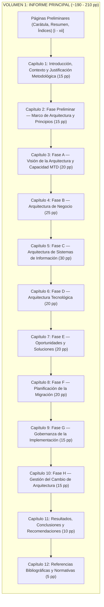
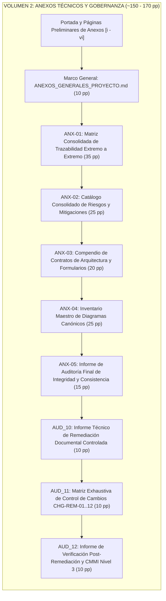

# ARQUITECTURA EDITORIAL Y PLAN DE MAQUETACIÓN EN MICROSOFT WORD (VERSIÓN NORMALIZADA)
## Proyecto de Arquitectura Empresarial — Yanbal Perú (Unique S.A.)
### Organización Bivolumen, Criterios de Distribución, Jerarquía Tipográfica y Paginación Estimada

---

## 1. Justificación Metodológica de la Arquitectura Bivolumen

El presente documento constituye el entregable **REV_06: Estructura Final del Documento Word y Plan de Maquetación**, normalizado conforme al criterio editorial prioritario de simplificación estructural, preferencia por dos niveles de numeración formal (`X.Y.`) y separación rigurosa entre el cuerpo argumental de arquitectura y el soporte documental exhaustivo.

### 1.1. Criterios de Selección Editorial: Alternativa Bivolumen (Aprobada)

Se evaluó la estructura documental óptima para la presentación formal ante el jurado evaluador y directivos corporativos, comparando un modelo monolítico frente a la arquitectura bivolumen:

| Criterio de Evaluación | Alternativa Monolítica (Tomo Único, ~380–420 pp) | Alternativa Bivolumen (Principal + Anexos, Aprobada) | Fundamentación de la Decisión Editorial |
| :--- | :--- | :--- | :--- |
| **Experiencia de Lectura y Evaluación** | El evaluador se ve obligado a interrumpir la lectura del marco arquitectónico para revisar matrices extensas de 20 a 35 páginas, perdiendo el hilo conceptual. | Permite mantener abierto el **Volumen 1 (Informe Principal)** para seguir la narrativa arquitectónica, mientras se consulta en paralelo el **Volumen 2 (Anexos Técnicos)**. | **Aprobada.** Maximiza la legibilidad, fluidez conceptual y defensa del proyecto. |
| **Mantenibilidad y Modularidad Documental** | Cualquier corrección en una fila de requerimientos o riesgos altera la paginación global y desajusta los índices de tablas y figuras de todo el informe. | Los anexos técnicos se gestionan de forma autónoma con paginación independiente, sin desfasar los capítulos analíticos del cuerpo principal. | **Aprobada.** Sigue las recomendaciones de gestión documental de TOGAF ADM. |
| **Rendimiento de Edición y Compilación** | Documentos con más de 400 páginas con múltiples tablas complejas y gráficos de alta resolución ralentizan el renderizado en Microsoft Word. | Dos volúmenes independientes ($\le 210$ pp y $\le 170$ pp) aseguran estabilidad operativa, desplazamiento ágil y exportación eficiente a PDF. | **Aprobada.** Garantiza estabilidad operativa sin riesgos de bloqueo en edición. |
| **Presentación y Encuadernación Física** | Un volumen único de más de 400 páginas resulta pesado e incómodo para manipulación física y encuadernación de grado académico. | Dos tomos equilibrados (~200 pp y ~160 pp) ofrecen un estándar editorial profesional, sobrio y acorde a los cánones de sustentación universitaria. | **Aprobada.** Estándar editorial universitario de alta calidad. |

### 1.2. Criterios de Asignación de Contenidos entre Volúmenes

Para garantizar una frontera clara y sin duplicaciones entre ambos volúmenes, se establecen los siguientes criterios innegociables de distribución:

- **Contenido del Volumen 1 (Informe Principal, ~190–210 pp):**
  - Desarrollo narrativo, conceptual y metodológico de cada fase del ciclo TOGAF ADM (Fase Preliminar a Fase H).
  - Justificación de decisiones arquitectónicas (`DEC-01` a `DEC-07`, `DEC-DOC-01`) y supuestos maestros (`ASM-01` a `ASM-16`).
  - Modelos visuales canónicos completos (`DIAG-01` a `DIAG-11`) insertados con su ficha analítica de correspondencia.
  - Tablas resumen, matrices de brechas consolidadas, síntesis de riesgos y cuadros ejecutivos de presupuesto y transición.
  - Conclusiones, evaluación de cumplimiento de objetivos estratégicos (`OBJ-01` a `OBJ-08`) y recomendaciones.
- **Contenido del Volumen 2 (Anexos Técnicos y Gobernanza, ~150–170 pp):**
  - Matrices exhaustivas de granularidad fina (e.g., Matriz de Trazabilidad Extremo a Extremo de los 24 Requerimientos en `ANX-01`).
  - Catálogo tabular detallado de los 14 Riesgos canónicos con matrices de probabilidad e impacto completas (`ANX-02`).
  - Plantillas completas de Contratos de Arquitectura (`AC-PKG-01` a `AC-PKG-05`), formatos de dispensa (`WVR`) y control de cambios (`RFC`) en `ANX-03`.
  - Catálogo formal de especificaciones de diagramas (`ANX-04`).
  - Informes de auditoría metodológica, verificación técnica, remediación y dictámenes de calidad (`ANX-05`, `AUD_10`, `AUD_11`, `AUD_12`).
- **Regla de Citas Cruzadas Inter-Volumen:**
  - El Volumen 1 no debe reproducir tablas de más de dos páginas de extensión. En su lugar, presentará un cuadro de síntesis y remitirá formalmente al Volumen 2 mediante la sintaxis: *(véase detalle exhaustivo en Volumen 2: Anexos Técnicos, Anexo ANX-XX, Apartado Y.Z, pág. N)*.

---

## 2. Estructura y Paginación Proyectada del Volumen 1: Informe Principal

El **Volumen 1** organiza el cuerpo de la arquitectura empresarial en 12 capítulos, aplicando rigurosamente la regla editorial de **dos niveles de numeración formal (`X.Y.`)**. Los desgloses temáticos internos se formatean como subtítulos en negrita sin numerar.

### 2.1. Desglose Estructurado por Capítulo y Distribución de Figuras — Volumen 1

| Capítulo | Denominación Oficial | Apartados Formales (Nivel 2: `X.Y.`) y Subtemas Clave | Figuras Oficiales Integradas | Paginación Estimada |
| :--- | :--- | :--- | :--- | :---: |
| **Preliminares** | Páginas Iniciales | - Portada institucional y carátula formal - Resumen ejecutivo (*Abstract* en español e inglés) - Índice de Contenido, Índice de Tablas, Índice de Figuras | — | Págs. i – xii (12 pp) |
| **Capítulo 1** | **Introducción, Contexto y Justificación Metodológica** | **1.1. Contexto Empresarial y Operativo de Yanbal Perú** (Venta directa multinivel, 24 departamentos, planta Lurín) **1.2. Planteamiento del Problema en Despacho B2B** (Falta de visibilidad, latencia de 120 min, impacto consultoras) **1.3. Justificación y Objetivos Estratégicos del Proyecto** (Alineación con OBJ-01 a OBJ-08) **1.4. Marco Metodológico y Normativo** (TOGAF ADM 10.ª Edición, ISO/IEC/IEEE 29148, OMG UML 2.5.1, ISO 31000) | — | Págs. 1 – 15 (15 pp) |
| **Capítulo 2** | **Fase Preliminar: Marco de Arquitectura y Principios** | **2.1. Alcance Organizacional y Límites del Esfuerzo de Arquitectura** (Lurín, operadores terceros, frontera B2B) **2.2. Principios de Arquitectura Empresarial** (PRN-01 a PRN-06 con nombre, declaración, justificación e implicancias) **2.3. Marco de Gobernanza Preliminar y Requerimientos de Alto Nivel** (Estructura de gobierno, directrices de cumplimiento) | — | Págs. 16 – 30 (15 pp) |
| **Capítulo 3** | **Fase A: Visión de la Arquitectura y Capacidad MTD** | **3.1. Evaluación de Partes Interesadas y Preocupaciones Clave** (Matriz RACI y expectativas de actores ACT-01 a ACT-08) **3.2. Diagnóstico del Problema de Trazabilidad y Cadena de Valor** (Análisis de cuellos de botella en CD Lurín y transporte) **3.3. Visión de la Capacidad MTD y Cadena de Valor Futura** (Capacidad de monitoreo desacoplada basada en eventos) **3.4. Evaluación de Riesgos Iniciales y Objetivos del Negocio** (Matriz inicial de riesgos y mapeo con OBJ-01..08) | **Figura 3.1.** Cadena de Valor y Visión Conceptual de la Capacidad MTD (`DIAG-01`) | Págs. 31 – 50 (20 pp) |
| **Capítulo 4** | **Fase B: Arquitectura de Negocio** | **4.1. Modelo de Casos de Uso del Negocio** (CUN-01 a CUN-06, actores directos y frontera de negocio B2B) **4.2. Proceso Operativo Actual AS-IS** (Flujo de actividades, carriles de actores, quiebres de información y desfase) **4.3. Proceso Operativo Objetivo TO-BE** (Flujo con marcas T0/T1, captura de eventos, buffer offline Store-and-Forward) **4.4. Comparativa de Rendimiento Operativo y Brechas de Negocio** (Reducción de latencia de 120 a $\le 30$ min, brechas GAP) | **Figura 4.1.** Modelo UML de Casos de Uso del Negocio B2B (`DIAG-02`) **Figura 4.2.** Flujo Operativo de Despacho Actual AS-IS (`DIAG-03`) **Figura 4.3.** Flujo Operativo de Despacho Objetivo TO-BE (`DIAG-04`) | Págs. 51 – 75 (25 pp) |
| **Capítulo 5** | **Fase C: Arquitectura de Sistemas de Información** | **5.1. Arquitectura de Datos y Entidades Canónicas** (ENT-01 a ENT-10, esquema unificado JSON, catálogo lógico) **5.2. Arquitectura de Aplicaciones y Microservicios MTD** (CMP-ING-01 a CMP-NOT-06, adaptadores ADP-SAP..CRM) **5.3. Interacción Dinámica y Cronológica** (Secuencia AS-IS con latencia acumulada vs. Secuencia TO-BE reactiva) | **Figura 5.1.** Secuencia de Consulta y Latencia AS-IS (`DIAG-05`) **Figura 5.2.** Secuencia de Notificación Reactiva TO-BE (`DIAG-06`) | Págs. 76 – 105 (30 pp) |
| **Capítulo 6** | **Fase D: Arquitectura Tecnológica** | **6.1. Principios de Infraestructura y Topología Híbrida** (Aislamiento on-premise Lurín y nube corporativa) **6.2. Especificación de Despliegue Físico y Nodos** (Nodos CD Lurín, DMZ perimetral, Bus SIS-05, clientes móviles) **6.3. Dimensionamiento, Seguridad Perimetral y Disponibilidad** (Cifrado TLS 1.3, autenticación mTLS, alta disponibilidad) | **Figura 6.1.** Topología de Despliegue Tecnológico Híbrido (`DIAG-07`) | Págs. 106 – 125 (20 pp) |
| **Capítulo 7** | **Fase E: Oportunidades y Soluciones** | **7.1. Consolidación de Brechas de Arquitectura** (Matriz canónica de GAP-01 a GAP-08 clasificados por dominio) **7.2. Definición Canónica de Paquetes de Trabajo** (PKG-01 Datos, PKG-02 Core MTD, PKG-03 Adaptadores, PKG-04 Transportistas, PKG-05 Telemetría) **7.3. Arquitectura de Solución Integrada y Mapeo Modular** (Estructura de componentes y dependencias en paquetes) | **Figura 7.1.** Arquitectura de Solución y Paquetes de Trabajo (`DIAG-08`) | Págs. 126 – 145 (20 pp) |
| **Capítulo 8** | **Fase F: Planificación de la Migración** | **8.1. Estrategia de Transición y Arquitecturas Intermedias** (Línea base AS-IS, AT-1 en S1-S12, AT-2 en S11-S18, TO-BE en S19-S24) **8.2. Hoja de Ruta de Implementación e Interdependencias** (Cronograma relativo de 24 semanas y 3 Quality Gates) **8.3. Matriz de Priorización Multicriterio, Recursos y Presupuesto** (Estimación presupuestal, perfiles requeridos) **8.4. Plan de Gestión de Riesgos de Implementación y Gobernanza del Cambio** (Monitoreo de riesgos y mitigaciones de despliegue) | **Figura 8.1.** Roadmap Estratégico y Máquina de Estados de Transición (`DIAG-09`) | Págs. 146 – 165 (20 pp) |
| **Capítulo 9** | **Fase G: Gobernanza de la Implementación** | **9.1. Marco Organizacional y Órganos de Gobernanza de Arquitectura** (Composición, roles y mandato del Architecture Board) **9.2. Ciclo de Puertas de Calidad y Criterios de Aceptación** (Gate 1 en S12, Gate 2 en S18, Gate 3 en S24) **9.3. Contratos de Arquitectura y Gestión de Desviaciones** (Contratos AC-PKG-01 a 05, procedimiento de dispensas WVR) | **Figura 9.1.** Flujo de Gobernanza, Puertas de Calidad y Dispensas (`DIAG-10`) | Págs. 166 – 180 (15 pp) |
| **Capítulo 10** | **Fase H: Gestión del Cambio de Arquitectura** | **10.1. Monitoreo Continuo del Desempeño y Detección de Desvíos** (Telemetría con CMP-AUD-04 y auditoría de lecturas SAP R3) **10.2. Taxonomía de Cambios y Umbrales Operativos** (RFC Tipo 1 Operativo ITIL, Tipo 2 Mayor ADM E-F-G, Tipo 3 Estratégico Fase A) **10.3. Ciclo de Vida del Cambio y Gobernanza Post-Implementación** (Procedimiento de gestión y actualización de repositorios) | **Figura 10.1.** Ciclo de Vida y Gestión del Cambio de Arquitectura (`DIAG-11`) | Págs. 181 – 195 (15 pp) |
| **Capítulo 11** | **Resultados, Conclusiones y Recomendaciones** | **11.1. Evaluación del Cumplimiento de Objetivos del Negocio** (Verificación meta de latencia $\le 30$ min y cobertura 24 departamentos) **11.2. Conclusiones Metodológicas y Arquitectónicas** (Síntesis de valor aportado por TOGAF ADM e integración por eventos) **11.3. Recomendaciones para la Operación Futura y Sostenibilidad** (Plan de evolución, observabilidad continua y capacitación) | — | Págs. 196 – 205 (10 pp) |
| **Capítulo 12** | **Referencias Bibliográficas y Normativas** | Normas The Open Group (TOGAF 10th Ed.), ISO/IEC/IEEE 29148, ISO 31000, OMG UML 2.5.1, literatura técnica y fuentes corporativas. | — | Págs. 206 – 210 (5 pp) |
| **TOTAL VOLUMEN 1** | — | — | **11 Figuras Canónicas** | **~210 páginas** |

---

## 3. Estructura y Paginación Proyectada del Volumen 2: Anexos Técnicos

El **Volumen 2** reúne la documentación complementaria, matrices exhaustivas, contratos e informes de auditoría del repositorio, manteniendo intacta la nomenclatura canónica:

### 3.1. Desglose Estructurado por Anexo Técnico — Volumen 2

| Código | Denominación Oficial del Anexo | Archivo Fuente en Repositorio (`10_Anexos_Tecnicos/`) | Contenido Clave y Nomenclatura Canónica | Paginación Estimada |
| :---: | :--- | :--- | :--- | :---: |
| **Preliminares** | Portada e Índice de Anexos | Presentación de anexos técnicos | Portada formal de volumen, índice general de anexos técnicos, tablas e índices | Págs. i – vi (6 pp) |
| **Marco General** | **Estructura y Gobernanza de Anexos** | `ANEXOS_GENERALES_PROYECTO.md` | Estructura del repositorio, matriz RACI global, ciclo de Quality Gates, normas de citación APA | Págs. 1 – 10 (10 pp) |
| **`ANX-01`** | **Matriz Consolidada de Trazabilidad Extremo a Extremo** | `ANX-01_Matriz_Consolidada_Trazabilidad_Extremo_a_Extremo.md` | Trazabilidad del 100% de los 24 Requerimientos Canónicos (`REQ-NEG`, `FUN`, `INT`, `RNF`, `ARQ`, `RES`) hacia componentes, fases, pruebas y contratos | Págs. 11 – 45 (35 pp) |
| **`ANX-02`** | **Catálogo Consolidado de Riesgos de Transformación** | `ANX-02_Catalogo_Consolidado_Riesgos_y_Mitigaciones.md` | Matriz detallada de los 14 Riesgos canónicos (`RSK-01` a `RSK-14`), mapa de calor $5 \times 5$, probabilidad, impacto y planes de mitigación ISO 31000 | Págs. 46 – 70 (25 pp) |
| **`ANX-03`** | **Compendio de Contratos de Arquitectura y Formularios** | `ANX-03_Compendio_Contratos_Arquitectura_y_Formularios.md` | Contratos completos `AC-PKG-01` a `AC-PKG-05`, métricas SLA, formularios de dispensa (`WVR`) y control de cambios (`RFC`) | Págs. 71 – 90 (20 pp) |
| **`ANX-04`** | **Inventario Maestro de Diagramas Canónicos** | `ANX-04_Inventario_Maestro_Diagramas_Canonicos.md` | Fichas técnicas formales de los once diagramas canónicos (`DIAG-01` a `DIAG-11`), clasificaciones UML 2.5.1 y trazabilidad documental | Págs. 91 – 115 (25 pp) |
| **`ANX-05`** | **Informe de Auditoría Final de Integridad y Consistencia** | `ANX-05_Informe_Auditoria_Final_Integridad_y_Consistencia.md` | Informe de auditoría inicial, hallazgos H-01 a H-04, validación metodológica TOGAF y certificación de trazabilidad | Págs. 116 – 130 (15 pp) |
| **`AUD_10`** | **Informe Técnico de Remediación Documental Controlada** | `AUD_10_Informe_Remediacion.md` | Detalle técnico de remediación para hallazgos H-01 a H-04, justificación de modificaciones y salvaguarda de fuentes | Págs. 131 – 140 (10 pp) |
| **`AUD_11`** | **Matriz Exhaustiva de Control de Cambios de Remediación** | `AUD_11_Matriz_Control_Cambios.md` | Registro formal antes/después de los 12 cambios de remediación controlada (`CHG-REM-01` a `CHG-REM-12`) | Págs. 141 – 150 (10 pp) |
| **`AUD_12`** | **Informe de Verificación Empírica Post-Remediación** | `AUD_12_Informe_Verificacion_Post_Remediacion.md` | Verificación post-remediación, auditoría sintáctica, evaluación CMMI Nivel 3 y dictamen de cierre | Págs. 151 – 160 (10 pp) |
| **TOTAL VOLUMEN 2** | — | — | **8 Documentos Maestros** | **~160 páginas** |

---

## 4. Guía de Estilos Tipográficos y Convenciones de Formato en Word

### 4.1. Configuración de Página y Márgenes
- **Tamaño de Papel:** A4 ($21.0\text{ cm} \times 29.7\text{ cm}$).
- **Márgenes:** Izquierdo $3.0\text{ cm}$ (reserva para encuadernación formal universitaria); Derecho $2.5\text{ cm}$; Superior $2.5\text{ cm}$; Inferior $2.5\text{ cm}$.

### 4.2. Jerarquía Tipográfica y Estilos
- **Texto Normal (Cuerpo de Párrafo):** Fuente Calibri o Segoe UI, tamaño 11 pt, interlineado 1.15 líneas, espaciado anterior 0 pt y posterior 6 pt, alineación justificada. Sangría de primera línea opcional (0.5 cm).
- **Título 1 (Capítulo o Fase):** Fuente Segoe UI Semibold o Calibri, tamaño 16 pt, Mayúsculas sostenidas, negrita, color Azul Corporativo Profundo (`#1A365D`), espaciado anterior con salto de página obligatorio, espaciado posterior 12 pt.
- **Título 2 (Apartado Principal):** Fuente Segoe UI Semibold o Calibri, tamaño 13 pt, formato Tipo Oración, negrita, color Azul Corporativo Medio (`#2B6CB0`), espaciado anterior 12 pt, espaciado posterior 4 pt. Numeración formal de dos dígitos (`X.Y.`).
- **Título 3 (Subapartado Excepcional):** Fuente Segoe UI o Calibri, tamaño 11.5 pt, negrita, color Gris Pizarra Oscuro (`#2D3748`), espaciado anterior 6 pt, posterior 2 pt. Se restringe a secciones de desarrollo técnico extenso e independiente (`X.Y.Z.`).
- **Subtítulos Temáticos sin Numeración:** Dentro del texto de apartado, utilizar viñetas con título en negrita al inicio de línea: `- **Subtítulo Temático:** Texto explicativo...`. No crear niveles de encabezado `####` ni numeraciones `X.Y.Z.W.`.

### 4.3. Formato Estandarizado de Tablas
- **Encabezado de Tabla:** Fondo azul corporativo (`#1A365D`), texto en color blanco, negrita, tamaño 9.5 pt, alineación centrada o justificada según el contenido. Configurar en Word la propiedad «Repetir filas de título en cada página».
- **Cuerpo de Tabla:** Texto en tamaño 9 pt, interlineado sencillo (1.0), espaciado anterior 2 pt y posterior 2 pt. Filas alternadas con sombreado tenue gris/azul (`#F7FAFC`) para facilitar la lectura.
- **Rótulo Superior:** Formato `Tabla X.Y. Nombre Descriptivo de la Tabla` (tamaño 10 pt, cursiva, alineado a la izquierda, color `#2D3748`).
- **Nota al Pie de Tabla:** Formato `Fuente: Elaboración propia bajo el marco TOGAF ADM e ISO/IEC/IEEE 29148` (tamaño 8.5 pt, regular, espaciado anterior 2 pt).

### 4.4. Formato de Inserción de Figuras y Diagramas UML
- **Resolución Gráfica:** Imágenes exportadas desde Visual Paradigm Community Edition en formato PNG de alta resolución (**300 DPI mínimo**), con fondo blanco puro y recorte ajustado a los límites del diagrama.
- **Alineación:** Centrada horizontalmente en la página, sin exceder los márgenes de impresión ($15.5\text{ cm}$ de ancho máximo).
- **Epígrafe Oficial Inferior:** Ubicado inmediatamente debajo de la imagen, centrado:  
  `Figura X.Y. Título Descriptivo del Diagrama (DIAG-XX)`  
  *(Fuente Calibri 10 pt, negrita el identificador y cursiva el título)*.
- **Nota al Pie de Figura:** `Fuente: Elaboración propia en Visual Paradigm Community bajo el estándar OMG UML 2.5.1` (8.5 pt, regular).

### 4.5. Convenciones de Foliación y Referencias Cruzadas
- **Foliación Páginas Preliminares:** Números romanos en minúsculas (`i, ii, iii...`), centrados en el margen inferior.
- **Foliación Volumen 1:** Números arábigos reiniciados en página 1 desde el Capítulo 1 (`1, 2, 3...`), margen inferior derecho. Encabezado de página alternada con el título del capítulo y la sección activa.
- **Foliación Volumen 2:** Números arábigos propios reiniciados en página 1, con encabezado superior indicando `VOLUMEN 2: ANEXOS TÉCNICOS Y GOBERNANZA — YANBAL PERÚ`.
- **Sintaxis de Referencia Cruzada:** En el texto se utilizará siempre el formato explícito:  
  *(véase Figura 4.2)*, *(véase Tabla 5.3)* o *(véase detalle en Volumen 2, Anexo ANX-01, pág. 24)*.
