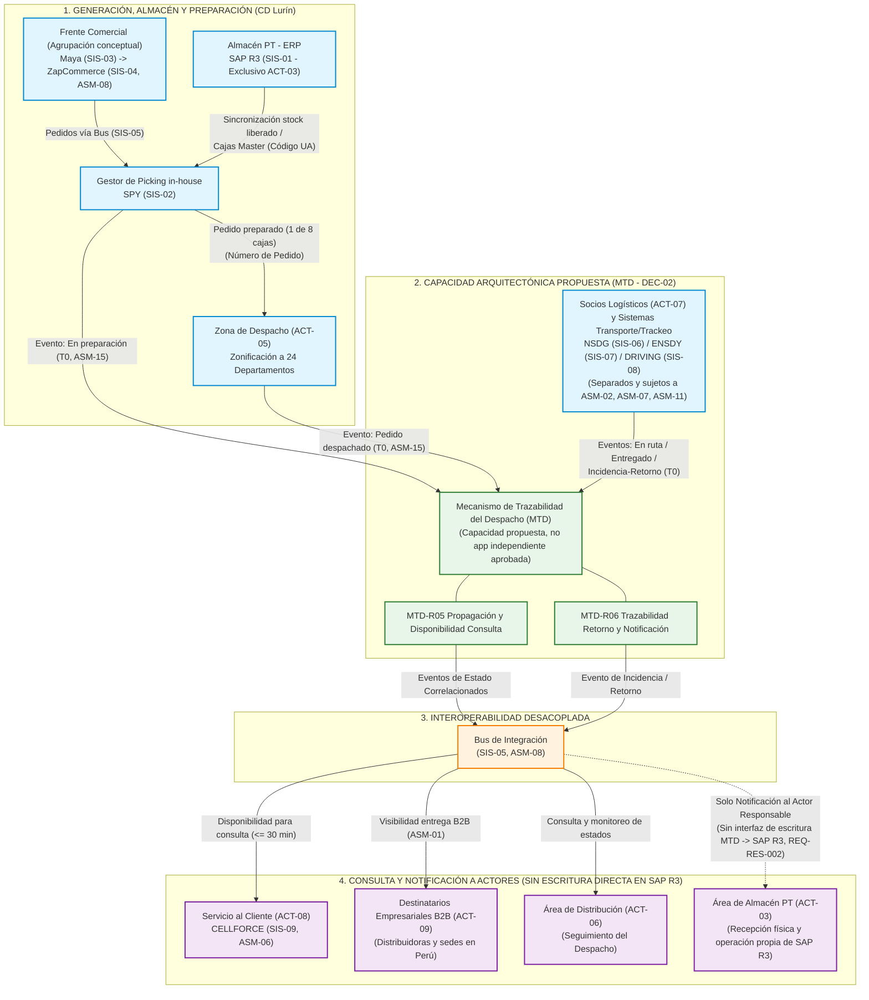

# `DIAG-01.1` — Visión de Contexto e Interoperabilidad E2E de la Capacidad Propuesta `MTD`

- **ID del Diagrama Derivado:** `DIAG-01.1`
- **Nombre del Diagrama Derivado:** Visión de Contexto e Interoperabilidad E2E de la Capacidad Propuesta `MTD` (`S1`, `S2`, `S3`, `S4`)
- **Tipo de Diagrama:** **Diagrama de Estructura Compuesta / Diagrama de Paquetes y Flujo Conceptual (OMG UML 2.5.1 — Categoría Estructural)**
- **Diagrama General del que Procede:** `DIAG-01` — *Diagrama Conceptual de la Visión de la Solución Propuesta (Capacidad `MTD`)* ([`02_Fase_A_Vision_de_Arquitectura/02_Fase_A_Vision_Arquitectura_Completa.md` — Apartado 2.7.5](../../02_Fase_A_Vision_de_Arquitectura/02_Fase_A_Vision_Arquitectura_Completa.md#275-diagrama-conceptual-de-la-visión-de-la-solución-to-be-diag-01))
- **Elementos Originales Incluidos:** Subgrafos `S1`, `S2` (frontera de contexto), `S3` y `S4`; nodos `A1`, `A2`, `A3`, `A4`, `B1`, `B2`, `C5`, `C6`, `D1`, `E1`, `E2`, `E3`, `E4`.

