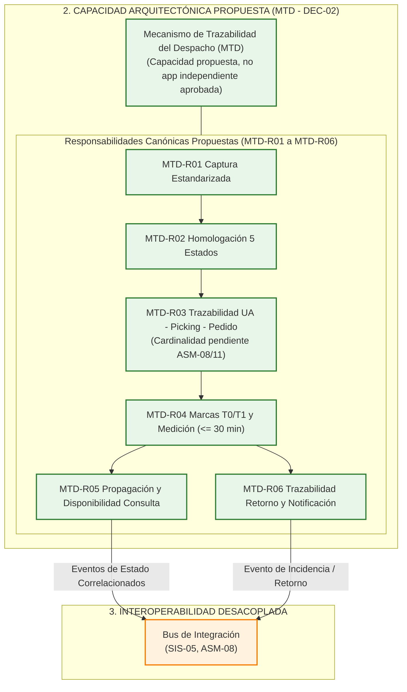

# `DIAG-01.2` — Descomposición Funcional Interna de Responsabilidades Canónicas del `MTD` (`MTD-R01` a `MTD-R06`)

- **ID del Diagrama Derivado:** `DIAG-01.2`
- **Nombre del Diagrama Derivado:** Descomposición Funcional Interna de Responsabilidades Canónicas del `MTD` (`MTD-R01` a `MTD-R06`)
- **Tipo de Diagrama:** **Diagrama de Estructura Compuesta / Flujo Interno de Capacidad (OMG UML 2.5.1 — Categoría Estructural)**
- **Diagrama General del que Procede:** `DIAG-01` — *Diagrama Conceptual de la Visión de la Solución Propuesta (Capacidad `MTD`)* ([`02_Fase_A_Vision_de_Arquitectura/02_Fase_A_Vision_Arquitectura_Completa.md` — Apartado 2.7.5](../../02_Fase_A_Vision_de_Arquitectura/02_Fase_A_Vision_Arquitectura_Completa.md#275-diagrama-conceptual-de-la-visión-de-la-solución-to-be-diag-01))
- **Elementos Originales Incluidos:** Subgrafo `S2`, subgrafo anidado `MTD_CORE`, subgrafo de salida `S3`; nodos `B1`, `C1`, `C2`, `C3`, `C4`, `C5`, `C6`, `D1`.

